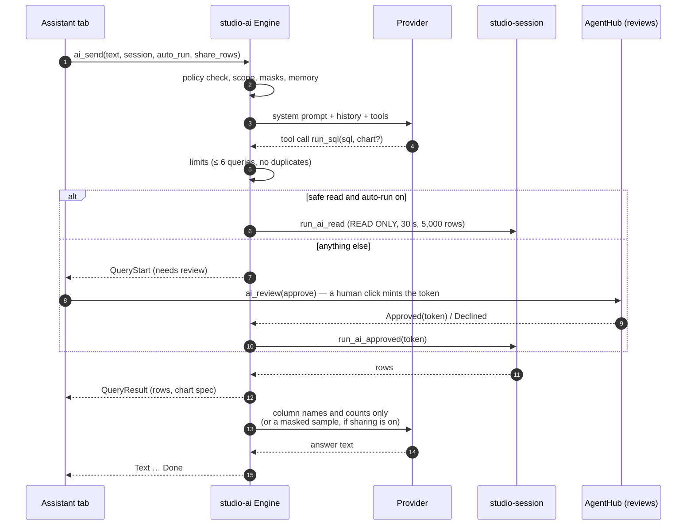
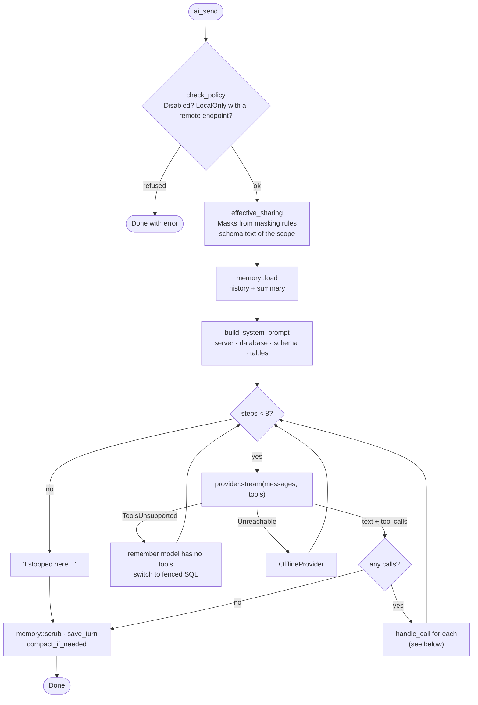
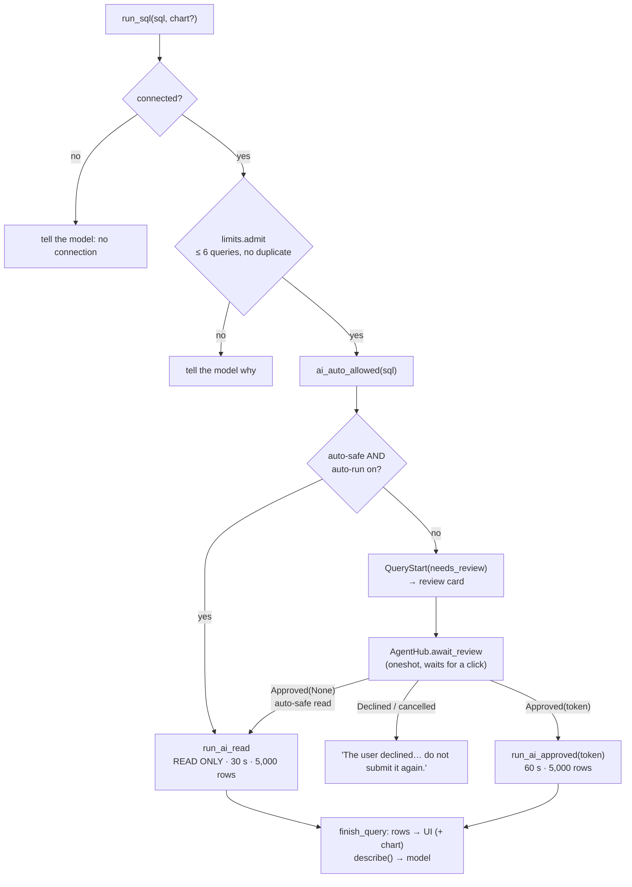

# AI assistant

`studio-ai` runs the conversation with the model. It reaches databases only through
`studio-session`, and every statement it proposes passes the same safety engine as yours.



## Tools

| Tool | Does |
|---|---|
| `run_sql` | Runs one statement through the gate; optional `chart` request |
| `describe_table` | Columns, types, keys and indexes, never rows |
| `explain_query` | The plan of one statement, without running it |
| `list_tables` | Table names in the database in use |

Unknown arguments are ignored, so nothing the model adds (such as `"approved": true`) has any
effect. A turn stops after **8 steps** and **6 queries**. Models without tool calling fall back
to fenced ```` ```sql ```` blocks, which go through the same gate; the fallback is remembered per
model.

## Scope

The assistant works on **the database in use only**:

- **MySQL / MariaDB**: each database is a schema, so only the one in use is described; with none
  in use the model gets the list of database names and is told to ask.
- **PostgreSQL**: the schemas of the connected database, the one in use first.
- The system prompt names the server, database and schema and tells the model to write
  unqualified names and stay in that database.

## Charts

`run_sql` accepts `chart: { type, x, y[], title }`, where `type` is one of `bar`,
`horizontal_bar`, `stacked_bar`, `line`, `area`, `pie`, `donut`, `scatter`. The request names
**columns only**; `studio_ai::chart` checks it against the result's columns and passes it to the
UI with the rows. A bad request never stops the query; the model is told why no chart was drawn.
Drawing a chart sends no rows to the model.

## Privacy

| Rule | How it is enforced |
|---|---|
| Rows are not sent unless sharing is on | `describe` builds the tool result from column names and counts; samples only when the user opted in and the profile allows it |
| Production and "no row sharing" forbid sharing | `effective_sharing` overrides the request |
| Masked columns never reach the model | `Masks` replace values with `***`; password-like names are always masked |
| Rows never enter memory | Memory stores words and statement outcomes; assistant text is scrubbed of shared values |
| Local-only profiles | The endpoint must be local, or the turn is refused |

## The turn loop

`Engine::run_turn` drives one question to its end and always finishes with `AiEvent::Done`.



### One `run_sql` call



### The review handshake

The model never sees or handles a token. When a statement needs review, the agent parks a
`PendingReview { sql, session, auto_read, reply }` in the `AgentHub` and waits on a oneshot
channel. Your click calls `ai_review(turn, query, approved)`:

| Your answer | Statement | What `ai_review` sends back |
|---|---|---|
| Decline | any | `Declined` |
| Approve | auto-safe read (auto-run was off) | `Approved(None)`: it still runs through `run_ai_read`, READ ONLY |
| Approve | anything else | `Approved(Some(token))`: a token minted **here** with origin `Ai` |

`take_review` removes the pending entry, so a review can be answered once. Cancelling the turn
(`ai_cancel`) or the query (`ai_cancel_query`) answers `Declined` and cancels any run on the
server.

## Memory

| Rule | Value |
|---|---|
| Stored per turn | Your text, the assistant's text (scrubbed), and each statement with its outcome and row count |
| Never stored | Result rows; any value that was shown to the model is replaced with `[value]` |
| Compaction | After about 24,000 characters, older turns are summarised by the model; the last 6 turns stay verbatim |
| If summarising fails | Nothing is lost; the conversation stays as it was |
| Forget | `ai_forget` removes a conversation, or the part from one turn onward |

## Providers and fallbacks

Providers implement a small `Provider` trait (`stream(request, cancel)`, `supports_tools()`). The
production adapter uses `rig-core` with the OpenAI chat format, which covers OpenAI, OpenRouter,
any compatible server and Ollama's compatible route. A scripted fake provider drives the tests.

| Situation | What happens |
|---|---|
| The model rejects tool definitions | It is remembered per model; the turn switches to fenced ```` ```sql ```` blocks, which pass the same gate |
| The endpoint cannot be reached, before anything was shown | An **offline engine** answers simple questions ("list tables", "count rows in …") from the schema it knows |
| A *Local only* connection with a remote endpoint | Refused before anything is sent. `is_local_endpoint` parses the host, so `http://localhost@evil.example` is **not** local |

**Test the model** in Settings (`ai_test_provider`) sends one short request and reports whether the
endpoint, key and model work.
