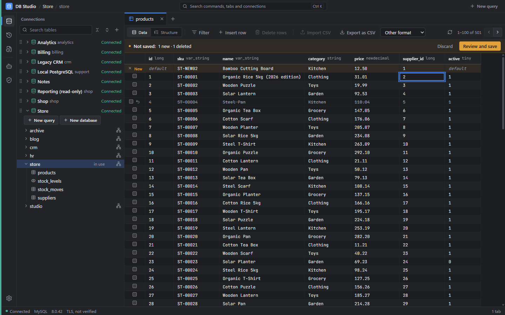
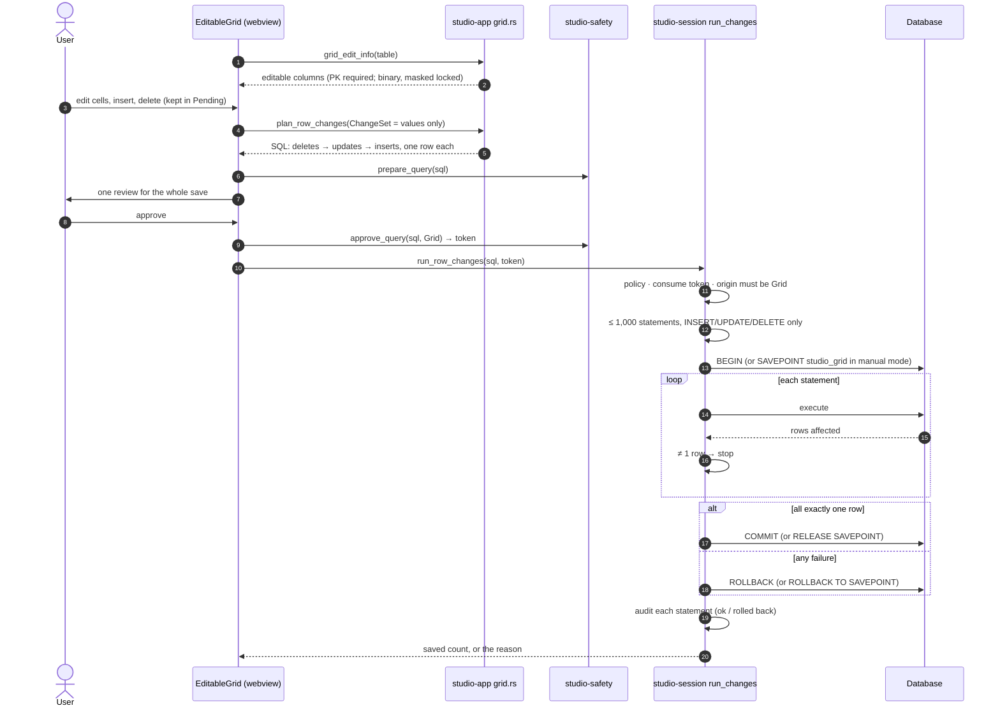
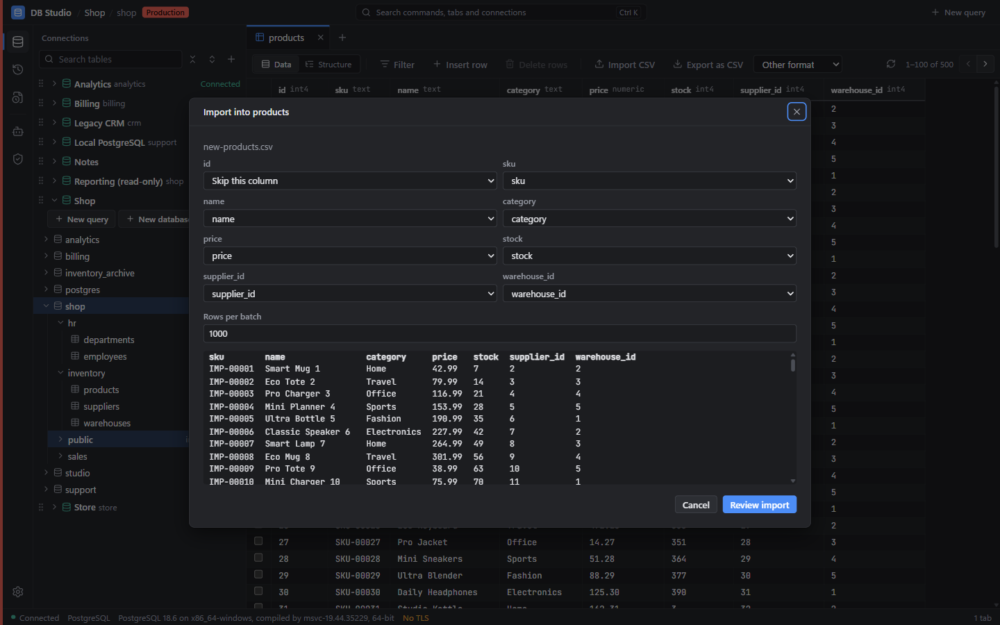
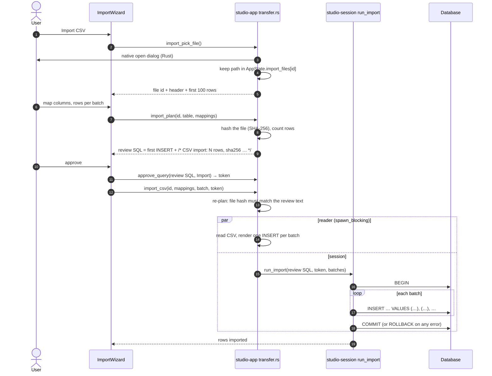
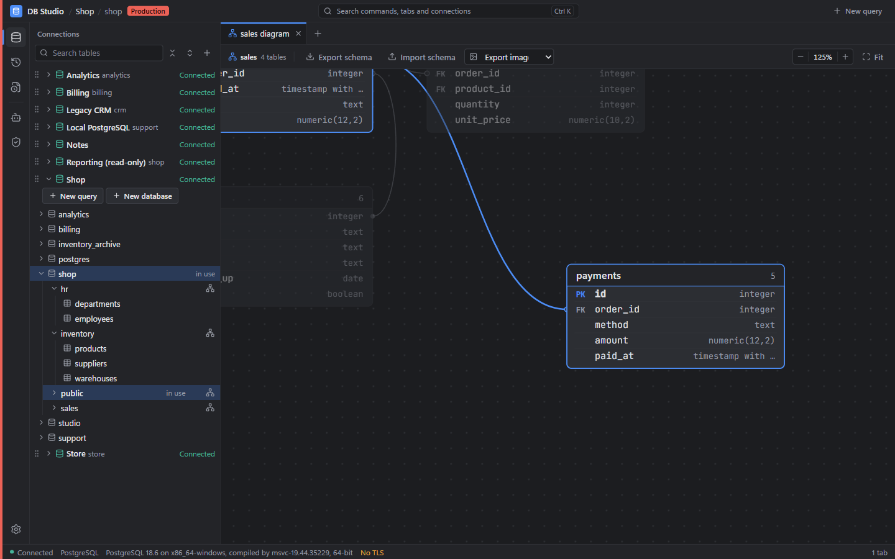
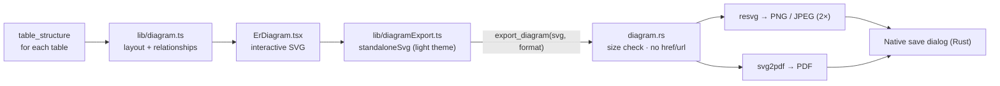
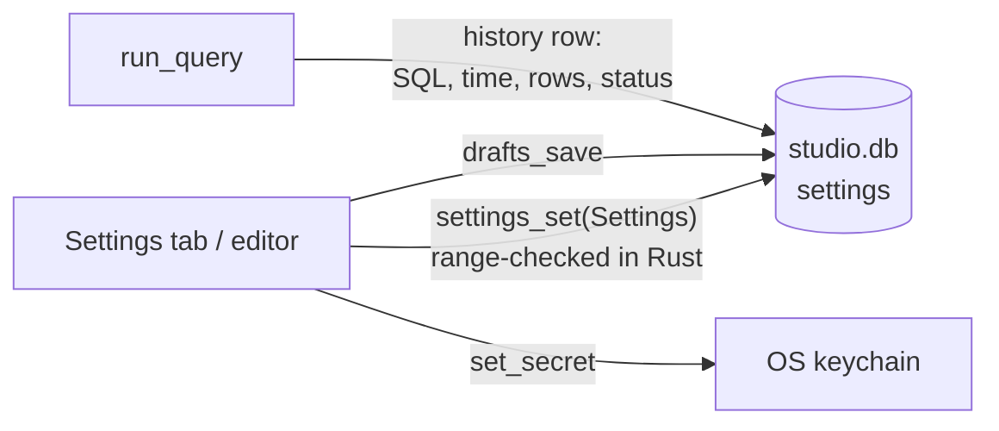

# Data flows

How the bigger features move data between the webview, Rust and the database. Every flow follows
the same rule: **the webview sends intent and values; Rust writes the SQL, opens the files and
decides what may run.** For a plain query, see [Life of a query](query-lifecycle.md).

## Inline edits

{ .shot }

Details that matter:

- **Values, not SQL.** The webview's `ChangeSet` holds edits by row and column, new rows and
  deletes. Rust looks up the columns again and quotes every identifier and literal for the engine.
- **Optimistic concurrency.** Each `UPDATE` and `DELETE` matches the primary key **and**, for types
  whose text form compares exactly (integers, text, dates, decimals; not floats or JSON), the value
  you loaded. If someone changed the row meanwhile, it matches 0 rows and the whole save is undone.
- **Exactly one row.** MySQL is connected with `CLIENT_FOUND_ROWS`, so an UPDATE that sets a value
  to what it already was still reports 1 row matched, as on PostgreSQL.
- **Frozen rows.** While edits are pending, the grid keeps showing the rows they were made on, so
  a background refresh cannot move an edit onto a different row.

## CSV import

{ .shot }

- The **path never reaches the webview**; it holds an opaque id.
- The review text includes the file's **SHA-256**. The token is bound to that text, so if the file
  changes after approval, re-planning produces different text and the token no longer matches.
- Batches go through a **bounded channel** (capacity 2), so a large file never sits in memory.
- Every batch must classify as a single INSERT.
- **One transaction** for the whole file: a bad row undoes every row.

## Export

| Command | Source | How |
|---|---|---|
| `export_query` | A SQL tab's statement | Re-runs it through `run_user` **with no token**, so only reads can be exported; streams to disk |
| `export_table` | A table tab | Builds a `SELECT` with the grid's filters as quoted literals; streams to disk |
| `export_rows` | Rows selected in a grid | Writes exactly what the grid holds (no SQL runs), so masked values stay masked; at most 1,000,000 rows |

Formats are **CSV**, **JSON lines**, **Excel** (`rust_xlsxwriter` in constant-memory mode, capped
at 1,048,575 rows per sheet) and **SQL inserts**. The save dialog opens in Rust and progress
streams back over a `Channel`.

## Schema diagram and image export

{ .shot }

The SVG from the webview is **untrusted**: it is size-checked, refused if it references any file,
image or URL, and drawn only with fonts bundled into the app. Raster output is capped in side
length and total pixels; PDF pages stay under the 200-inch limit readers accept. Charts from the
assistant are saved the same way.

## Schema files

- **Export** (`export_schema`): reads every table and view, orders tables so each comes after the
  tables it references (cycles go last), adds PostgreSQL sequences first and extra indexes after,
  and writes a `.sql` script.
- **Import** (`open_schema_file` + `outline_schema`): reads a UTF-8 script in Rust, and parses it
  into an outline the diagram can draw. **Nothing runs.** Applying it goes through the normal
  editor review like any other SQL.

## Settings, history and drafts

`settings_set` range-checks every field (font sizes, limits, …) before storing it. History keeps
the SQL and outcome, never the rows, trimmed to the size set in Settings. Secrets go only to the
keychain.
