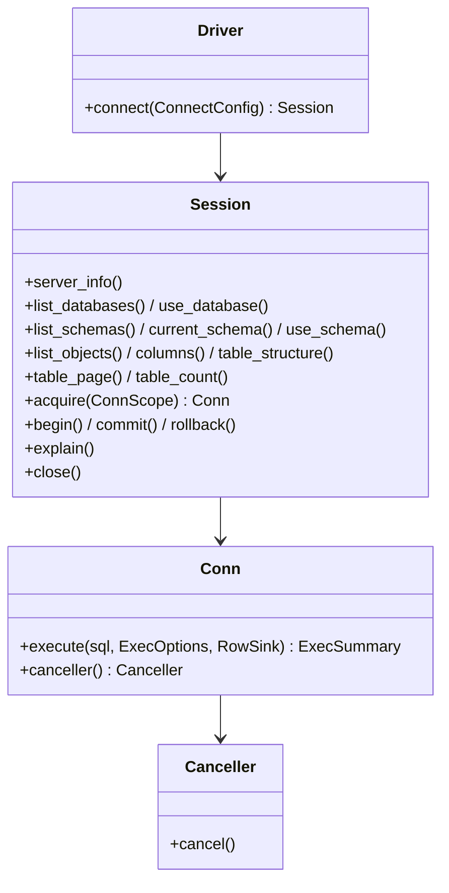

# Database drivers

`studio-db` defines what every engine must provide; each `driver-*` crate implements it and
depends only on `studio-db` and `studio-types`.

`ExecOptions` carries `read_only_tx`, `timeout`, `max_rows` and `batch_size`. Results flow as
`RowEvent::Columns` then `RowEvent::Batch` into a bounded channel, so a slow consumer slows the
driver instead of filling memory.

## Values

`Value` covers `Null`, `Bool`, `Int` (fits a JavaScript number), `BigInt` and `Decimal` (as text,
so nothing loses precision), `Float`, `Text`, `Json`, `Temporal` (the server's own text), `Bytes`
(length plus a 64-byte hex preview; large blobs never reach the grid) and `Unsupported`.

## Engines

=== "PostgreSQL"

    - `tokio-postgres` with a `deadpool-postgres` pool; TLS with `tokio-postgres-rustls`.
    - Results use the simple (text) protocol, which yields the server's own text for every type;
      `prepare` still runs first to learn column types and to refuse multi-statement strings.
    - Cancel uses the protocol's cancel request. Pooled connections recycle with
      `ROLLBACK; RESET ALL`.
    - All four TLS modes are tested against a real server, including a host name the certificate
      does not cover.

=== "MySQL / MariaDB"

    - `mysql_async` with a pool of up to four connections; TLS with rustls.
    - `CLIENT_FOUND_ROWS` is set, so an UPDATE reports rows matched (as on PostgreSQL), which the
      grid's exactly-one-row check relies on.
    - Cancel uses `KILL QUERY`; a client-side watchdog backs up `MAX_EXECUTION_TIME`, which only
      covers SELECT.
    - Read-only work also sets `SET SESSION TRANSACTION READ ONLY` so DDL cannot escape.

=== "SQLite"

    - `rusqlite` (bundled SQLite) on blocking threads.
    - One file, one database (`main`).

## The conformance kit

`studio-db` ships a conformance suite every driver runs against a real server: streaming large
results, cancel, timeouts, read-only enforcement, paging, filters, metadata and EXPLAIN. Filters are
built by a shared `FilterBuilder`; `LIKE` uses `!` as its escape so it behaves the same on every
engine and `sql_mode`.
