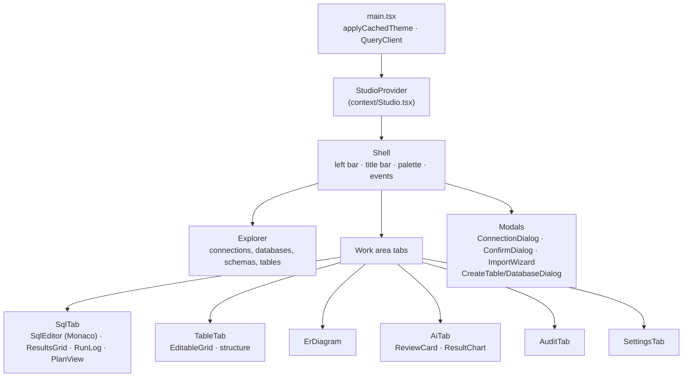
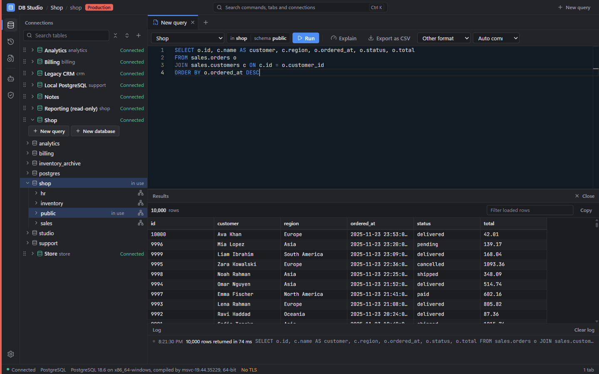

# Frontend

React and TypeScript (strict, no `any` in new code), styled with Tailwind CSS, bundled by Vite.
The frontend renders and asks; Rust decides.

## Structure

- **`StudioProvider`** (`src/context/Studio.tsx`) holds open tabs, sessions per profile, the
  review dialog's promise, and which tabs have unsaved changes.
- **TanStack Query** caches server state: profiles, schemas, table pages, settings, conversations.
  Keys are grouped by profile (`['schema', profileId, …]`) so a write invalidates exactly what it
  may have changed.
- **Flows** in `src/api/` encode multi-step interactions so components stay small:
  `runFlow` (prepare → review → approve → run), `runChanges` (the grid save), the AI turn stream.
- **Pure logic** lives in `src/lib/` and is tested on its own: `pendingEdits`, `chart`,
  `diagram`, `diagramExport`, `resultStore`, `useNamespace`.

## Component tree



| Where state lives | What |
|---|---|
| `StudioProvider` (React context) | Open tabs, the session id per connection, which tabs have unsaved edits, the confirm dialog's promise |
| TanStack Query cache | Everything Rust owns: profiles, databases, schemas, table pages, settings, conversations, audit entries |
| `ResultStore` (outside React) | Streaming result rows, so a million rows never pass through React state |
| `Pending` (per table tab) | Edits not yet saved |
| `localStorage` | Conveniences only: connection order and collapsed state, the cached theme, text zoom, and the chat view of each conversation **with rows stripped** (`withoutRows`). Rust memory stays the source of truth |

## A run, in code

The SQL tab calls `runFlow` (`src/api/run.ts`). The frontend **never decides** whether SQL is
safe; it asks Rust and shows the answer.

```ts
const verdicts = await api.prepareQuery(target.session, sql);       // Rust classifies
let token: string | null = null;
if (verdicts.some((v) => !v.readOnly)) {
  const confirmed = await confirm({ sql, verdicts, ... });          // the review dialog
  if (!confirmed) return { status: 'declined' };                    // declining never mints
  token = (await api.approveQuery(target.session, sql, origin)).token;
}
const channel = new Channel<RunEvent>();
channel.onmessage = (event) => applyRunEvent(store, event);         // rows stream in
const outcomes = await unwrap(commands.runQuery(target.session, sql, token, runId, channel));
```

`runChanges` is the grid's version: it always reviews, approves with origin `Grid`, and calls
`run_row_changes`, because grid tokens do not open `run_query`.

## The results grid

`ResultStore` accumulates `RunEvent` batches outside React state and notifies subscribers; the
`ResultsGrid` renders only the visible rows. Measured: a million rows in about 7 seconds, with the
worst UI stall around 20 ms and about 37 rows in the DOM.

{ .shot }

How it stays fast:

- Each batch is kept **as the array it arrived in**; `append` never copies earlier rows.
- `rowAt(i)` finds the chunk by **binary search** over chunk start offsets.
- `notify()` **coalesces** updates, so a fast stream re-renders once per frame, not once per batch.
- The grid subscribes with React's `useSyncExternalStore` and `@tanstack/react-virtual` draws
  only the rows in view.

## Inline editing

`EditableGrid` keeps edits pending in a `Pending` value (edits by row and column, new rows,
marked deletes). While edits are pending the grid freezes the rows they were made on, so a
background refresh cannot shift them. `toChangeSet` turns them into a `ChangeSet` that Rust
plans into SQL.

## Charts and the diagram

Charts are hand-written SVG (`ResultChart`), using a colour palette validated for colour vision
deficiency in both themes. The diagram is SVG too. To save either as an image, the frontend
serialises a standalone light-theme SVG (`standaloneSvg`) and Rust renders it.

## Design system

- **Colour means risk**: *safe*, *change* and *danger* tokens are reserved for risk; an accent
  marks what you act on.
- **Themes**: light and dark, defined as CSS custom properties on `[data-theme]`.
- **Type**: Atkinson Hyperlegible for the interface, JetBrains Mono for SQL and cells.
- **Accessibility**: keyboard paths for menus and grids, labelled controls, 3:1 control outlines,
  text contrast checked per theme.
