# Architecture overview

DB Studio is a [Tauri 2](https://tauri.app/) application. A Rust backend, split into a Cargo
workspace of eleven crates, owns every connection, secret and decision about safety. A React +
TypeScript interface runs in the operating system's webview and talks to Rust only through
generated, typed commands.

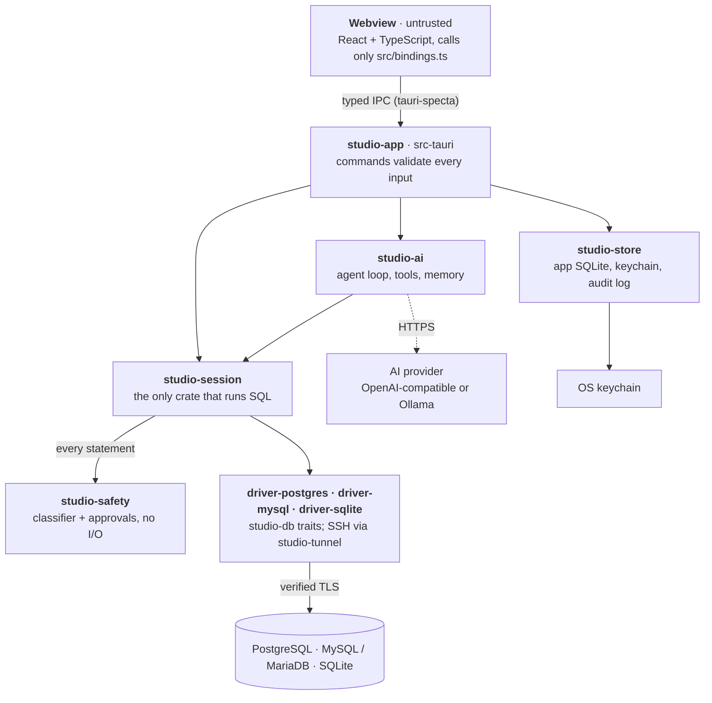

## Layers and the trust boundary

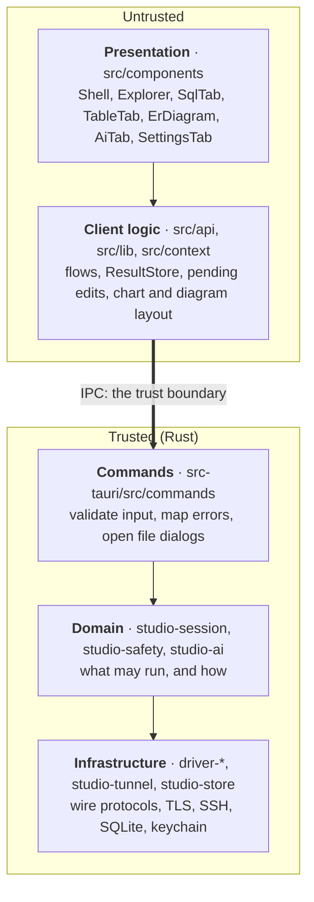

Everything above the boundary may be wrong or hostile and still cannot change data: the commands
below it re-check every input, and only the domain layer decides what runs.

## From the screen to the code

| What you see | Frontend | Commands | Crates |
|---|---|---|---|
| 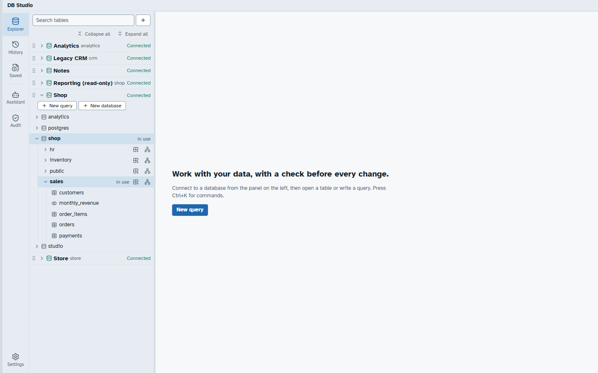{ .shot width="260" } Side panel | `shell/Explorer.tsx` | `list_profiles`, `connect`, `list_databases`, `list_objects` | `studio-store`, `studio-session`, `driver-*` |
| 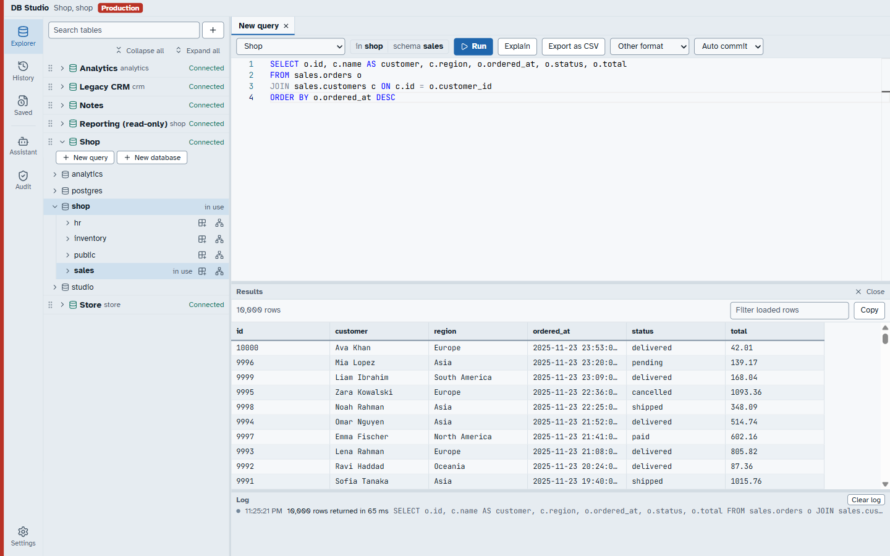{ .shot width="260" } SQL tab | `workbench/SqlTab.tsx`, `ResultsGrid.tsx`, `api/run.ts` | `prepare_query`, `run_query`, `cancel_run`, `explain_query` | `studio-safety`, `studio-session` |
| 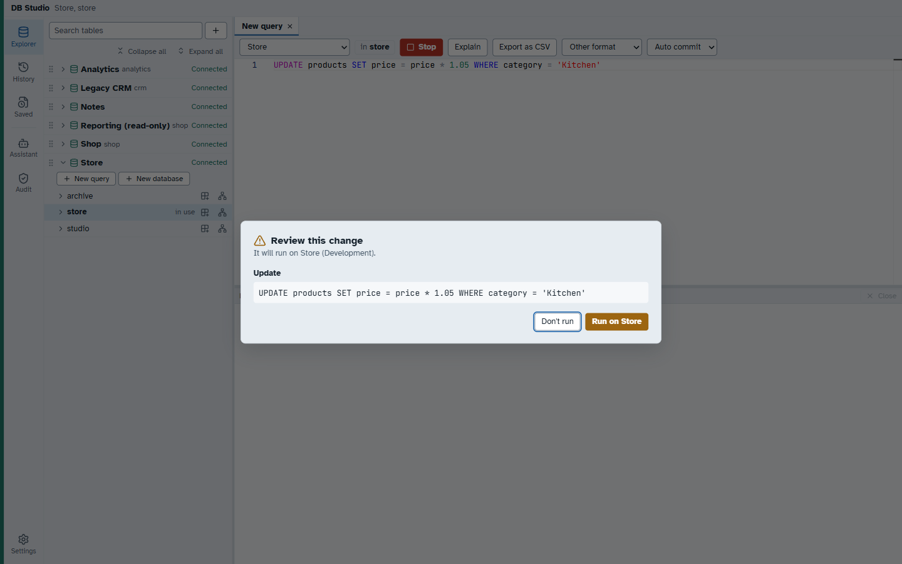{ .shot width="260" } Review | `modals/ConfirmDialog.tsx` | `approve_query` | `studio-safety` (`ApprovalBook`) |
| 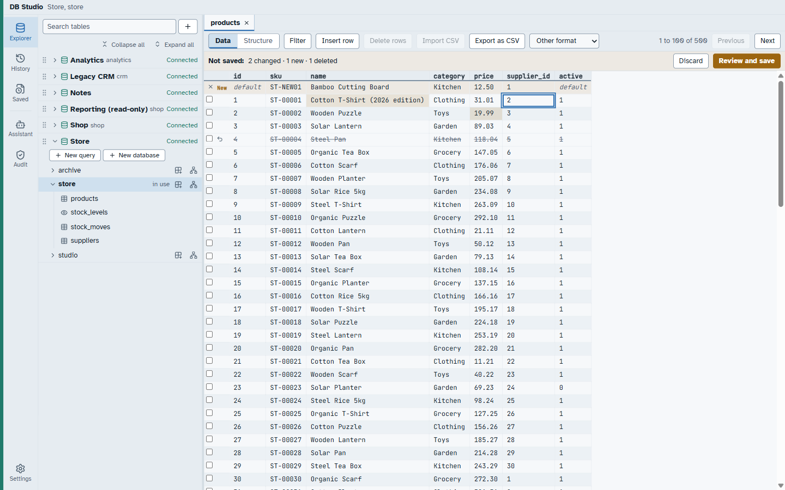{ .shot width="260" } Table grid | `workbench/TableTab.tsx`, `EditableGrid.tsx`, `lib/pendingEdits.ts` | `table_page`, `grid_edit_info`, `plan_row_changes`, `run_row_changes` | `studio-session` (`run_changes`) |
| 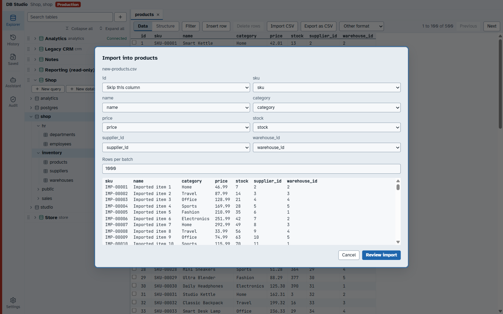{ .shot width="260" } Import | `modals/ImportWizard.tsx` | `import_pick_file`, `import_plan`, `import_csv` | `studio-session` (`run_import`) |
| 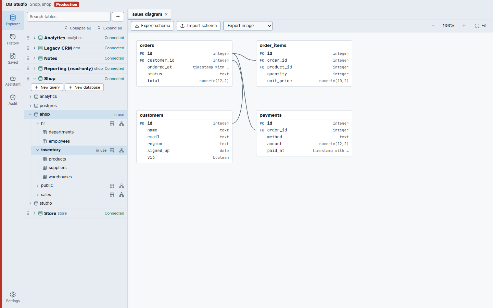{ .shot width="260" } Diagram | `workbench/ErDiagram.tsx`, `lib/diagram.ts` | `table_structure`, `export_diagram`, `export_schema` | `studio-app` (resvg, svg2pdf) |
| 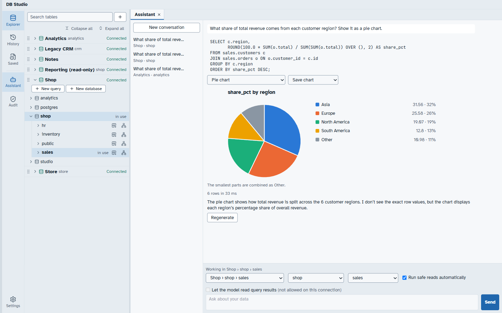{ .shot width="260" } Assistant | `ai/AiTab.tsx`, `ReviewCard.tsx`, `ResultChart.tsx` | `ai_send`, `ai_review`, `ai_cancel` | `studio-ai` |
| 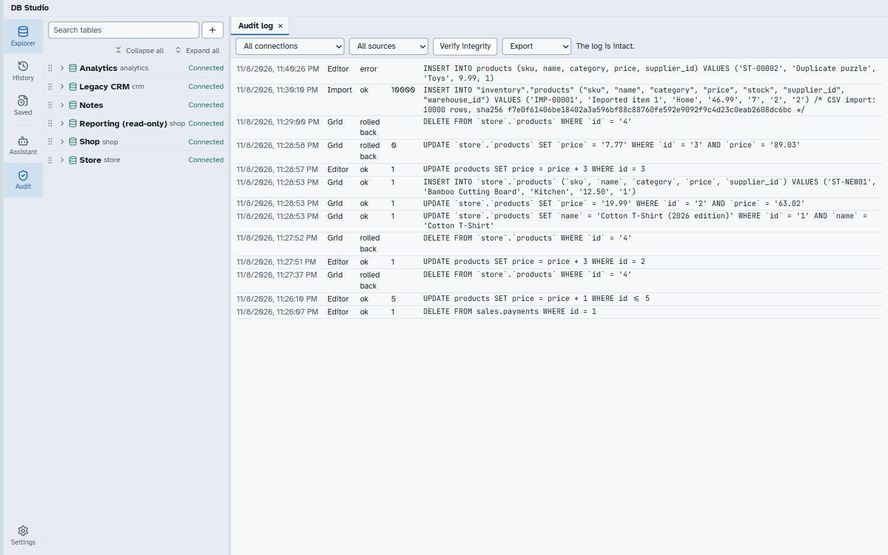{ .shot width="260" } Audit log | `workbench/AuditTab.tsx` | `audit_list`, `audit_verify`, `audit_export` | `studio-store` |
| 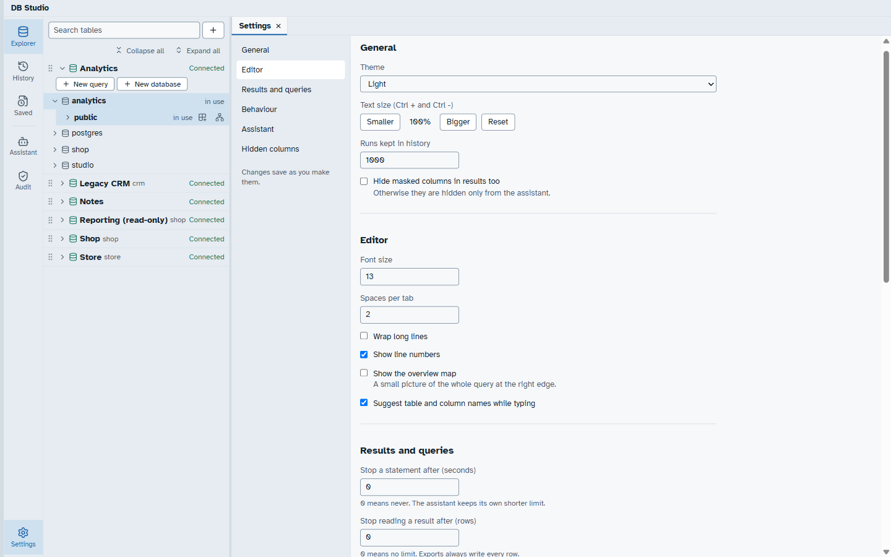{ .shot width="260" } Settings | `workbench/SettingsTab.tsx` | `settings_get`, `settings_set`, `set_secret`, `masking_set` | `studio-store` |

## Principles

**The webview is untrusted.** It renders and asks; it never decides. Every command re-validates
its input in Rust. The webview never receives a secret, never decides whether SQL is safe, and
never supplies a file path for a write.

**One door to the database.** `studio-session` is the only crate that executes SQL, and every path
into it goes through `studio-safety` first. The assistant reaches databases only through the
session, so there is no route from the model to a raw connection.

**Fail closed.** The classifier is an allow-list: only statements it positively recognises as reads
are reads. Anything else, including SQL that does not parse, needs an approval.

**Approvals come from people.** A write needs a random, single-use, 60-second token bound to the
SHA-256 of the exact SQL and to the session. Only commands triggered by a human click
(`approve_query`, `ai_review`) can mint one.

**Small crates with one job.** Drivers know nothing of Tauri, AI or storage, so each can be tested
alone against a real server. The safety crate performs no I/O, so it can be tested exhaustively.

## Read on

| Page | Covers |
|---|---|
| [Technologies and languages](tech-stack.md) | Languages, frameworks, libraries and versions, and why each was chosen |
| [Workspace and crates](workspace.md) | Each crate's job, dependencies and public surface |
| [Startup, state and threads](runtime.md) | Process model, startup sequence, `AppState`, threads, errors, events, logging |
| [Life of a query](query-lifecycle.md) | From the Run button to the result grid |
| [Data flows](data-flows.md) | Inline edits, CSV import, export, diagrams, schema files, settings |
| [Safety engine](safety-engine.md) | Classification, risk, the AI gate, approval tokens |
| [Sessions and transactions](sessions.md) | Sessions, runs, the four doors, cancel, manual mode |
| [Database drivers](drivers.md) | The `Driver`/`Session`/`Conn` traits and each engine |
| [AI assistant](ai.md) | Agent loop, tools, charts, scope, privacy, memory |
| [Storage and secrets](storage.md) | App database, migrations, keychain, audit chain |
| [Networking, TLS and SSH](networking.md) | Transport security and tunnels |
| [Frontend](frontend.md) | React structure, state, the grid, charts |
| [IPC and bindings](ipc.md) | How commands are defined, typed and generated |
