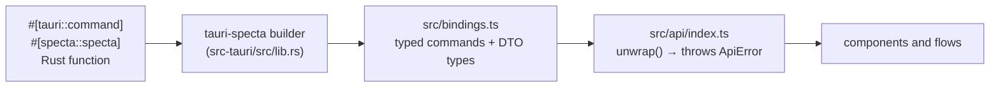

# IPC and bindings

The webview calls Rust only through Tauri commands, and only through the generated
`src/bindings.ts`.



## Defining a command

```rust
/// Turns the pending grid edits into SQL for review.
#[tauri::command]
#[specta::specta]
pub async fn plan_row_changes(
    state: State<'_, AppState>,
    session_id: SessionId,
    table: TableRef,
    changes: ChangeSet,
) -> Result<PlannedSql, AppError> {
    // validate, then call a plain, testable function
}
```

- Commands are **thin**: they validate input and call plain functions that tests can call
  without Tauri.
- Errors are `AppError { code, message, detail }`; library errors (`thiserror`) are mapped to it.
- DTOs live in `studio-types` and derive `serde` and `specta::Type`.

## Regenerating bindings

```bash
cargo test -p studio-app export_bindings
```

Debug builds also export them on start. `bindings.ts` is never edited by hand.

## Streams

Long operations stream over a Tauri `Channel`: query runs (`RunEvent`), exports (progress) and
assistant turns (`AiEvent`). `Channel::send` does not wait for the webview, so back-pressure ends
at the Rust side of IPC; drivers already bound memory with their own bounded channels.

## Numbers

Bindings use `dangerously_cast_bigints_to_number`. Only counts and millisecond timestamps are
64-bit over IPC, all far below 2^53; database 64-bit values travel as strings in `Value::BigInt`.

## Capabilities

Tauri capabilities grant the webview only what it needs (dialogs, opener, process, updater,
webview zoom). The production content security policy allows no remote scripts or connections
other than IPC.
