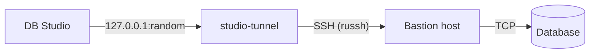

# Networking, TLS and SSH

## TLS

All drivers use **rustls** with the `ring` provider. Verification is on by default.

| Mode | Encrypts | Verifies chain | Verifies host name |
|---|:-:|:-:|:-:|
| `VerifyFull` *(default)* | ✓ | ✓ | ✓ |
| `VerifyCa` | ✓ | ✓ | |
| `Require` | ✓ | | |
| `Disable` | | | |

A profile may add a CA bundle and a client certificate and key. Lowering the mode is an explicit
choice in the profile and is marked in the interface. PostgreSQL reports the server certificates
it saw, so the interface can show them.

!!! note
    On MySQL, `VerifyCa` currently behaves as strictly as `VerifyFull`; it fails safe, and a test
    pins the behaviour.

## SSH tunnels

`studio-tunnel` opens a local port forward through a bastion with `russh`:

- Sign in with a **password**, a **private key** (optional passphrase) or the **SSH agent**.
- **Host keys are pinned** in `known_hosts` on first trust. An unknown key returns
  `HostKeyUnknown` and a changed key `HostKeyChanged`; the interface asks the user, and **no
  credential is sent to an unverified server**.
- The database driver connects to the local end; TLS to the database still applies on top.
- The handshake has one overall deadline, so a peer that accepts and then goes silent cannot hang
  the connection.

Host certificates (OpenSSH CA) are refused for now.
