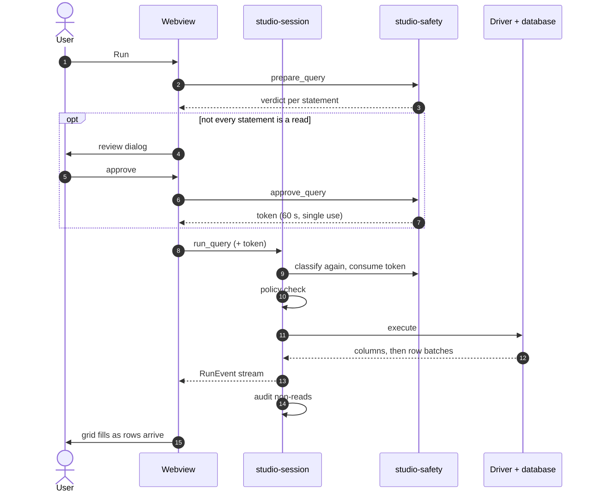

# Life of a query

What happens between pressing **Run** and seeing rows.

*Commands pass through `studio-app`, which validates them; it is left out above for clarity.*

## Key points

1. **Classification happens twice.** `prepare_query` classifies for the review dialog; `run_user`
   classifies again and never relies on what the interface said.
2. **The token is consumed before it is compared.** A token is removed from the approval book
   first, so it can never be used twice, even if the comparison then fails.
3. **Tokens are bound to their door.** A token minted for the editor cannot open the assistant's
   door, and a grid token opens only the grid's door.
4. **Rows stream.** Drivers send `RowEvent::Columns` before the first batch, then batches of rows.
   The session relays them as `RunEvent`s on a Tauri `Channel`; the frontend's `ResultStore`
   appends them and the virtual grid renders only visible rows.
5. **Scripts stop at the first error.** Earlier results stay; the failed statement reports its
   error with the SQLSTATE and character position.
6. **Cancel is real.** *Stop* cancels the run token and asks the driver to cancel on the server
   (`pg_cancel_backend`-style cancel for PostgreSQL, `KILL QUERY` for MySQL).

## Other doors

| Door | Used by | Rules |
|---|---|---|
| `run_user` | SQL editor | Reads free; anything else needs an editor token. AI and grid tokens refused. |
| `run_changes` | Inline grid save | Grid token only; every statement must be INSERT/UPDATE/DELETE and change exactly one row; all or nothing. |
| `run_import` | CSV import | Import token bound to a hash of the file; every batch one INSERT; one transaction. |
| `run_ai_read` | Assistant | No token parameter at all; only `ai_auto` statements, in a READ ONLY transaction, 30 s, 5,000 rows. |
| `run_ai_approved` | Assistant | AI token from `ai_review`; exactly one statement; 60 s, 5,000 rows. |

See [Sessions and transactions](sessions.md) for each door in detail.
