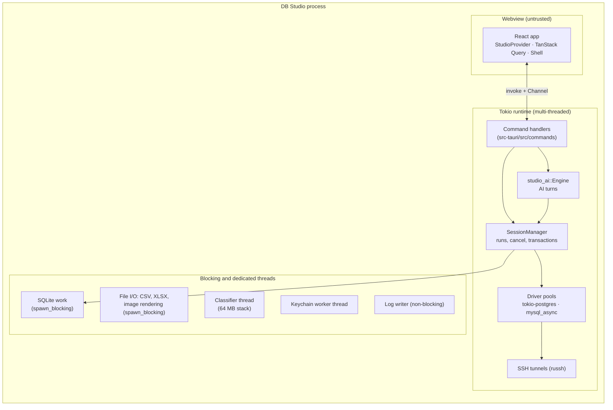
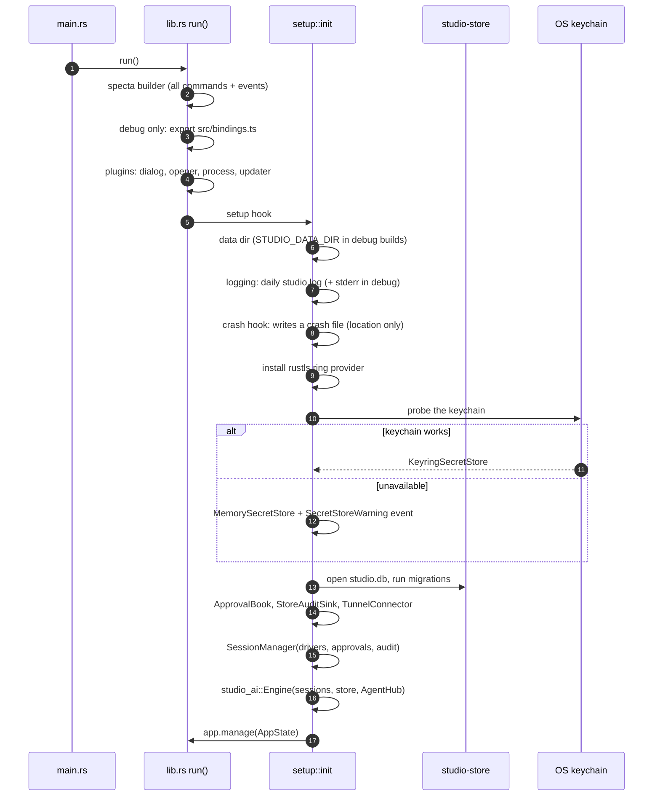
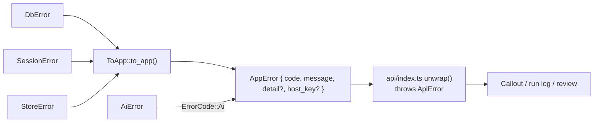

# Startup, state and threads

What exists while DB Studio is running: how it starts, what state it shares, which threads do
the work, and how errors and events reach the interface.

## Process model

DB Studio is **one operating-system process**. Tauri hosts the system webview (WebView2 on
Windows, WKWebView on macOS, WebKitGTK on Linux) and the Rust code in the same process; they talk
over Tauri's IPC.



| Thread | Why it is separate |
|---|---|
| **Tokio workers** | All network I/O: drivers, tunnels, the AI provider, IPC handlers |
| **`spawn_blocking`** | `rusqlite` calls, CSV/Excel reading and writing, `resvg`/`svg2pdf` rendering — anything that would block a worker |
| **Classifier thread** | Parsing hostile SQL can recurse deeply; a dedicated thread with a 64 MB stack keeps it from overflowing, and a panic there becomes a fail-closed verdict |
| **Keychain worker** | OS keychain APIs are blocking, and some OS stores misbehave under concurrent access, so every call is queued to one thread |
| **Log writer** | `tracing-appender` writes the log file off the hot path |

Locks are never held across an `.await` that does network I/O.

## Startup

`studio_app_lib::run()` builds the Tauri app; `setup::init` builds the shared state.



Points worth knowing:

- **Crash files hold only the location** of a panic, never its message, because a message could
  quote SQL or a value and the file is meant to be attached to bug reports.
- **If the keychain is unavailable**, secrets live in memory until you quit, and the interface
  shows a warning; nothing is written to disk instead.
- **Debug builds** can point the data folder elsewhere with `STUDIO_DATA_DIR`, so end-to-end runs
  never touch a developer's own connections. Release builds always use the platform folder.

## Shared state

```rust
pub struct AppState {
    pub store: Store,                         // app SQLite + secrets
    pub sessions: Arc<SessionManager>,        // open connections and runs
    pub approvals: Arc<ApprovalBook>,         // pending write approvals
    pub ai: Arc<studio_ai::Engine>,           // AI turns
    pub import_files: DashMap<String, PathBuf>, // picked CSVs by opaque id
    pub _log_guard: Option<WorkerGuard>,      // keeps the log writer alive
}
```

| Part | Shared with | Notes |
|---|---|---|
| `ApprovalBook` | `SessionManager` | Only `approve_query` and `ai_review` call `issue`; a test scans the source to prove it |
| `SessionManager` | `studio_ai::Engine` | The assistant has no other path to a database |
| `Store` | `StoreAuditSink`, `TunnelConnector`, the AI engine | Cloned handles to one SQLite pool |
| `import_files` | — | So the webview never holds a file path |

## Drivers are plugged in at startup

```rust
pub fn drivers() -> HashMap<Engine, Arc<dyn Driver>> {
    HashMap::from([
        (Engine::Postgres, Arc::new(driver_postgres::PostgresDriver) as Arc<dyn Driver>),
        (Engine::MySql,    Arc::new(driver_mysql::MySqlDriver)       as Arc<dyn Driver>),
        (Engine::Sqlite,   Arc::new(driver_sqlite::SqliteDriver)     as Arc<dyn Driver>),
    ])
}
```

`studio-session` knows only the `Driver` trait. MariaDB uses the MySQL driver. Adding an engine
means a new `driver-*` crate that passes the [conformance kit](drivers.md#the-conformance-kit)
and one line here.

## Errors

Library crates define their own errors with `thiserror`. `src-tauri/src/error.rs` maps them to one
stable shape the frontend understands:



| Library error | `ErrorCode` |
|---|---|
| `DbError::Query { sqlstate, position }` | `Database`, with `detail` so the editor can underline the position |
| `DbError::Tls` / `Timeout` / `Cancelled` | `Tls` / `Timeout` / `Cancelled` |
| `SessionError::ApprovalRequired` / `Expired` / `Mismatch` | the same names |
| `SessionError::ReadOnlyProfile` | `ReadOnlyProfile` |
| `SessionError::DirtyTransaction` | `DirtyTransaction` |
| `SessionError::HostKey { changed }` | `HostKeyUnknown` or `HostKeyChanged`, with the key's fingerprint for the trust dialog |
| `StoreError::Secret` | `Secret` |

The full list is in the [error codes reference](../reference/errors.md).

## Events

Besides command replies and per-run `Channel`s, Rust emits two app-wide events:

| Event | When | The interface |
|---|---|---|
| `ConnectionLost { sessionId }` | An SSH tunnel dropped | Marks the connection disconnected and says *Connect again to continue* |
| `SecretStoreWarning { message }` | The keychain could not be used at startup | Shows that passwords last only until you quit |

## Logging

`tracing` writes a daily `studio.log` in the app's log folder (`info` by default, `RUST_LOG` to
change it). **SQL parameters, row values and secrets are never logged**; secrets are
`SecretString` and cannot be formatted by accident.
