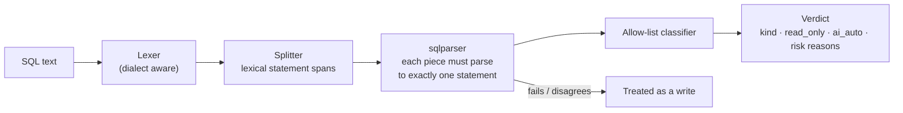
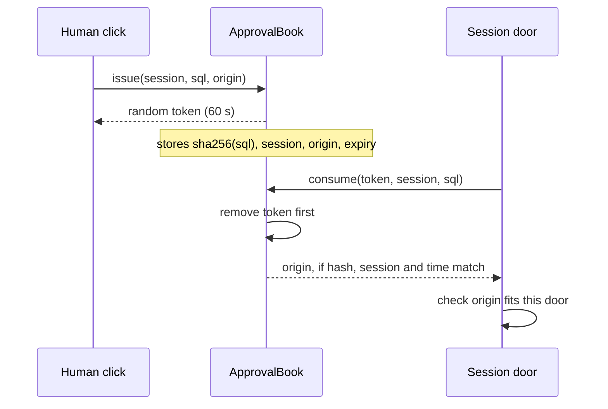

# Safety engine

`studio-safety` decides, for every statement, whether it is a read, whether the assistant may run
it unattended, and how risky it is. It also issues and checks approval tokens. It performs **no
I/O**, which keeps it fast and exhaustively testable.

## Classification

- **An allow-list, not a deny-list.** Only statements positively recognised as reads (`SELECT`,
  `SHOW`, `EXPLAIN`, …) are reads. Everything else is a write, including anything that fails to
  parse.
- **Lexical splitting.** AST spans are not reliable byte offsets, so scripts are split by the
  lexer. Each piece must parse to exactly one statement; any disagreement between lexer and
  parser fails closed.
- **Hidden writes are found.** A read that contains a write (`WITH … DELETE`, data-modifying CTEs,
  `SELECT … INTO`, locking reads such as `FOR UPDATE`) is not a read.
- **Dangerous functions.** Functions with side effects (`nextval`, `set_config`, `pg_notify`,
  `pg_terminate_backend`, `pg_read_file`, MySQL `SLEEP`/`GET_LOCK`, …) may be run by a person
  after review but never by the assistant unattended.
- **Robust against hostile input.** A comma-free token cap and a dedicated 64 MB thread keep
  pathological input from overflowing the stack; a parser panic becomes a fail-closed verdict.

The test tables hold more than 165 cases per dialect.

## Risk reasons

High-risk statements show a reason and require the *I understand* tick box:

| Statement | Reason shown |
|---|---|
| `DROP …` | permanently removes the object and its data |
| `TRUNCATE` | removes every row and cannot be filtered |
| `DELETE` without `WHERE` | removes every row in the table |
| `UPDATE` without `WHERE` | changes every row in the table |
| `ALTER … DROP` | permanently removes part of the table |
| `GRANT`, `REVOKE`, roles | changes who can access the database |
| Unparsable SQL | its effect is unknown |

## The AI gate

`ai_auto_allowed` is stricter than "is a read": exactly one statement, no executable comments
(MySQL `/*! … */`), and every part of it on the allow-list with no side-effecting functions. Only
then may `run_ai_read` execute it, and even then inside a READ ONLY transaction.

## Approval tokens

- **Random and single use**: removed before it is compared.
- **Short-lived**: 60 seconds.
- **Bound** to the SHA-256 of the exact SQL text and to the session.
- **Origin-tagged**: Editor, Grid, Import or Ai. Each door accepts only its own origins.
- **Minted only by human clicks**: `approve_query` and `ai_review`. A test scans the code to prove
  no other path mints one.
