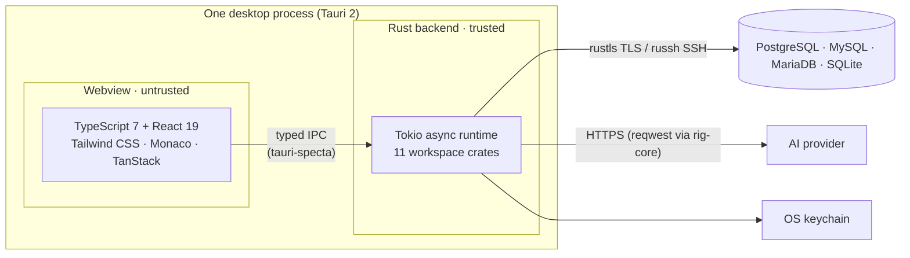

# Technologies and languages

DB Studio is built from two programs that ship as one desktop app: a **Rust** backend that owns
every connection, secret and safety decision, and a **TypeScript + React** interface that runs in
the operating system's webview. [Tauri 2](https://tauri.app/) joins them.

## Languages

| Language | Where | Used for |
|---|---|---|
| **Rust** (2021 edition, stable toolchain) | `crates/*`, `src-tauri/` | The whole backend: drivers, safety engine, sessions, storage, AI agent, Tauri commands, image rendering |
| **TypeScript / TSX** (strict) | `src/` | The interface: React components, flows, pure logic, tests |
| **JavaScript** (ES modules, Node 22) | `tests/e2e/` | End-to-end tests and screenshot scripts that drive the real app over WebView2's debug port |
| **SQL** | `crates/studio-store/migrations/`, test seeds | The app database schema; seed data for test servers |
| **CSS** | `src/index.css`, Tailwind config | Design tokens (light and dark themes) on top of Tailwind utilities |
| **TOML / JSON / YAML** | `Cargo.toml`, `tauri.conf.json`, `.github/workflows/`, `docker/compose.yml` | Build, app config, capabilities, CI, test servers |
!!! info "Generated code"
    `src/bindings.ts` is generated from the Rust command signatures by `tauri-specta`. It is never
    edited by hand, so the TypeScript types always match what Rust accepts and returns. See
    [IPC and bindings](ipc.md).

## Backend (Rust)

Versions are the ones resolved in `Cargo.lock` at the time of writing.

### Application shell

| Crate | Version | Role |
|---|---|---|
| `tauri` | 2.12 | Window, webview, IPC, bundling, installers |
| `tauri-specta` + `specta` | 2.0.0-rc.26 | Turns `#[tauri::command]` functions and DTOs into TypeScript |
| `tauri-plugin-dialog` | 2 | Native open/save dialogs, opened **from Rust** so the webview never names a path |
| `tauri-plugin-opener`, `-process`, `-updater` | 2 | Opening links, restarting, update checks |
| `tracing`, `tracing-subscriber`, `tracing-appender` | 0.1 / 0.3 / 0.2 | Structured logs to a daily file (and stderr in debug) |

### Async runtime and utilities

| Crate | Role |
|---|---|
| `tokio` 1.54 | Multi-threaded async runtime, channels, timers, `spawn_blocking` |
| `tokio-util` | `CancellationToken` for cancelling runs and AI turns |
| `futures`, `async-trait` | Streams and async trait objects (`Driver`, `Session`, `Conn`, `Provider`) |
| `dashmap` | Concurrent maps: open sessions, approval book, running turns |
| `serde`, `serde_json` | Serialisation of every DTO and setting |
| `thiserror` 2 | Error enums in every library crate |
| `uuid`, `chrono` | Ids and timestamps |

### Databases

| Crate | Version | Used by | Role |
|---|---|---|---|
| `tokio-postgres` | 0.7.18 | `driver-postgres` | PostgreSQL wire protocol |
| `deadpool-postgres` | 0.14 | `driver-postgres` | Connection pool |
| `tokio-postgres-rustls` | 0.14 | `driver-postgres` | TLS for PostgreSQL |
| `x509-parser` | 0.16 | `driver-postgres` | Shows the certificates the server presented |
| `mysql_async` | 0.37 | `driver-mysql` | MySQL and MariaDB, with rustls |
| `rusqlite` (bundled SQLite) | 0.39 | `driver-sqlite` | SQLite files, on blocking threads |
| `sqlx` (SQLite) | 0.9 | `studio-store` | The app's own database and its migrations |

### Safety, security and networking

| Crate | Version | Role |
|---|---|---|
| `sqlparser` | 0.63 | Parses each statement for the [safety engine](safety-engine.md) |
| `sha2`, `hex`, `rand` | — | SQL hashes for approval tokens, audit chain hashes, random tokens |
| `rustls` (with `ring`) | 0.23 | TLS for every driver, verification on by default |
| `rustls-native-certs` | 0.8 | Trusts the operating system's root certificates |
| `russh` | 0.65 | SSH tunnels with host-key pinning |
| `keyring` | 3.6 | Windows Credential Manager, macOS Keychain, Secret Service |
| `secrecy` | 0.10 | `SecretString` so secrets cannot be printed or logged by accident |

### AI

| Crate | Version | Role |
|---|---|---|
| `rig-core` | 0.46 | OpenAI-compatible chat with tool calling and streaming (OpenAI, OpenRouter, Ollama, …) |
| `reqwest` | 0.13 | HTTP client underneath `rig-core` |

### Files and images

| Crate | Role |
|---|---|
| `csv` | CSV import and export |
| `rust_xlsxwriter` (constant memory) | Excel export that streams rows to disk |
| `resvg` | Renders diagrams and charts to PNG and JPEG, with bundled fonts |
| `svg2pdf` | Renders them to vector PDF |
| `image` (JPEG only) | JPEG encoding |

## Frontend (TypeScript)

| Package | Version | Role |
|---|---|---|
| `react`, `react-dom` | 19.3 | Components |
| `typescript` | 7.0 | Strict typing; no `any` in new code |
| `vite` + `@vitejs/plugin-react` | 8.3 | Dev server (port 1420) and production bundle |
| `tailwindcss`, `postcss`, `autoprefixer` | 3.4 | Utility CSS on top of CSS-variable design tokens |
| `@tauri-apps/api` | 2.12 | `invoke` and `Channel`, used only through `bindings.ts` |
| `@tanstack/react-query` | 5 | Caches server state (profiles, schemas, pages, settings) |
| `@tanstack/react-virtual` | 3 | Virtual scrolling for result grids of a million rows |
| `@tanstack/react-table` | 9 | Column model for the editable table grid |
| `monaco-editor` | 0.57 | The SQL editor, with schema-aware completion |
| `sql-formatter` | 15 | Formats SQL in the editor and review dialog |
| `@radix-ui/*` | — | Accessible dialogs, menus, popovers, tabs, tooltips |
| `cmdk` | 1.1 | The command palette (++ctrl+k++) |
| `react-resizable-panels` | 4 | Side panel, editor and results splits |
| `react-markdown` + `remark-gfm` | 10 / 4 | Renders the assistant's answers |
| `lucide-react` | — | Icons |
| `class-variance-authority`, `clsx`, `tailwind-merge` | — | Component variants and class names |
| `@fontsource/atkinson-hyperlegible`, `@fontsource/jetbrains-mono` | 5 | Bundled fonts (no network fetch) |

Charts and the schema diagram are **hand-written SVG**: no chart library is used, so every chart
can be serialised and rendered by Rust for saving.

## Tooling and testing

| Tool | Role |
|---|---|
| Cargo workspace, `rustfmt`, `clippy -D warnings` | Build and lint; `unsafe_code = "forbid"` for the whole workspace |
| `cargo test` + `insta` + `proptest` + `tempfile` | Unit, snapshot and property tests (about 345 Rust tests) |
| `cargo deny` | Licence and advisory checks (`deny.toml`) |
| Vitest + Testing Library + jsdom | Frontend tests (`src/test/`) |
| Node 22 scripts over the WebView2 DevTools protocol | End-to-end runs and the screenshots in this site |
| Docker Compose (`docker/compose.yml`) | PostgreSQL 17 (plain and TLS), MySQL 8.4, MariaDB 11, an OpenSSH bastion |
| GitHub Actions (`ci.yml`, `release.yml`) | The gate on every push; installers on release |
| MkDocs 1.6 + Material 9.5 | This documentation site |

## Why these choices

| Choice | Reason |
|---|---|
| **Tauri instead of Electron** | A small native binary using the system webview; Rust can own the trust boundary. |
| **Rust for every decision** | Memory safety without a garbage collector, and one place (not the webview) where safety is decided. |
| **`sqlparser` plus a lexer** | A real parser for classification, with the lexer as a cross-check so disagreements fail closed. |
| **rustls everywhere** | One TLS stack with the same verification rules on every engine; no OpenSSL to install. |
| **`tauri-specta`** | Types are generated, so the frontend cannot call a command with the wrong shape. |
| **Hand-written SVG charts** | Values come only from real rows, and the same SVG renders to PNG/JPEG/PDF in Rust. |
| **OS keychain via `keyring`** | Secrets never sit in a file the app writes. |
