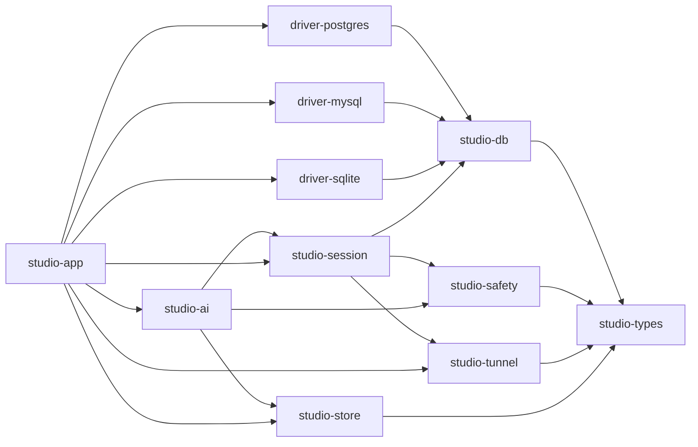

# Workspace and crates



*An arrow means "depends on". `studio-types` is used by every crate.*

| Crate | Folder | Job |
|---|---|---|
| `studio-types` | `crates/studio-types` | DTOs shared with the frontend (serde + specta) and `AppError`. No logic. |
| `studio-db` | `crates/studio-db` | The `Driver`, `Session` and `Conn` traits; `Value`, `RowBatch`, `DbError`; SQL quoting and a conformance kit every driver must pass. |
| `driver-postgres` | `crates/driver-postgres` | PostgreSQL via `tokio-postgres` and `deadpool-postgres`, TLS via rustls. |
| `driver-mysql` | `crates/driver-mysql` | MySQL and MariaDB via `mysql_async`, TLS via rustls. |
| `driver-sqlite` | `crates/driver-sqlite` | SQLite via `rusqlite` (bundled), on blocking threads. |
| `studio-safety` | `crates/studio-safety` | Lexer, splitter, `sqlparser` classifier, risk reasons, the AI gate, approval tokens. Pure: no I/O. |
| `studio-tunnel` | `crates/studio-tunnel` | SSH local port forwarding via `russh`, host-key pinning. |
| `studio-session` | `crates/studio-session` | Open sessions, runs, streaming, cancel, manual transactions, policy. The only crate that runs SQL. |
| `studio-store` | `crates/studio-store` | The app's own SQLite (`sqlx` + migrations), keychain secrets, hash-chained audit log. |
| `studio-ai` | `crates/studio-ai` | Agent loop, tools, chart requests, providers (via `rig-core`), memory, an offline fallback engine. |
| `studio-app` | `src-tauri` | The Tauri binary: `AppState`, commands, plugins, bindings export, rendering of images. |

## Notable dependencies

| Area | Crates |
|---|---|
| Runtime | `tokio`, `tokio-util`, `futures`, `async-trait` |
| App shell | `tauri` 2, `tauri-specta`, `specta`, `tauri-plugin-dialog`, `-opener`, `-process`, `-updater` |
| SQL | `sqlparser` 0.63 (classification), `tokio-postgres`, `mysql_async` 0.37, `rusqlite` 0.39, `sqlx` 0.9 |
| Security | `rustls` with `ring`, `secrecy`, `keyring`, `sha2` |
| SSH | `russh` 0.65 |
| AI | `rig-core` |
| Files | `csv`, `rust_xlsxwriter`, `resvg`, `svg2pdf`, `image` (JPEG only) |
| Errors and logs | `thiserror`, `tracing` |

Dependencies are added with `cargo add`; shared ones live in the root `[workspace.dependencies]`.
`cargo deny check` enforces licences and advisories, with each exception documented in
`deny.toml`.

## Frontend layout

```text
src/
├── api/            typed wrappers around bindings.ts; run, AI and settings flows
├── bindings.ts     generated by tauri-specta (never edited by hand)
├── components/
│   ├── ai/         assistant tab, review cards, charts
│   ├── modals/     connection, confirm, create table/database, import
│   ├── shell/      window shell, side panel (Explorer)
│   ├── ui/         buttons, fields, callouts, context menu
│   └── workbench/  SQL tab, table tab, grid, diagram, settings, audit
├── context/        Studio context: tabs, sessions, confirm dialog
├── lib/            pure logic: charts, pending edits, diagram layout, result store
└── test/           Vitest + Testing Library
```
