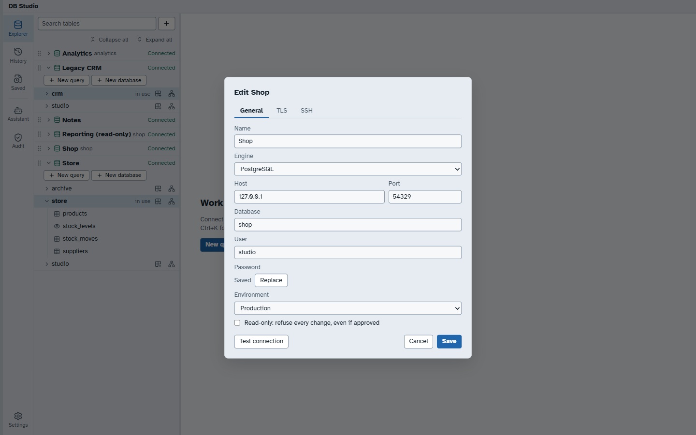
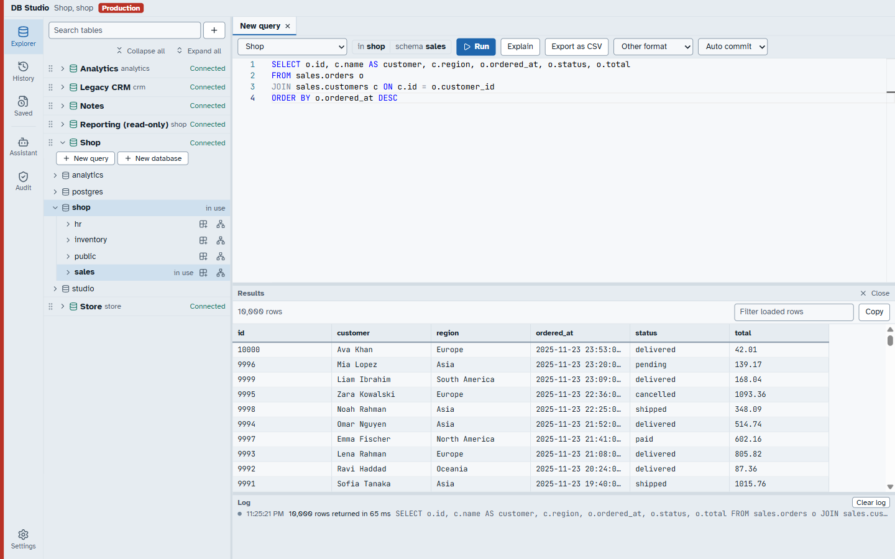

# Your first connection

## 1. Add a connection

Click **+** at the top of the side panel (or press ++ctrl+k++ and choose *New connection*).

{ .shot }

| Field | Notes |
|---|---|
| **Name** | What the side panel and the title bar show. |
| **Engine** | PostgreSQL, MySQL (also for MariaDB) or SQLite. |
| **Host / Port** | For SQLite, choose a database file instead. |
| **Database** | Optional for PostgreSQL and MySQL; you can pick one after connecting. |
| **User / Password** | The password goes straight to the OS keychain and is never shown again. |
| **Environment** | Development, Staging or Production. Production adds a red band and asks you to type the connection name before any change. |
| **Read-only** | Refuses every change, even an approved one. |

The **TLS** tab defaults to *Verify full*: the server certificate must be valid and match the host.
The **SSH** tab connects through a bastion host. See [Connections](../user-guide/connections.md).

## 2. Connect

Click the plug icon next to the connection. The side panel lists its databases and schemas; the
one in use is bold and marked *in use*.

## 3. Run a query

Click **New query**, type SQL and press ++ctrl+enter++.

{ .shot }

Reads run immediately. Anything that could change data opens a review first; see
[Reviews and safety](../user-guide/safety.md).

## 4. Ask the assistant (optional)

Open **Settings → Assistant**, choose a provider (any OpenAI-compatible endpoint, or Ollama), enter
the model name and save an API key. Then open the **Assistant** from the left bar and ask a
question. See [AI assistant](../user-guide/assistant.md).
