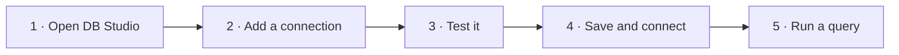
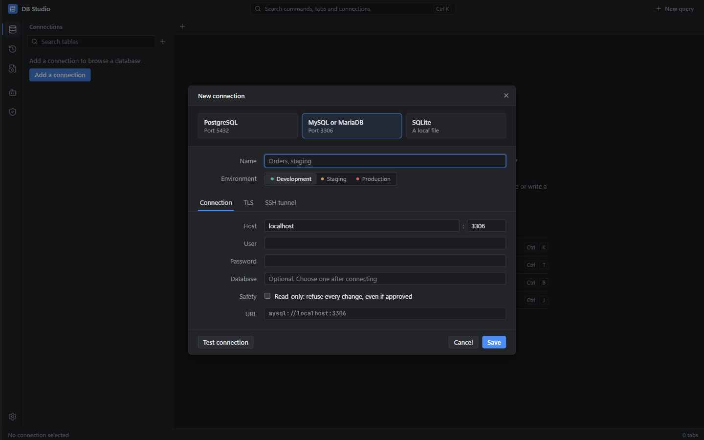
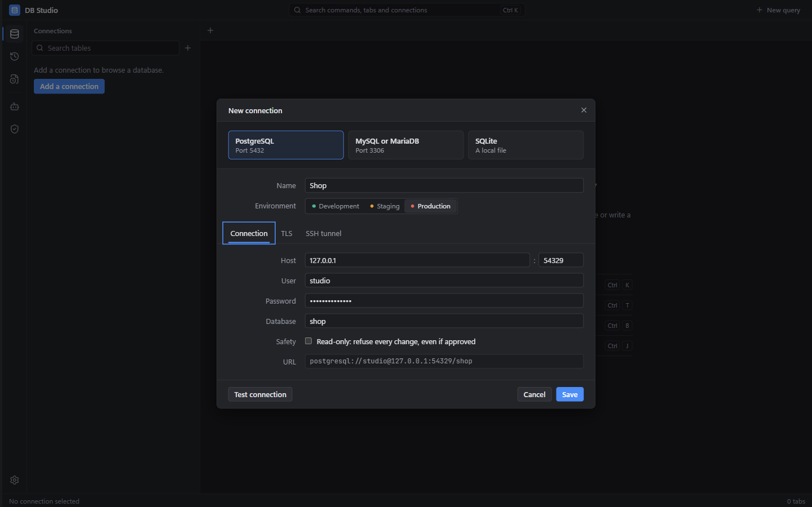
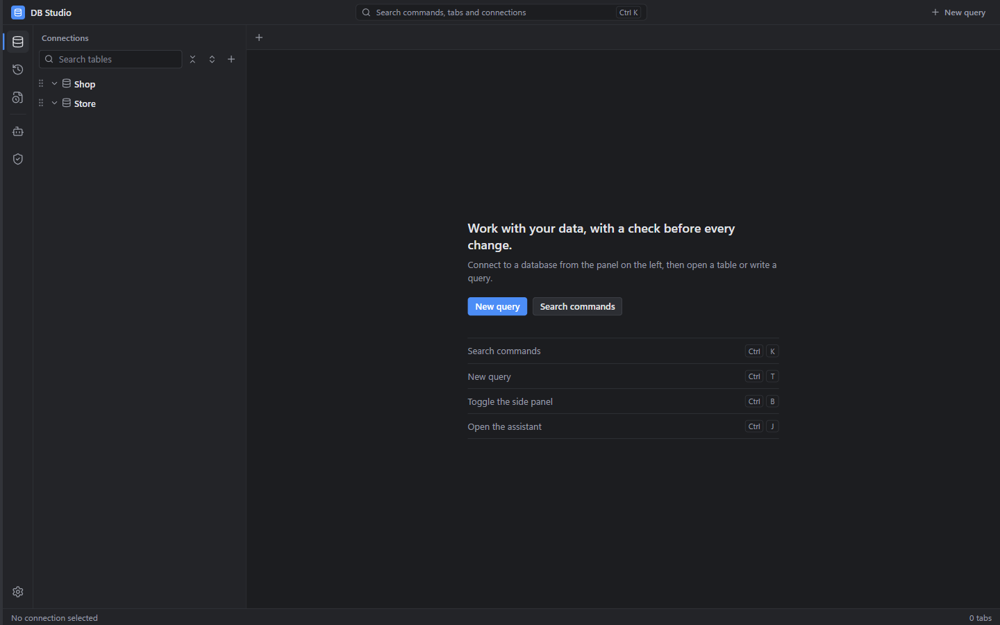
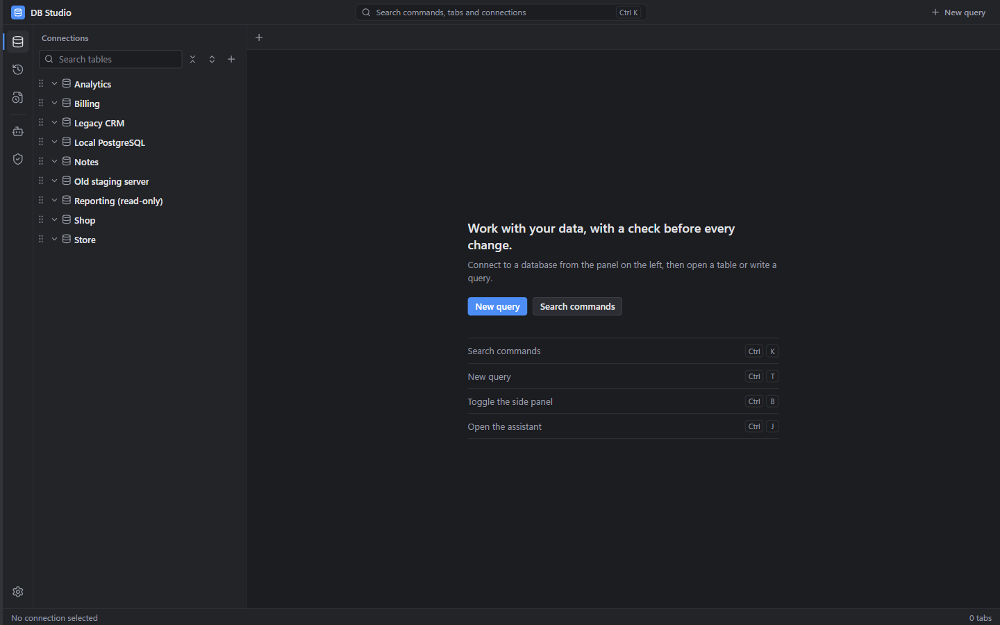

# Your first connection

This walk-through takes you from an empty window to your first query result in five steps.

## 1. Open DB Studio

On first launch there are no connections. The welcome page lists the four shortcuts worth
remembering: the command palette (++ctrl+k++), a new query (++ctrl+t++), the side panel
(++ctrl+b++) and the assistant (++ctrl+j++).

{ .shot loading=lazy }

## 2. Add a connection

Click **Add a connection** (or **+** at the top of the side panel, or *New connection* in the
command palette). First choose the engine. Each card shows its default port.

=== "PostgreSQL"

    { .shot loading=lazy }

=== "MySQL or MariaDB"

    { .shot loading=lazy }

=== "SQLite"

    { .shot loading=lazy }

    SQLite needs only a **database file** (choose it with **Choose**). There are no TLS or SSH tabs.

Then fill in the details:

{ .shot loading=lazy }

| Field | Notes |
|---|---|
| **Name** | What the side panel, title bar and reviews show. |
| **Environment** | *Development*, *Staging* or *Production*. Staging adds an amber band to the window edge. Production adds a red band and a *Production* label, and you must type the connection name before any change runs. |
| **Host / Port** | The server address. |
| **User / Password** | The password goes straight to the operating system keychain. It is never shown again. |
| **Database** | Optional. You can pick one after connecting. |
| **Safety** | *Read-only: refuse every change, even if approved.* |
| **URL** | A read-only preview of the connection URL. It never includes the password. |

The **TLS** tab defaults to *Verify full*, and the **SSH tunnel** tab connects through a bastion
host. Both are covered in [Connections](../user-guide/connections.md#connection-settings).

## 3. Test the connection

**Test connection** connects once, without saving. A green box shows the server version and
whether the link is encrypted:

{ .shot loading=lazy }

If it fails, the server's own reason is shown under the form (for example a wrong password). See
[Troubleshooting](../user-guide/troubleshooting.md#connection-errors) for each common message.

{ .shot loading=lazy }

## 4. Save and connect

**Save** adds the connection to the side panel. Connections can be reordered by dragging their
grip. Hover over one to see its **connect**, **edit** and **delete** buttons.

| After two connections | A full list |
|---|---|
| { .shot loading=lazy } | { .shot loading=lazy } |

Click the plug icon to connect. The side panel lists the databases and schemas. The ones in use
are highlighted and marked *in use*.

{ .shot loading=lazy }

## 5. Run a query

Click **New query** under the connection. The toolbar shows where the tab runs (*in shop · schema
public*). The status bar shows the engine, the server version and the TLS state.

{ .shot loading=lazy }

Type SQL and press ++ctrl+enter++. Rows stream into the grid, and the run log records the
statement:

{ .shot loading=lazy }

Reads run immediately. Anything that could change data opens a review first; see
[Reviews and safety](../user-guide/safety.md).

## Optional: set up the assistant

Open **Settings → Assistant**, choose a provider (Ollama, or any OpenAI-compatible endpoint such as
OpenAI or OpenRouter), enter the model name, save an API key and press **Test the model**. Then
open the **Assistant** from the left bar. See [AI assistant](../user-guide/assistant.md).
