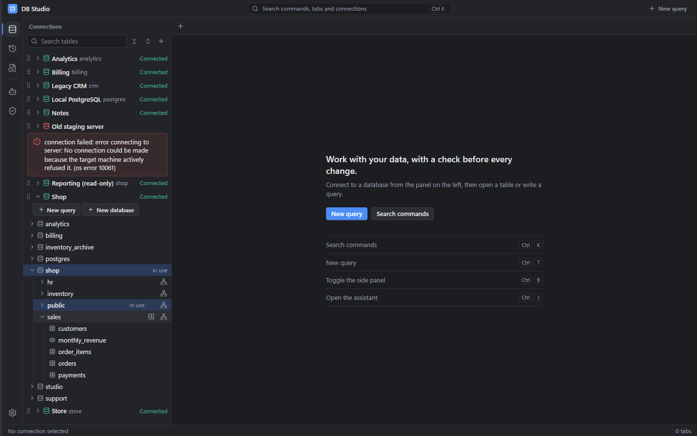
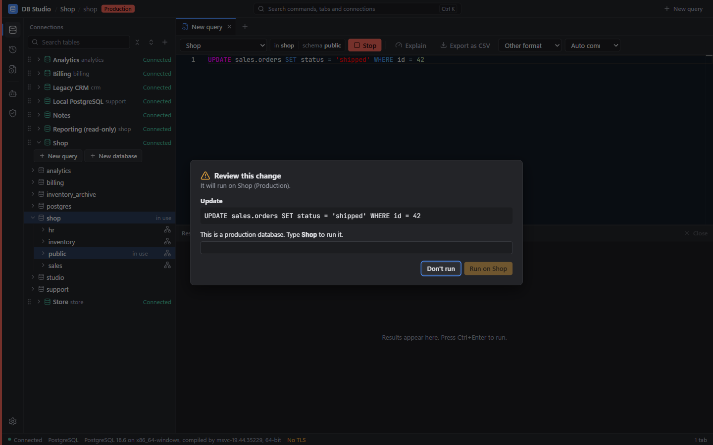
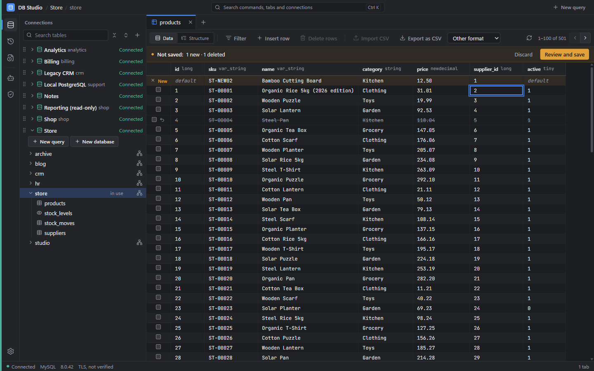
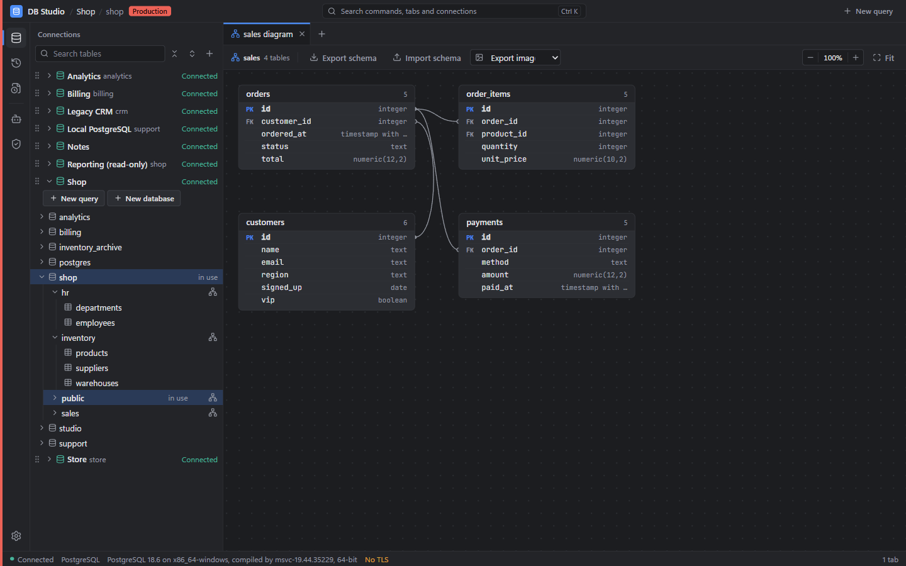
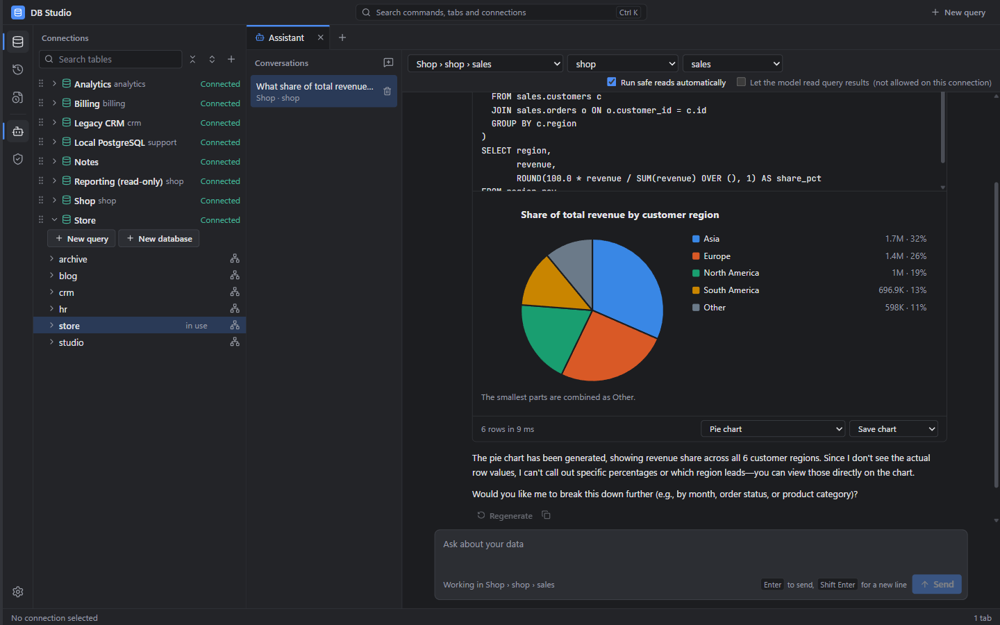
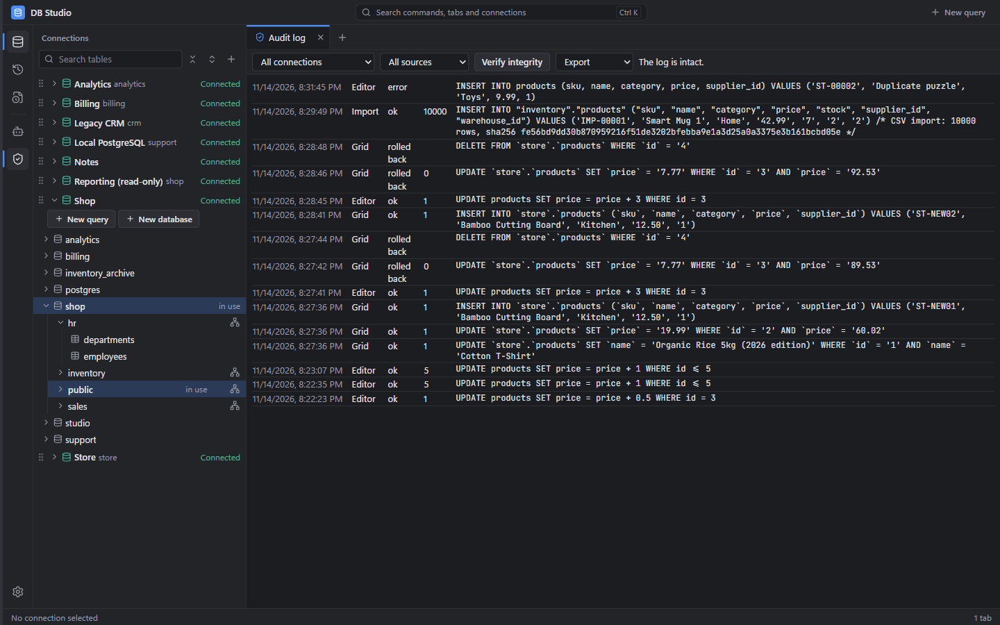

---
hide:
  - navigation
---

# DB Studio

**A desktop database client for PostgreSQL, MySQL/MariaDB and SQLite, with a check before every
change and an AI assistant that cannot act without you.**

{ .shot }

DB Studio is a native desktop app built with [Tauri 2](https://tauri.app/): a Rust backend in a
Cargo workspace and a React + TypeScript interface in the system webview. It is designed around one
idea: **nothing changes your data until a person has seen the exact SQL and approved it**, whether
you typed that SQL, edited a cell, imported a file or asked the assistant.

-   :material-database-search:{ .lg .middle } **Work with real databases**

    ---

    PostgreSQL, MySQL, MariaDB and SQLite, over verified TLS or SSH tunnels. Browse schemas,
    stream large results, page through tables and draw schema diagrams.

    [:octicons-arrow-right-24: User guide](user-guide/index.md)

-   :material-shield-check:{ .lg .middle } **Safe by construction**

    ---

    A Rust safety engine classifies every statement. Writes need a single-use approval token that
    only a human click can mint. Read-only and production connections are enforced in Rust.

    [:octicons-arrow-right-24: Security](security/index.md)

-   :material-robot-happy:{ .lg .middle } **A careful assistant**

    ---

    Ask questions in plain language. The assistant writes the SQL, runs safe reads, draws charts
    from the real rows, and proposes changes that wait for your approval.

    [:octicons-arrow-right-24: AI assistant](user-guide/assistant.md)

-   :material-sitemap:{ .lg .middle } **Clear architecture**

    ---

    Eleven crates with one job each. Only `studio-session` runs SQL, and it asks
    `studio-safety` first. The webview never sees a secret.

    [:octicons-arrow-right-24: Architecture](architecture/index.md)

## A quick look

| Query and stream results | Review every change | Edit tables in place |
|---|---|---|
| { .shot loading=lazy } | { .shot loading=lazy } | { .shot loading=lazy } |
| **Draw the schema** | **Ask the assistant** | **Audit everything** |
| { .shot loading=lazy } | { .shot loading=lazy } | { .shot loading=lazy } |

Every screen also comes in a [light theme](user-guide/themes.md).

## At a glance

| | |
|---|---|
| **Engines** | PostgreSQL, MySQL 8, MariaDB 11, SQLite 3 |
| **Platforms** | Windows (tested), macOS and Linux (built, not yet tested) |
| **Backend** | Rust 2021, Tokio, Tauri 2, sqlparser, rustls, russh, sqlx |
| **Frontend** | React, TypeScript (strict), Tailwind CSS, Monaco editor |
| **AI providers** | Any OpenAI-compatible endpoint (OpenAI, OpenRouter, …) or Ollama |
| **Secrets** | Only in the operating system keychain |
| **Telemetry** | None |

See [Technologies and languages](architecture/tech-stack.md) for every language, framework and
library, with versions.

## Where to start

- **Using the app?** Start with [Installation](getting-started/installation.md) and
  [your first connection](getting-started/first-connection.md), then take the
  [guided tour](user-guide/how-it-works.md).
- **Evaluating its safety?** Read the [threat model](security/threat-model.md) and the
  [safety rules](security/rules.md).
- **Working on the code?** Read the [architecture overview](architecture/index.md) and the
  [tech stack](architecture/tech-stack.md), then
  [set up your environment](development/environment.md).
