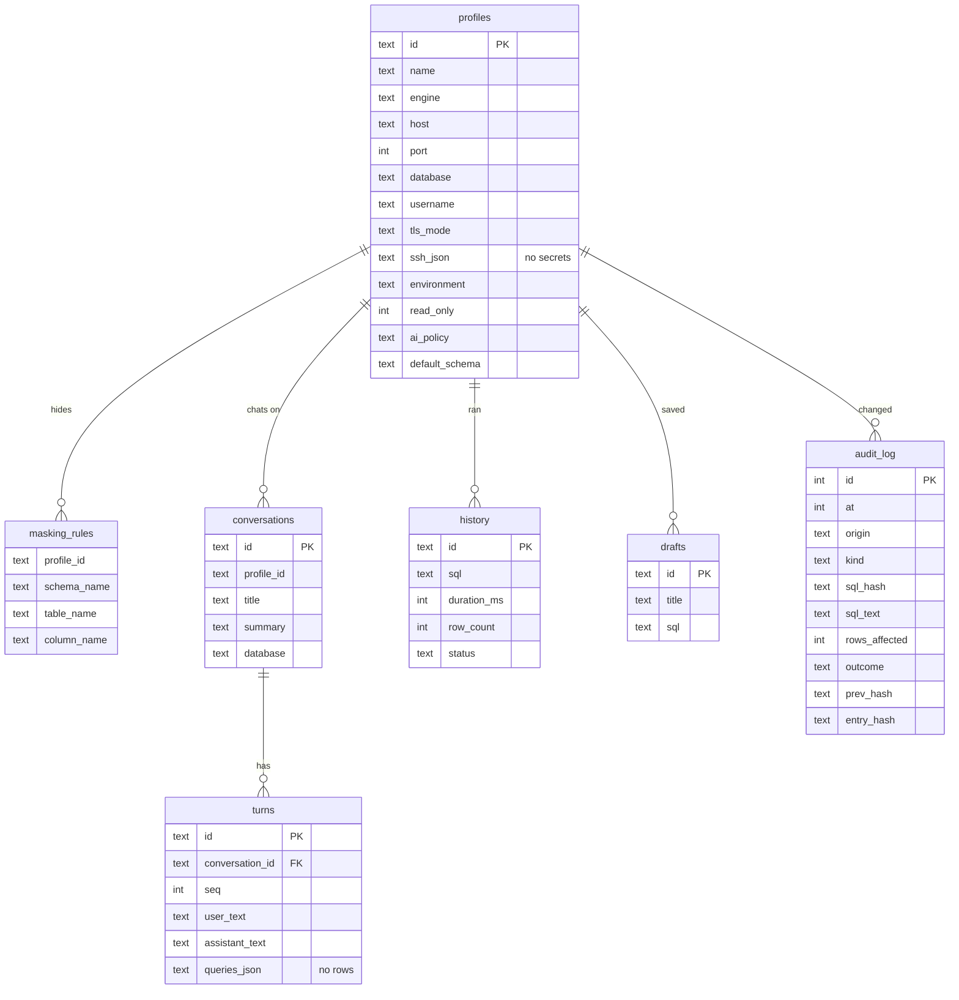

# Data model

The app database is SQLite, migrated by `sqlx` from `crates/studio-store/migrations/`.

Also: `settings (key, value_json)` and `known_hosts (host, port, key_type, fingerprint)`.

| Migration | Adds |
|---|---|
| `0001_init.sql` | All tables above |
| `0002_defaults.sql` | `profiles.default_schema`, `conversations.database` |

Secrets are **not** in this database; they live in the OS keychain.
