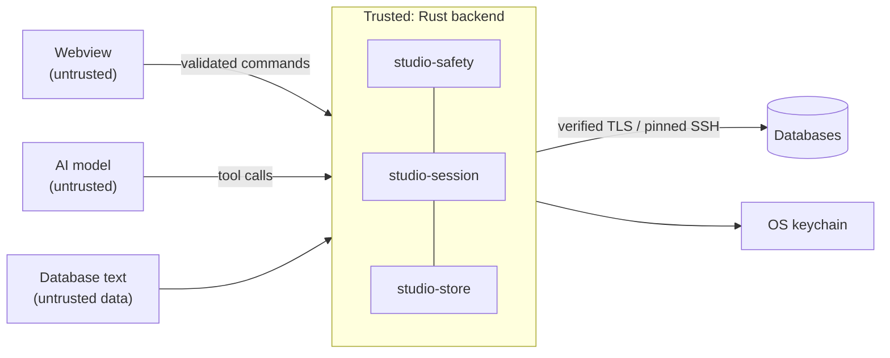

# Threat model

## Assets

- The **data** in connected databases, especially production.
- **Credentials**: database passwords, SSH keys and passphrases, AI provider keys.
- The **integrity of the record** of what was changed.

## Trust boundaries

| Untrusted party | Assumed able to | Defence |
|---|---|---|
| **The webview** | Call any command with any argument | Every command re-validates; secrets are never returned; Rust classifies SQL; file paths for writes come from Rust's own dialogs |
| **The AI model** | Ask for any SQL, invent arguments, follow instructions hidden in data | Tool arguments are parsed strictly and extras ignored; only `ai_auto` reads run unattended, read-only, with limits; everything else needs a human click; rows withheld by default; masked columns replaced |
| **Text from databases** | Contain prompt injections | Marked as untrusted data in the prompt; the model is told never to follow it; it cannot widen what the gate allows anyway |
| **The network** | Intercept or impersonate | TLS verification on by default; SSH host keys pinned; no credential sent to an unverified bastion |
| **A local file editor** | Change an import file after review | The approval covers the file's hash |

## Out of scope

- An attacker who controls the **operating system account** (they can read the keychain).
- A **malicious database server** returning crafted protocol data beyond what the drivers already
  validate.
- **Signed-binary** guarantees: builds are not yet code-signed.

## Known residual risk

!!! warning "Approvals trust the webview's call"
    `approve_query` is triggered by a click in the interface. A fully compromised webview could
    call it directly and approve SQL without a person seeing it. A native, Rust-drawn confirmation
    dialog would close this gap; it is the top item on the security backlog.

Other noted gaps: on MySQL a timed-out `SLEEP` is reported as a success; qualified names to other
databases (`otherdb.table`) are not yet refused for the assistant. See
[Known issues](../reference/known-issues.md).
