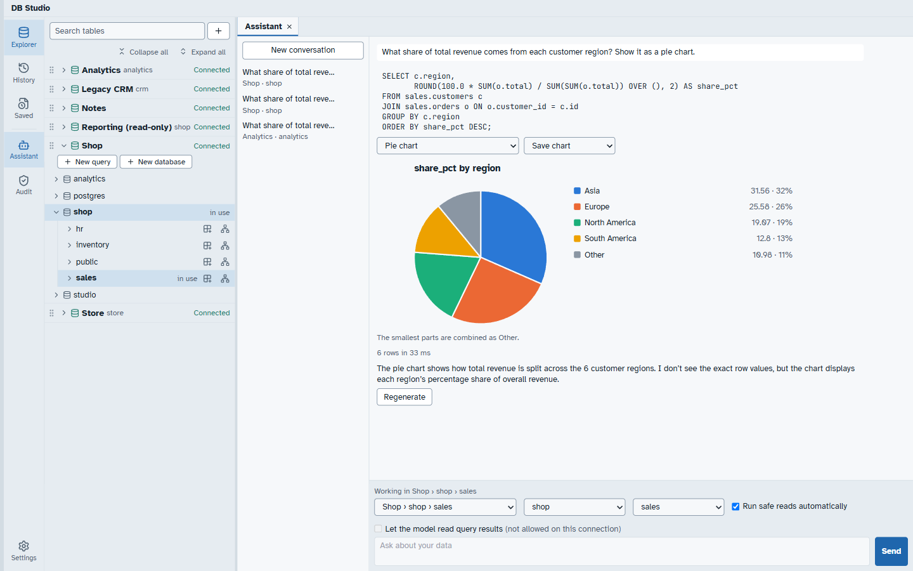
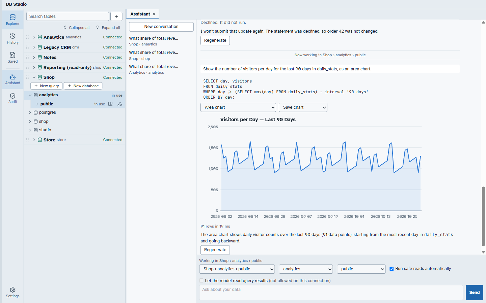
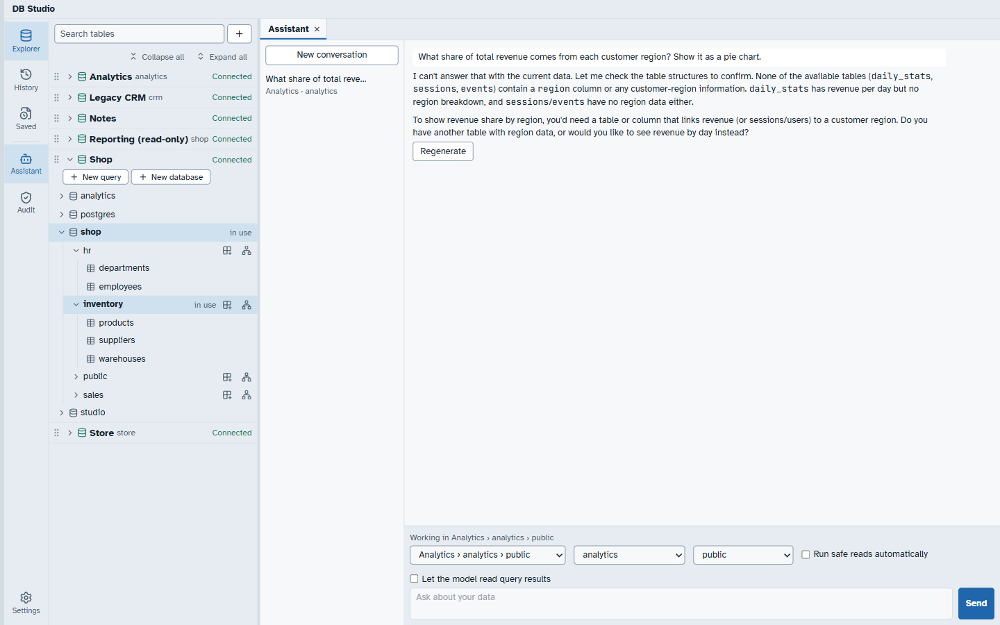
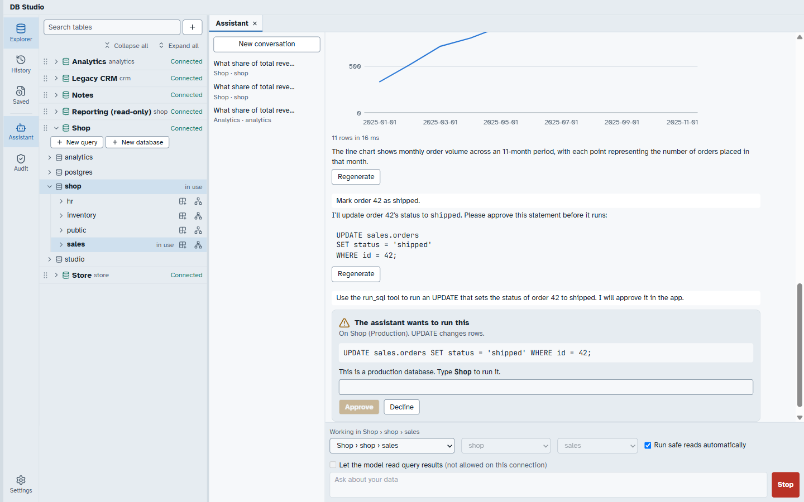
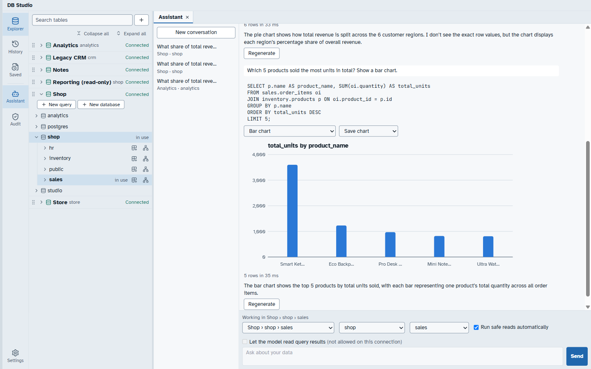
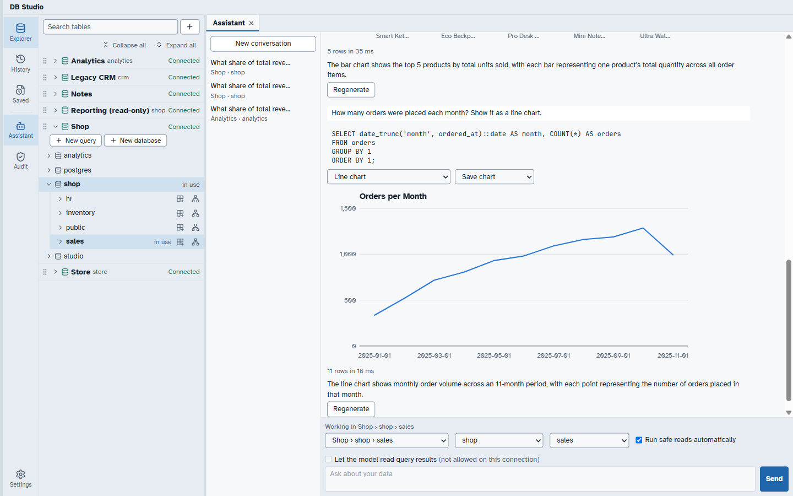
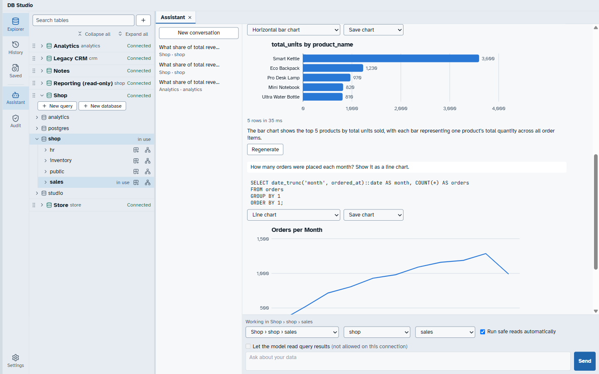

# AI assistant

Open the **Assistant** from the left bar (++ctrl+j++). Ask questions in plain language; the
assistant writes SQL, runs safe reads, draws charts and proposes changes for you to approve.

{ .shot }

## Where it works

The line above the input says where the assistant works: **server › database › schema**. It sees
only the tables of the database in use, never the rest of the server.

- Change it with the **Database** and **Schema** pickers in the chat, or from the side panel; both
  use the same switch, so SQL tabs and the assistant always agree.
- Switching mid-chat adds a note to the conversation.
- With no database in use (a MySQL connection opened without one), it lists the database names
  and asks which to use.

{ .shot }

{ .shot }

## Reads, writes and your approval

| The assistant… | What happens |
|---|---|
| Runs a **safe read** | Runs at once if *Run safe reads automatically* is on: in a READ ONLY transaction, with a 30-second limit and a 5,000-row cap. |
| Proposes **anything else** | A review card waits for **Approve** or **Decline**. On Production you type the name. |
| Is **declined** | It is told the statement did not run and does not submit it again. |

{ .shot }

## Charts

Ask for a chart ("…as a pie chart", "…per month as a line"), and the assistant asks the app to
draw one. It names **columns only**; the values always come from the rows the database returned,
so it cannot draw numbers it made up.

| Bar | Line |
|---|---|
| { .shot } | { .shot } |

Every result has a **Show as** chooser: table, bar, horizontal bar, stacked bar, line, area, pie,
donut or scatter. Forms that do not fit are greyed out with the reason. **Save chart** writes PNG,
JPEG or PDF.

{ .shot }

## Privacy

- **Result rows are not sent to the model** unless you tick *Let the model read query results*.
  Connections set to never share rows (and Production, by default) forbid it.
- **Masked columns** are replaced with `***` before anything reaches the model, and are never
  stored in its memory.
- **Per connection**, the assistant can be limited to local models, forbidden to see rows, or
  turned off. See [Settings](settings.md).
- Conversations are kept locally, without result rows.

## Providers

**Settings → Assistant**: choose *OpenAI or compatible* (OpenAI, OpenRouter, or any
OpenAI-compatible server) or *Ollama*, set the endpoint and model, and save the key. **Test the
model** sends one short request. Models without tool calling fall back to fenced SQL in their
replies, which still goes through the same review.
