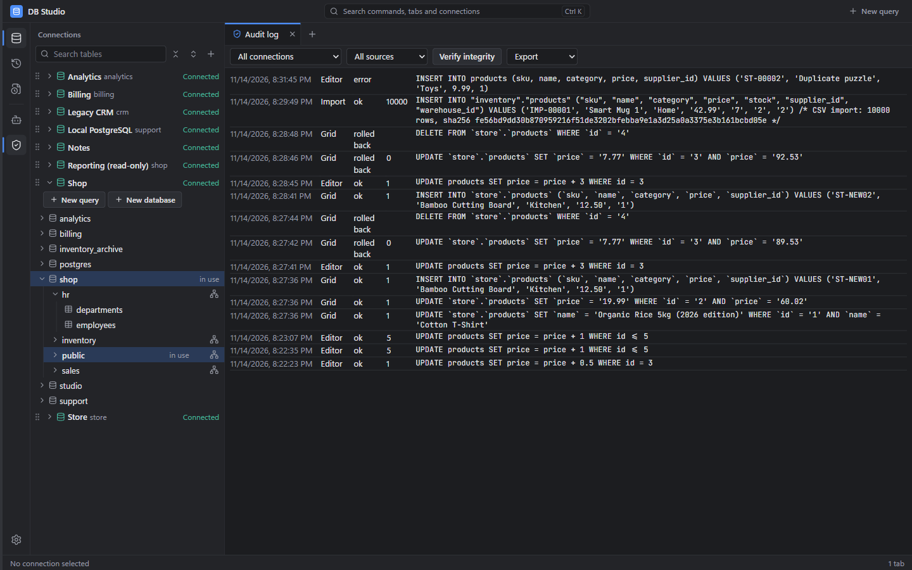

# Audit log

Every statement that is not a pure read is recorded, whoever started it: the editor, the grid, the
import wizard or the assistant. Open it with the shield in the left bar or ++ctrl+l++.

{ .shot loading=lazy }

Each entry holds the time, connection, environment, **source** (*Editor*, *Grid*, *Import*,
*Ai*), kind, the SQL and its SHA-256, the rows affected and the outcome (*ok*, *error*,
*cancelled*, *rolled back*). Grid saves that were refused show as *rolled back*. An import shows
its row count and the file's hash in a SQL comment.

## Working with the log

- **Filter** by connection (*All connections*) and by source (*All sources*).
- **Verify integrity** checks the whole chain. Entries are hash-chained, so a changed or deleted
  entry is detected. Otherwise it reports *The log is intact*.
- **Export** writes the log to a file.

{ .shot loading=lazy }

Result rows and parameters are never written to the log.
