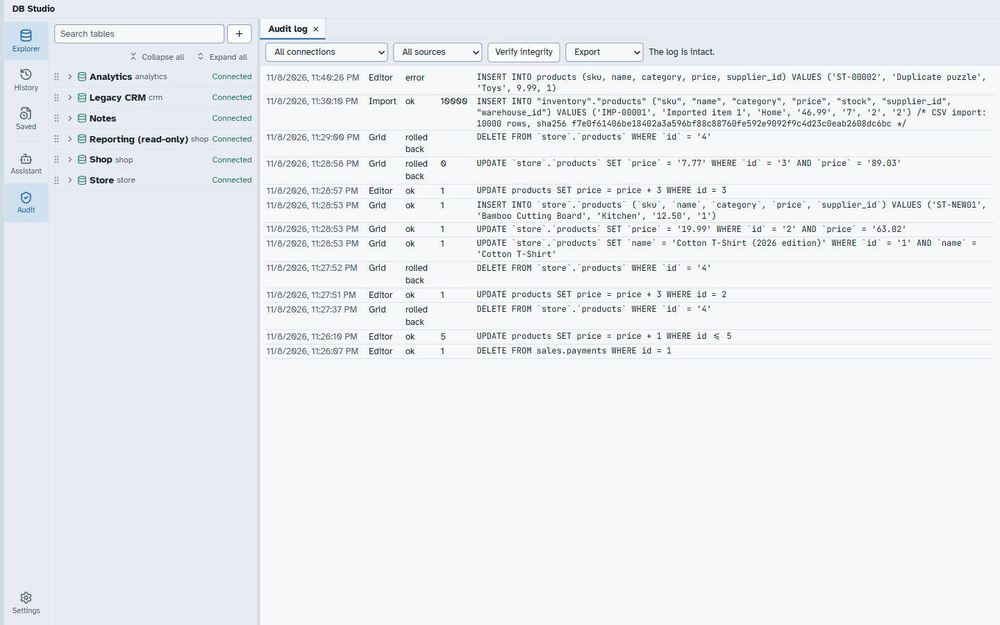

# Audit log

Every statement that is not a pure read is recorded, whoever started it: the editor, the grid,
the import wizard or the assistant.

{ .shot }

Each entry holds the time, connection, environment, **source** (Editor, Grid, Import, Ai), kind,
the SQL and its SHA-256, the rows affected and the outcome (*ok*, *error*, *cancelled*, *rolled
back*).

- **Filter** by connection and source.
- **Verify integrity** checks the whole chain. Entries are hash-chained, so a changed or deleted
  entry is detected (*The log is intact* otherwise).
- **Export** writes the log to a file.

Result rows and parameters are never written to the log.
