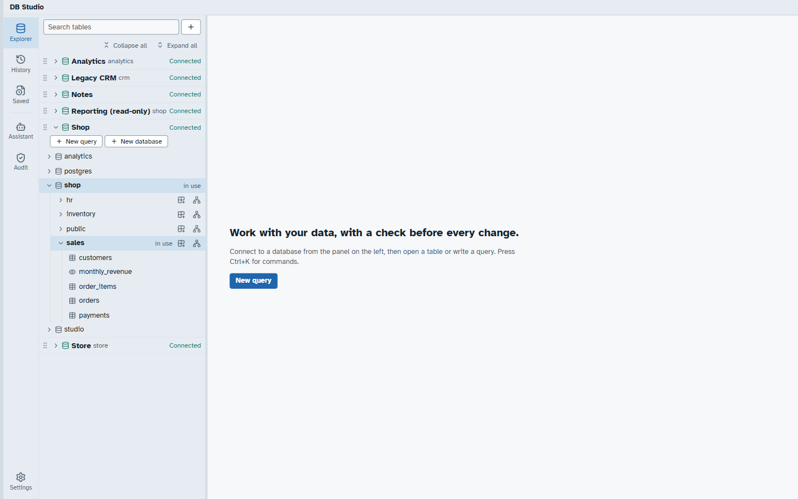
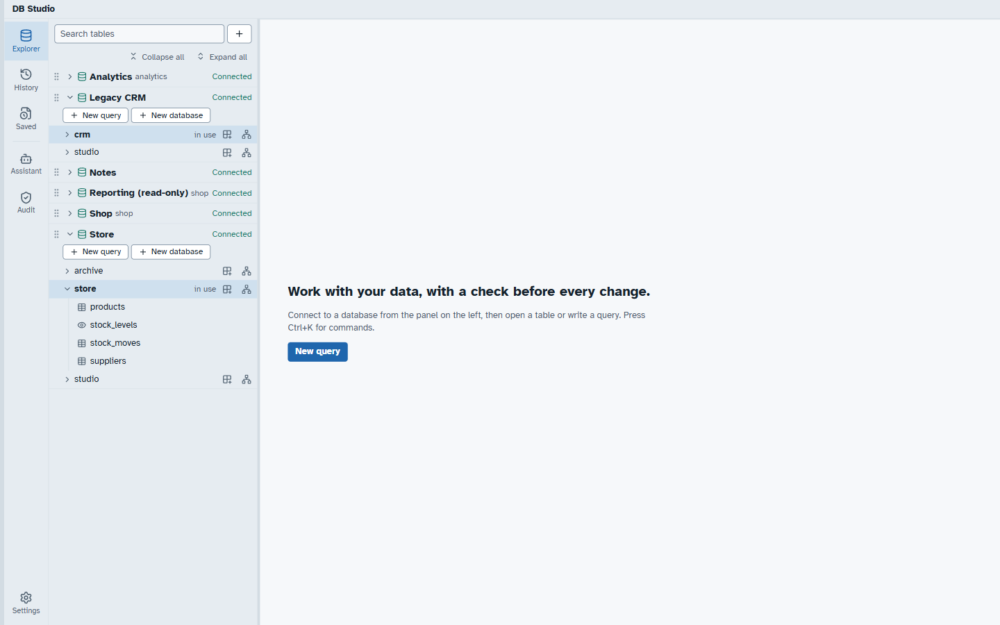
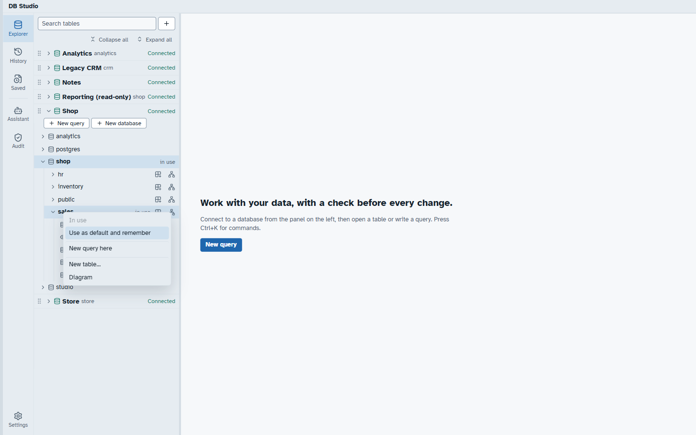
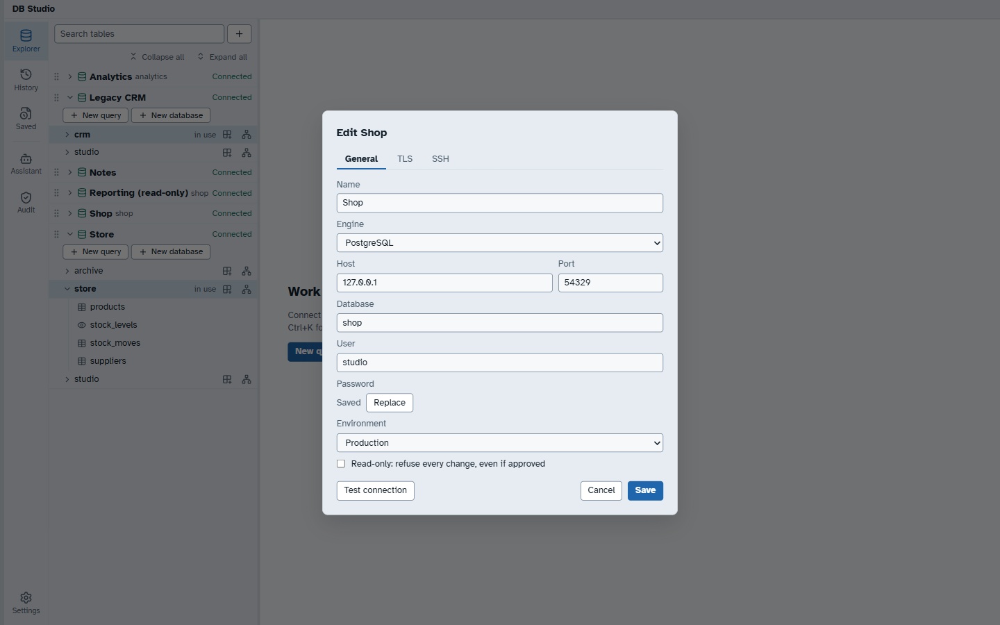
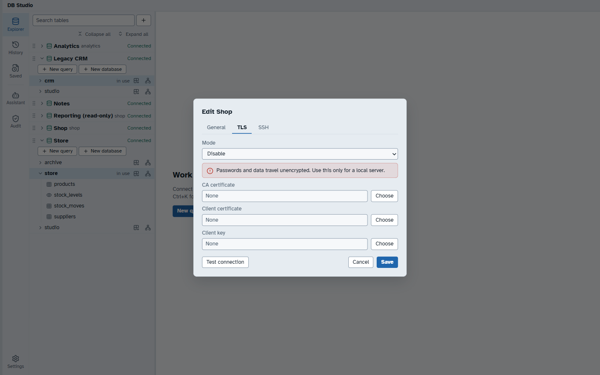
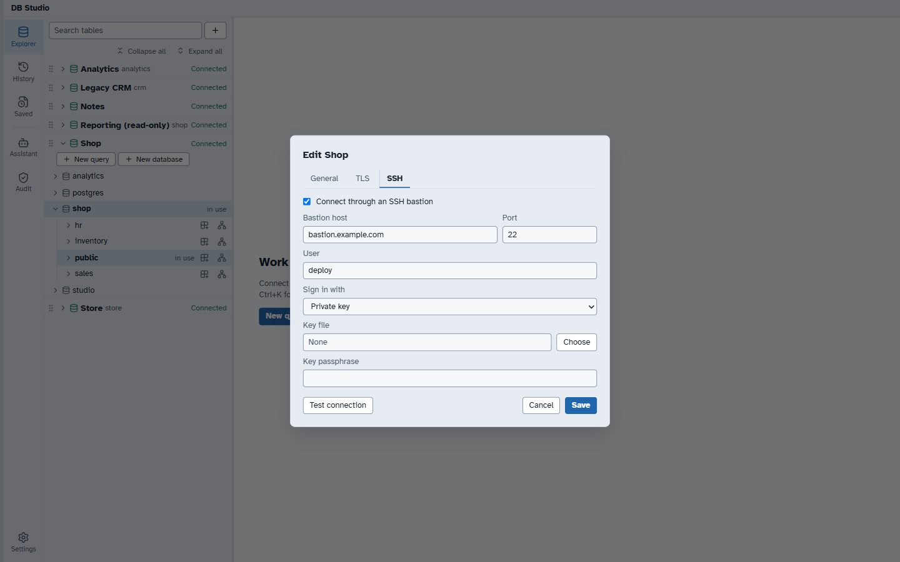
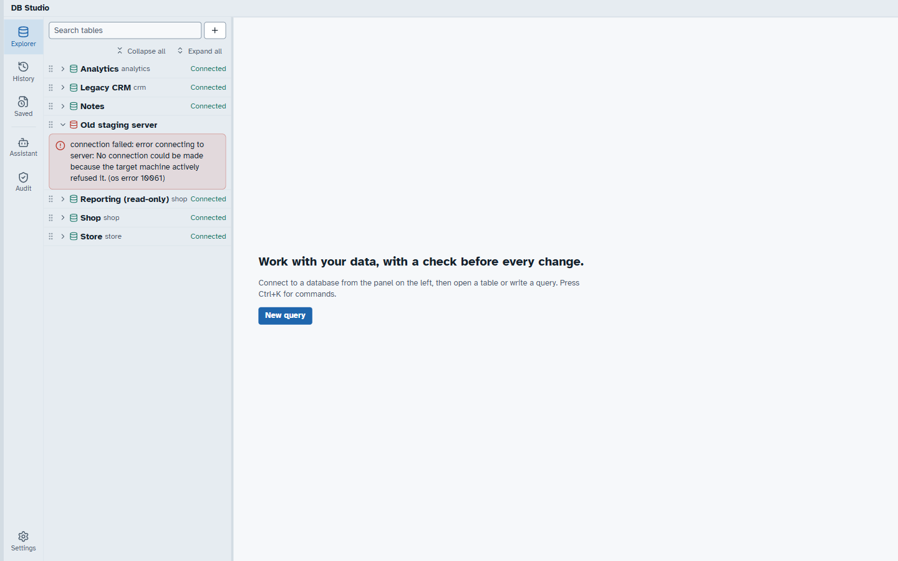
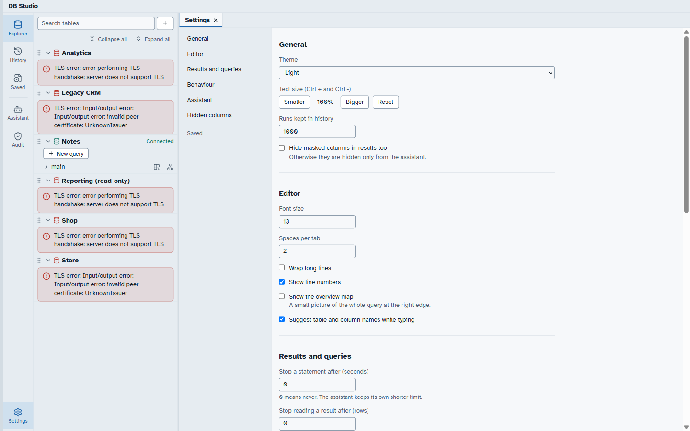

# Connections

## The side panel

{ .shot }

- **Connect / disconnect** with the plug icon. A failed connection shows its reason underneath.
- **Collapse and expand** each connection, or use *Collapse all* / *Expand all*. The state is
  remembered.
- **Reorder** by dragging the grip, or with ++alt+up++ / ++alt+down++ on it.
- **Search tables** filters every connection at once, including collapsed ones.
- **New query** and **New database** buttons appear under a connected connection.

## Databases and schemas

- **PostgreSQL**: a connection is tied to one database. The side panel lists every database on the
  server; choosing another one opens a new session for it. Inside the database in use, each schema
  is listed, and the schema in use is where unqualified names resolve first.
- **MySQL / MariaDB**: databases are listed as schemas. Choosing one changes the default database
  for every pooled connection.
- **SQLite**: one file, one database (`main`).

{ .shot }

### Default database and schema

Left-click a database or schema to use it. **Right-click** (or press ++shift+f10++) for more:

{ .shot }

| Item | What it does |
|---|---|
| **Use as default** | Switches to it now. SQL tabs, table tabs and the assistant all work there. |
| **Use as default and remember** | Also saves it on the connection, so the next connect opens there. |
| **Forget remembered default** | Clears the saved choice. |
| **New query here** | Switches, then opens a SQL tab. |
| **New table…** / **Diagram** | For schemas. |

Switching is refused while a manual transaction has uncommitted work; commit or roll back first.

## Connection settings

=== "General"

    { .shot }

    **Environment** changes how careful the app is: Production asks you to type the connection
    name before any change runs. **Read-only** refuses every change, even after approval.

=== "TLS"

    { .shot }

    | Mode | Meaning |
    |---|---|
    | **Verify full** *(default)* | Encrypted; the certificate must chain to a trusted CA **and** match the host name. |
    | **Verify CA** | Encrypted; the certificate must chain to a trusted CA. |
    | **Require** | Encrypted, but the server's identity is not checked. |
    | **Disable** | No encryption. Use only for a local server. |

    A custom CA bundle and a client certificate and key can be chosen as files.

=== "SSH"

    { .shot }

    Connects through a bastion host with local port forwarding. Sign in with a password, a
    private key file (with an optional passphrase) or the SSH agent. The bastion's host key is
    pinned on first use; a changed key is refused until you trust it again.

## Errors you may see

{ .shot }

{ .shot }

TLS errors such as *invalid peer certificate: UnknownIssuer* mean verification is doing its job:
install the server's CA, choose its CA file in the TLS tab, or (for a local server only) lower the
mode.
