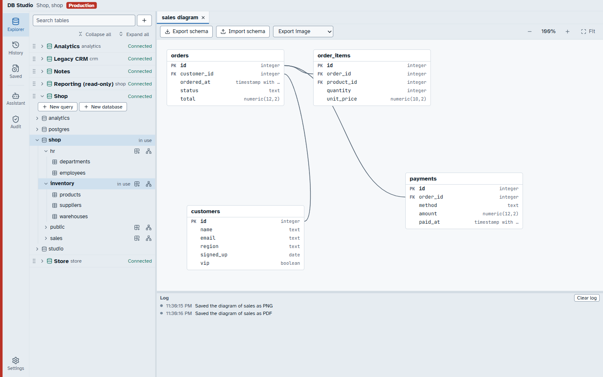
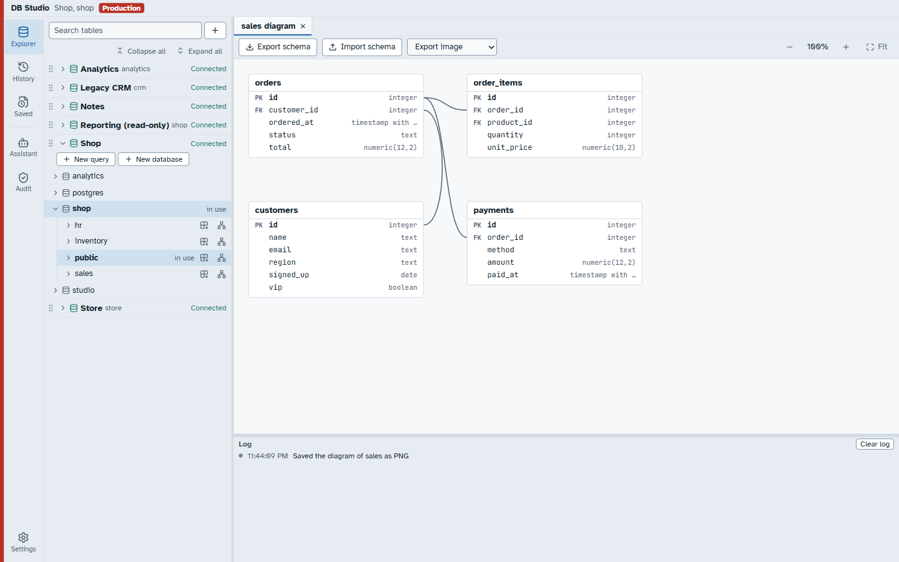
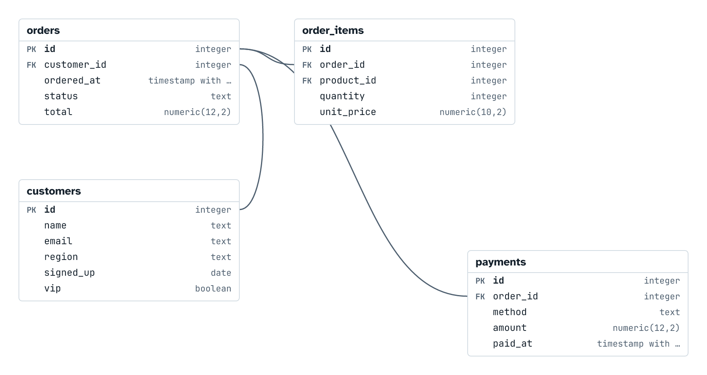

# Schema diagram

Click the diagram icon next to a schema (or right-click → **Diagram**). Tables are drawn from the
live database with their keys, types and the relationships between them.

{ .shot }

- **Drag** the background to pan, **scroll** to zoom, **drag a table** to move it.
- **Fit** frames every table; **+ / −** zoom.

{ .shot }

## Saving as an image

**Export image** saves the whole diagram, not just the part on screen, as **PNG**, **JPEG** or
**PDF**, always in light colours on white:

{ .shot }

The file is drawn in Rust (resvg and svg2pdf, with bundled fonts), so it looks the same on every
machine:

{ .shot }

!!! note
    Table positions are not saved yet; reopening the tab arranges the tables again.
