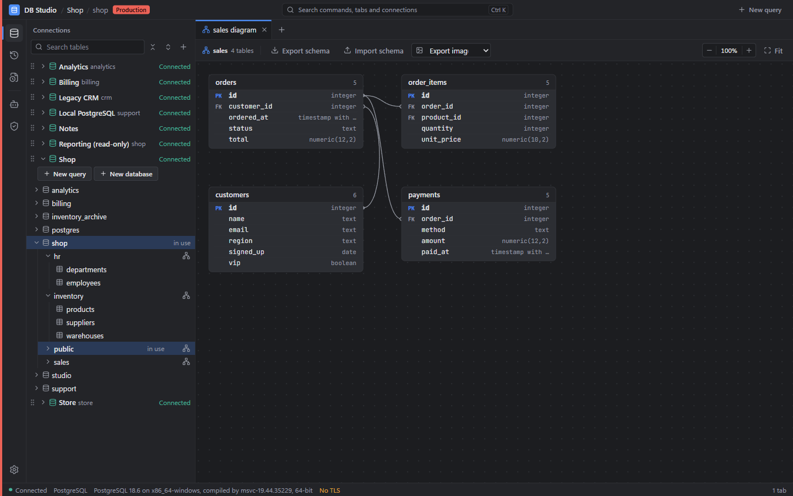
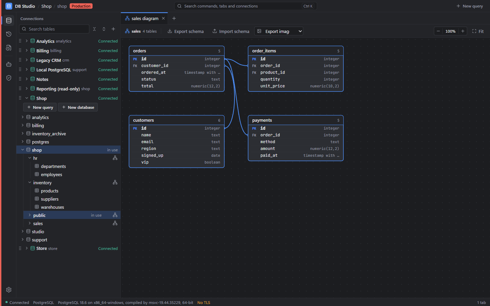
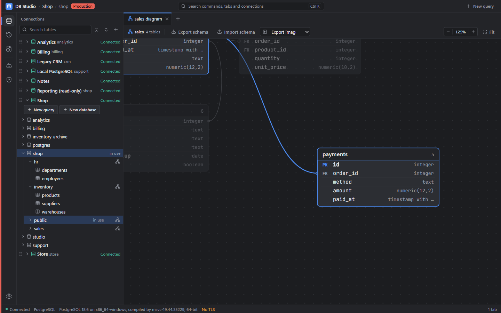
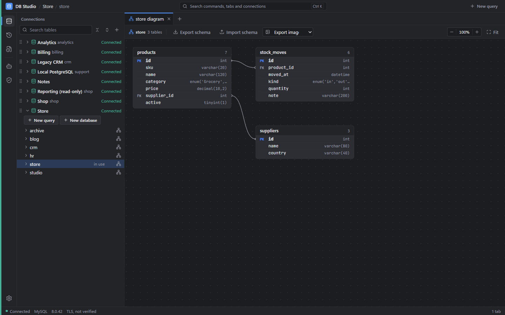
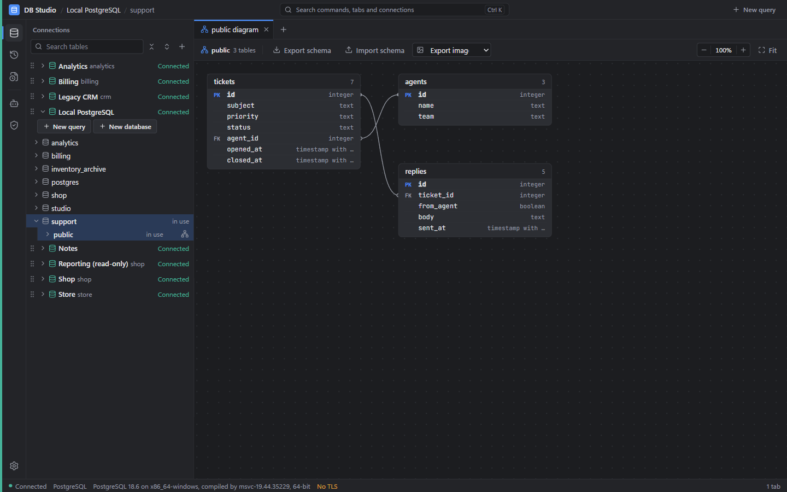
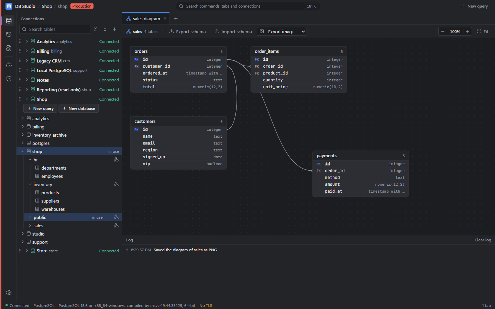
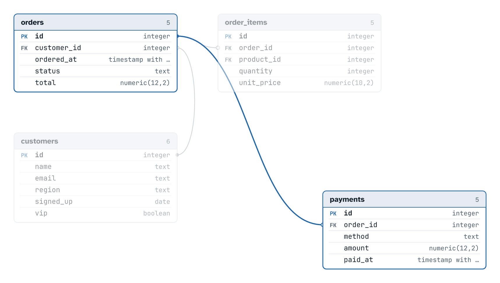
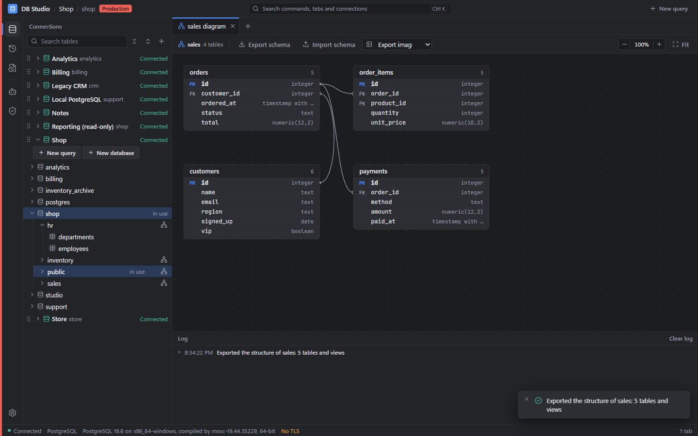
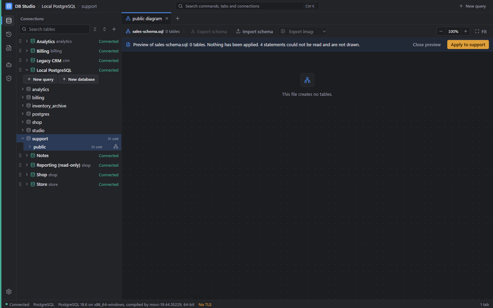

# Schema diagram

Click the diagram icon next to a schema (or right-click → **Diagram**). Tables are drawn from the
live database with their keys, types and the relationships between them.

{ .shot loading=lazy }

Each table card lists its columns and types, with **PK** and **FK** markers and its column count.
Lines join each foreign key to the key it references. The toolbar shows the schema and the number
of tables.

## Exploring

- **Hover** a table to highlight its relationships and the tables it touches.

    { .shot loading=lazy }

- **Drag** the background to pan, **scroll** to zoom, and **drag a table** to move it.
- **Fit** frames every table. **−** / **+** zoom, and the percentage shows the zoom level.

    { .shot loading=lazy }

Diagrams work on every engine:

| MySQL | Another PostgreSQL schema |
|---|---|
| { .shot loading=lazy } | { .shot loading=lazy } |

## Saving as an image

**Export image** saves the whole diagram as **PNG**, **JPEG** or **PDF**, not just the part on
screen. It is always drawn in light colours on white, and the log confirms the save:

{ .shot loading=lazy }

The file is drawn in Rust (resvg and svg2pdf, with bundled fonts), so it looks the same on every
machine:

{ .shot loading=lazy }

## Exporting and importing the schema

**Export schema** writes the schema's structure as SQL. **Import schema** previews a `.sql` file
as a diagram before anything is applied. See
[Import and export → Schema files](import-export.md#schema-files).

| Export | Import preview |
|---|---|
| { .shot loading=lazy } | { .shot loading=lazy } |

!!! note
    Table positions are not saved yet. Reopening the tab arranges the tables again.
