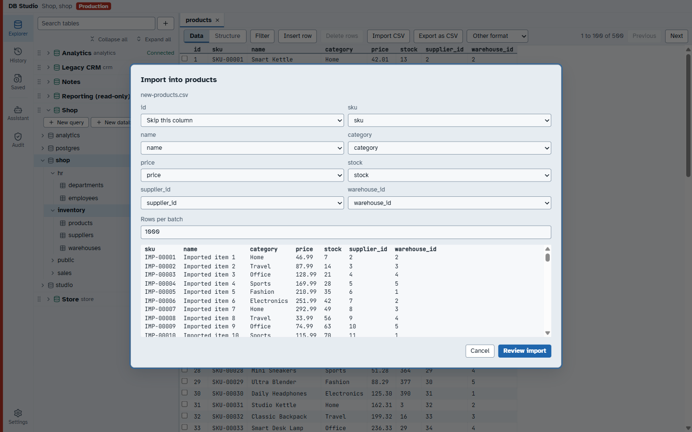
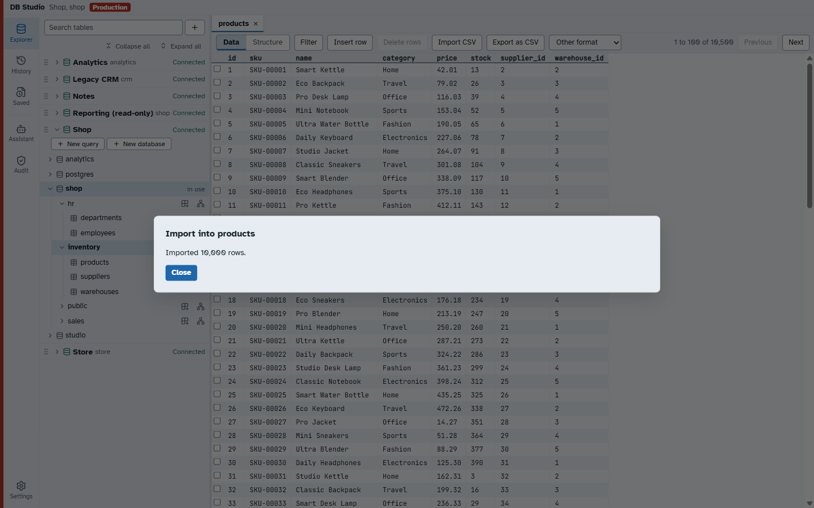

# Import and export

## Exporting

| From | What is written |
|---|---|
| A SQL tab | The selected rows, else the filtered rows, else the whole result |
| A table tab | The selected rows, else the filtered rows, else the whole table (streamed) |

Formats: **CSV**, **JSON lines**, **Excel** (`.xlsx`) and **SQL inserts**. The **Export as …**
button uses the format chosen in Settings; **Other format** picks another.

The save dialog is opened by Rust, so the interface never supplies a file path. Masked values stay
masked in exports.

## Importing CSV

Open a table and choose **Import CSV**.

{ .shot }

1. **Choose a CSV file** (the file stays in Rust; the interface sees a preview only).
2. **Map** each table column to a file column, or skip it.
3. Choose the **rows per batch**.
4. **Review import**. The review covers a hash of the file, so editing the file after the review
   makes the approval fail.

{ .shot }

Every batch runs in **one transaction**: a single bad row undoes the whole import.

## Schema files

The [schema diagram](diagrams.md) tab can **export** a schema's structure (tables in dependency
order, foreign keys, views) as a `.sql` file and **import** one. An imported file is drawn as a
preview first and applied only through the normal review.
