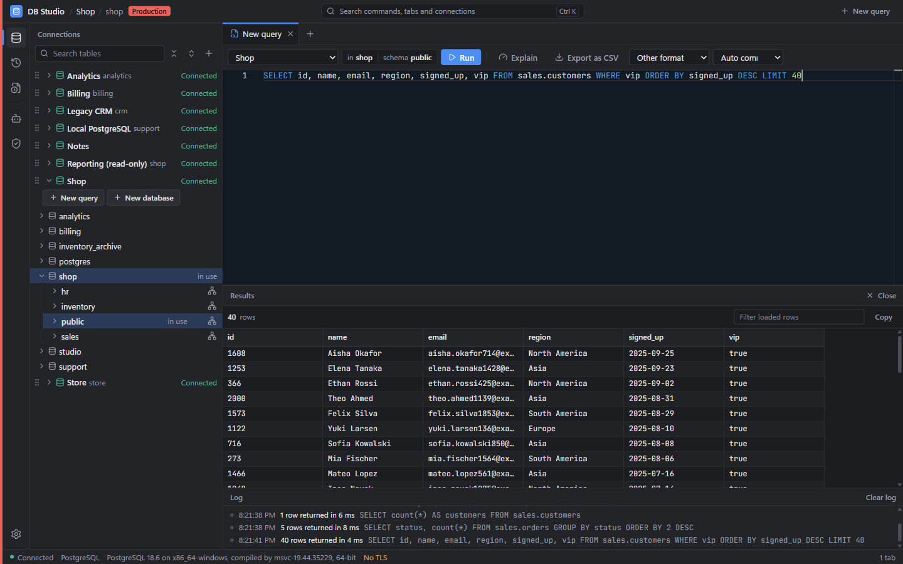
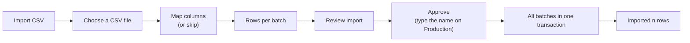
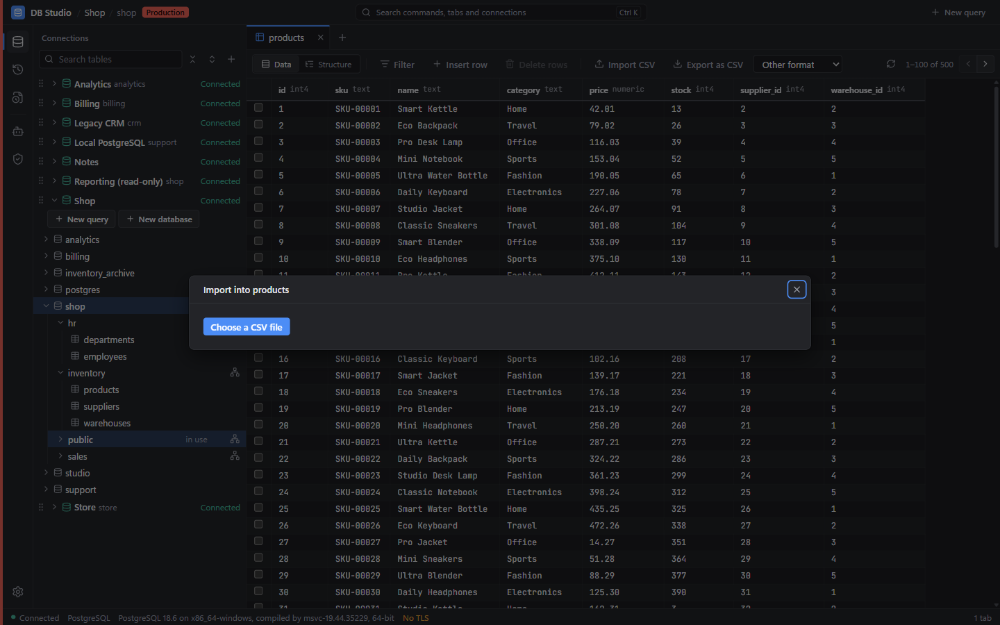
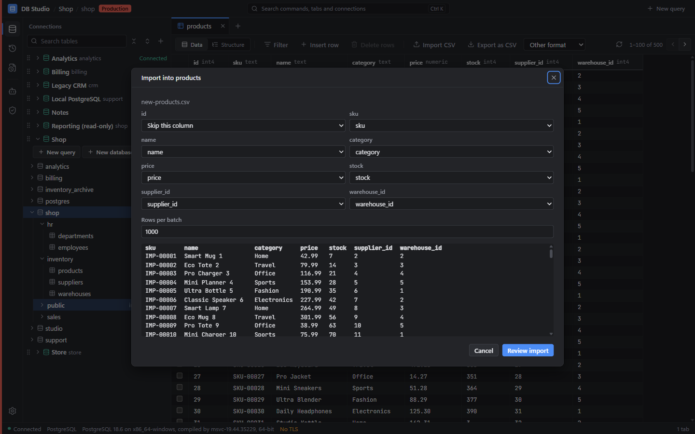
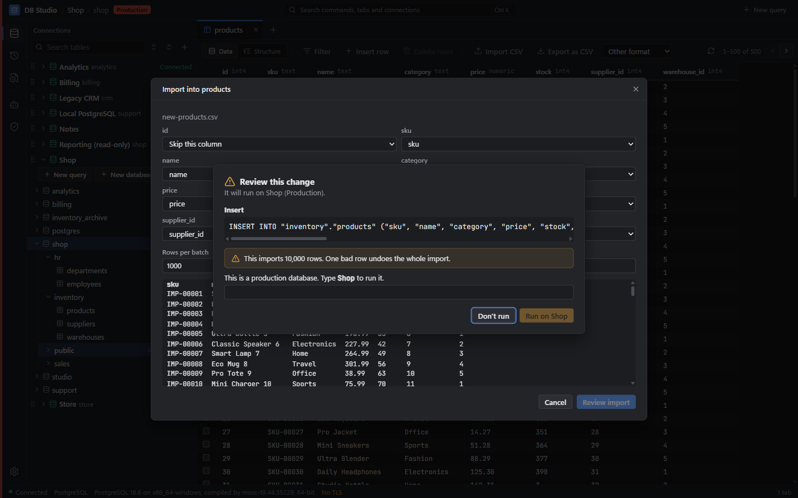
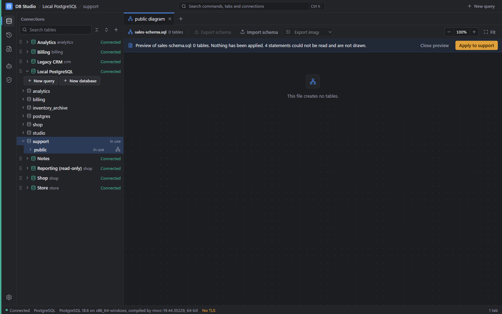

# Import and export

## Exporting

| From | What is written |
|---|---|
| A SQL tab | The selected rows, else the filtered rows, else the whole result |
| A table tab | The selected rows, else the filtered rows, else the whole table (streamed) |

Formats: **CSV**, **JSON lines**, **Excel** (`.xlsx`) and **SQL inserts**. The **Export as …**
button uses the format chosen in **Settings → Behaviour**. **Other format** picks another.

{ .shot loading=lazy }

The save dialog is opened by Rust, so the interface never supplies a file path. Masked values stay
masked in exports. Exports always write every row, whatever the row limit in Settings.

## Importing CSV

Open a table and choose **Import CSV**.

=== "1 · Choose a file"

    { .shot loading=lazy }

    The file stays in Rust. The interface sees only a preview.

=== "2 · Map the columns"

    { .shot loading=lazy }

    Map each table column to a file column, or choose **Skip this column** (for example an
    identity `id`). Set the **rows per batch**. The preview below shows the first rows as they
    will be imported.

=== "3 · Review"

    { .shot loading=lazy }

    **Review import** shows the `INSERT` and how many rows it covers, and warns that one bad row
    undoes everything. The review covers a hash of the file, so editing the file after the review
    makes the approval fail.

=== "4 · Done"

    { .shot loading=lazy }

    The table's total updates (*1–100 of 10,500*), and the import appears in the
    [audit log](audit-log.md) with source *Import*.

Every batch runs in **one transaction**: a single bad row undoes the whole import.

## Schema files

The [schema diagram](diagrams.md) tab can **export** a schema's structure (tables in dependency
order, foreign keys and views) as a `.sql` file, and **import** one.

| Export schema | Import schema (preview) |
|---|---|
| { .shot loading=lazy } | { .shot loading=lazy } |

An imported file is **drawn as a preview first**. The banner says how many tables it creates and
which statements could not be read, and that *Nothing has been applied*. **Apply to …** sends it
through the normal review. **Close preview** discards it.
