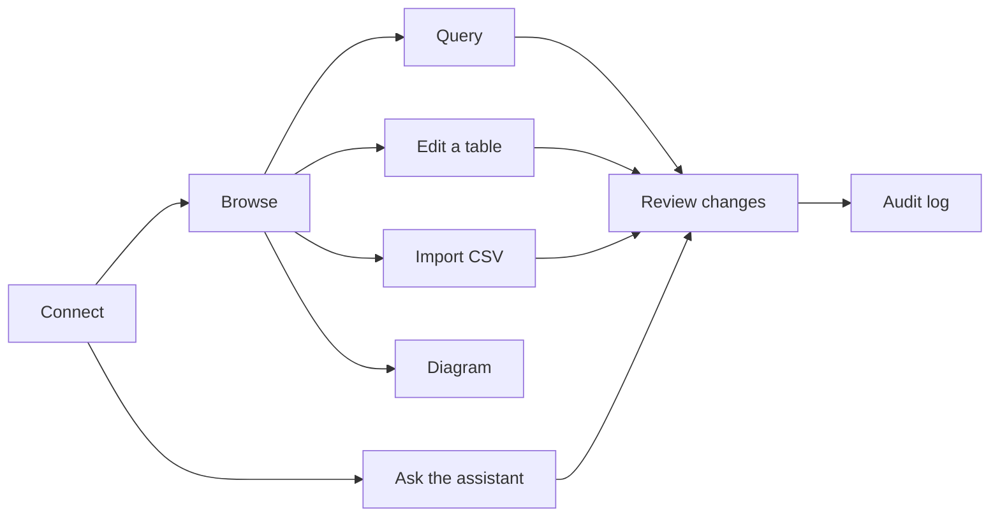

# User guide

{ .shot loading=lazy }

The window has five parts:

| Area | What it holds |
|---|---|
| **Title bar** | The connection and database of the active tab, an environment label (*Staging*, *Production*, *Read-only*), the command search (++ctrl+k++) and **New query**. |
| **Left bar** | Explorer, History, Saved queries, Assistant, Audit log, and Settings at the bottom. |
| **Side panel** | Your connections, their databases, schemas and tables. |
| **Work area** | Tabs for SQL queries, tables, diagrams, the assistant, the audit log and settings. |
| **Status bar** | Connection state, engine, server version and TLS state of the active tab, and the tab count. |

The window edge carries a coloured band for the active connection's environment: green for
Development, amber for Staging and red for Production.

New here? Read **[How everything works](how-it-works.md)**, a guided tour with screenshots that
also explains what happens behind each step.

## The everyday workflow

Every path that changes data goes through the same **review**, and every change ends up in the
**audit log**.

## Pages

| Task | Page |
|---|---|
| See the whole app, step by step, and what happens behind each step | [How everything works](how-it-works.md) |
| Add, test, edit and organise connections; choose the default database; create databases and tables | [Connections](connections.md) |
| Write and run SQL, read results, explain plans, stop a query | [SQL editor](sql-editor.md) |
| Understand reviews, risk levels, Production, read-only and transactions | [Reviews and safety](safety.md) |
| Browse, filter and edit table data in place | [Tables and inline editing](tables.md) |
| Import CSV, export results, tables and schemas | [Import and export](import-export.md) |
| See, arrange and save the schema as a diagram | [Schema diagram](diagrams.md) |
| Ask questions in plain language and get charts | [AI assistant](assistant.md) |
| Tune the editor, limits, assistant and hidden columns | [Settings](settings.md) |
| Review every change ever made | [Audit log](audit-log.md) |
| Work faster from the keyboard | [Keyboard shortcuts](shortcuts.md) |
| Understand an error message | [Troubleshooting](troubleshooting.md) |
| See every screen in the light theme | [Light and dark](themes.md) |
