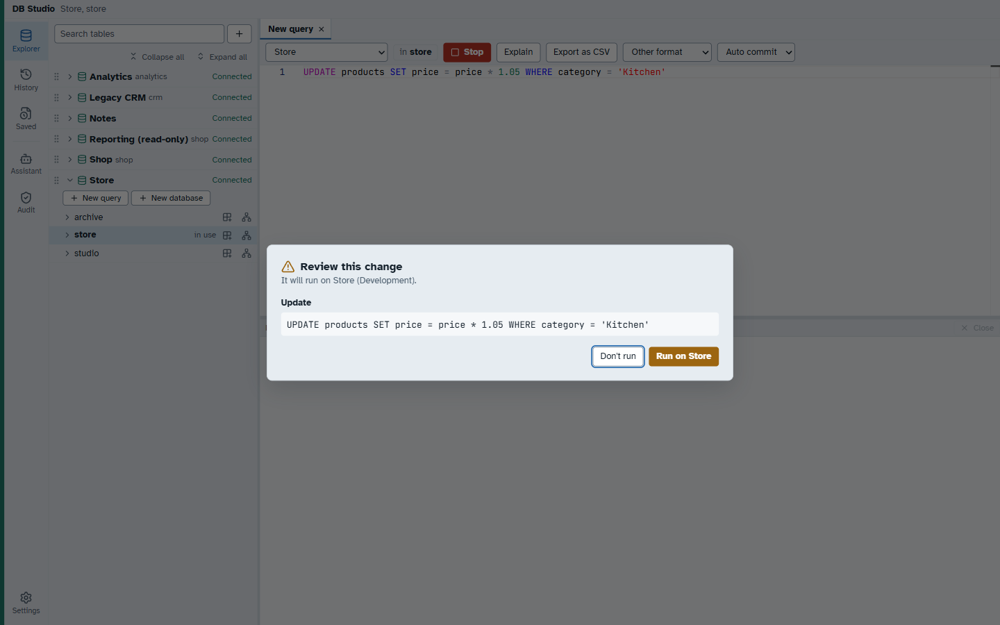
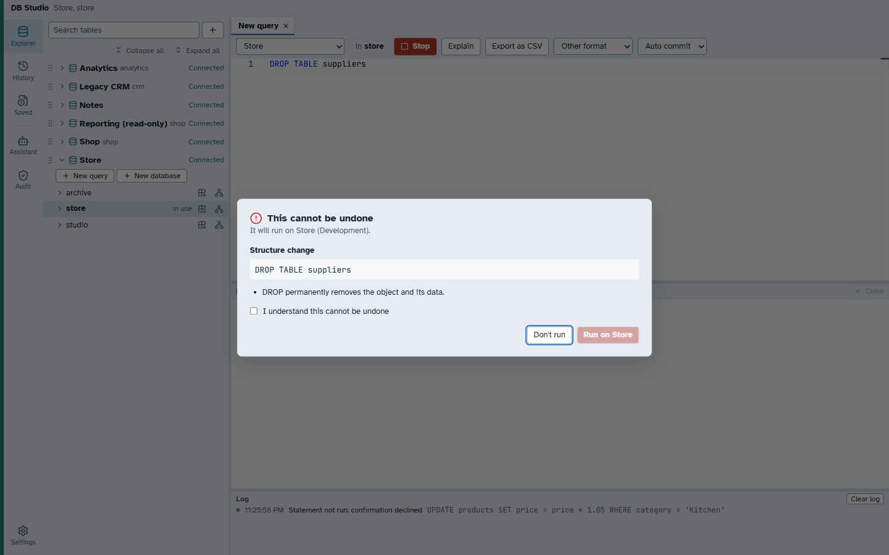
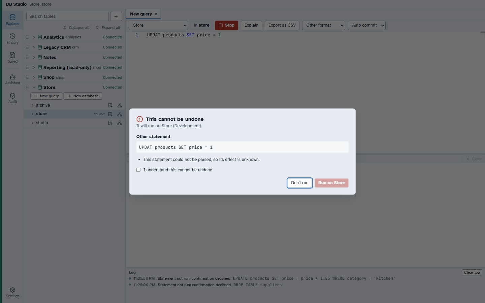
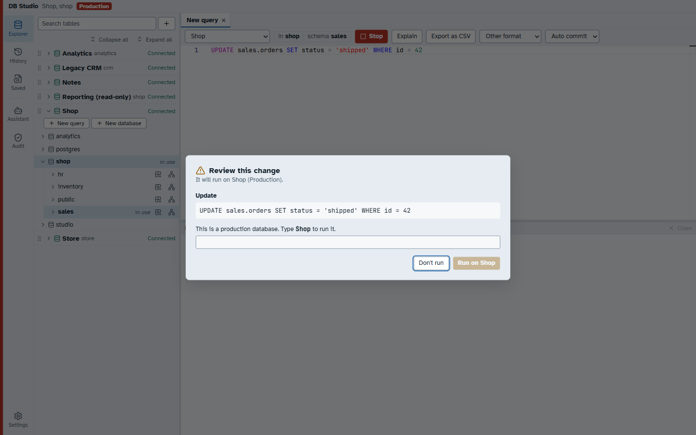
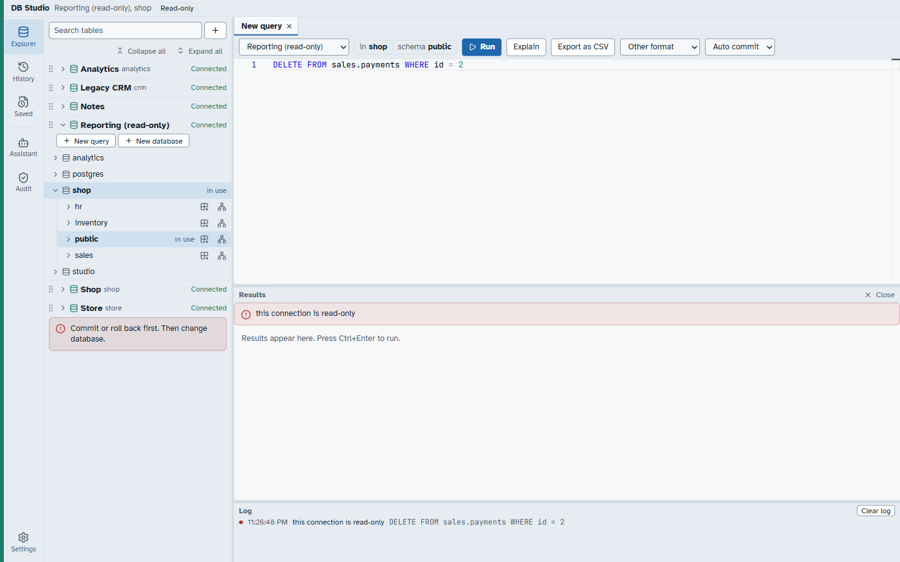
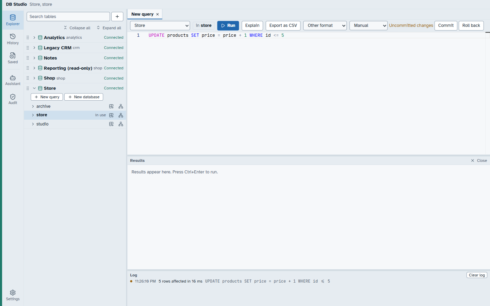
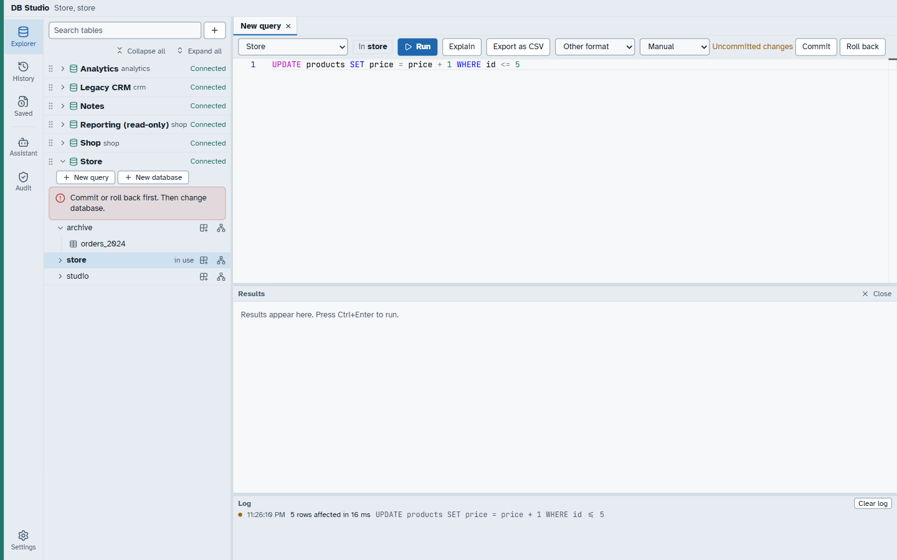
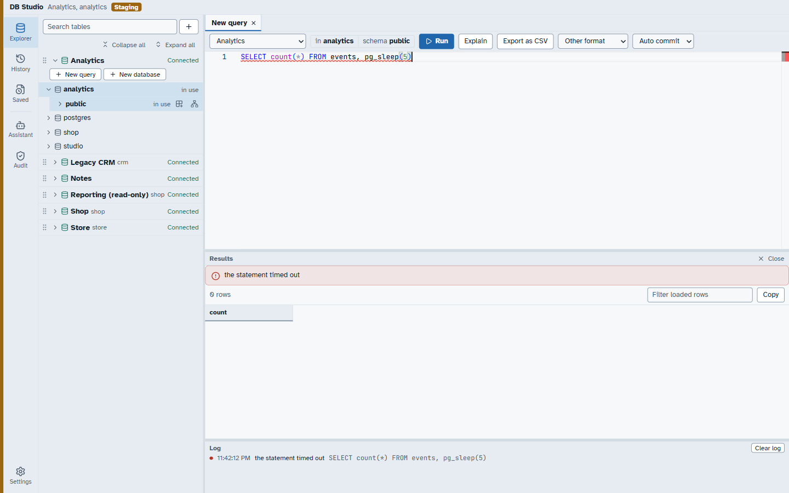

# Reviews and safety

Every statement is classified in Rust before it runs. **Reads run at once; anything else opens a
review.** The review shows the exact SQL that will run, what kind of statement it is, and which
connection and environment it targets.

## Risk levels

=== "Change"

    { .shot }

    Inserts, updates and deletes. Click **Run on *connection*** to approve, or **Don't run**.

=== "Danger"

    { .shot }

    Statements that cannot be undone stay locked until you tick **I understand this cannot be
    undone**: `DROP`, `TRUNCATE`, `ALTER … DROP`, `GRANT`/`REVOKE`, and an `UPDATE` or `DELETE`
    without `WHERE`.

=== "Unparsed"

    { .shot }

    SQL that does not parse is **treated as a write** and reviewed. It never runs unseen.

## Production

On a Production connection you type the connection's name before **Run** unlocks.

{ .shot }

## Read-only connections

A read-only connection refuses every change, even after approval. The refusal comes from the
session in Rust, not from the interface.

{ .shot }

## Transactions

**Auto commit** (the default) commits each statement. **Manual** keeps changes in one transaction
until you press **Commit** or **Roll back**; the toolbar shows *Uncommitted changes*.

{ .shot }

While a manual transaction has uncommitted work, switching database or schema is refused, and
typed `COMMIT` / `ROLLBACK` statements are refused so the app's state cannot drift.

{ .shot }

## Limits

**Settings → Results and queries** sets a statement time limit and a row limit for your own
queries. The assistant has its own, shorter limits.

{ .shot }

!!! info "How approvals work"
    Approving mints a random, single-use token that expires after 60 seconds and is bound to the
    SHA-256 of the exact SQL and to the session. Rust removes the token before comparing it. See
    the [safety engine](../architecture/safety-engine.md).
