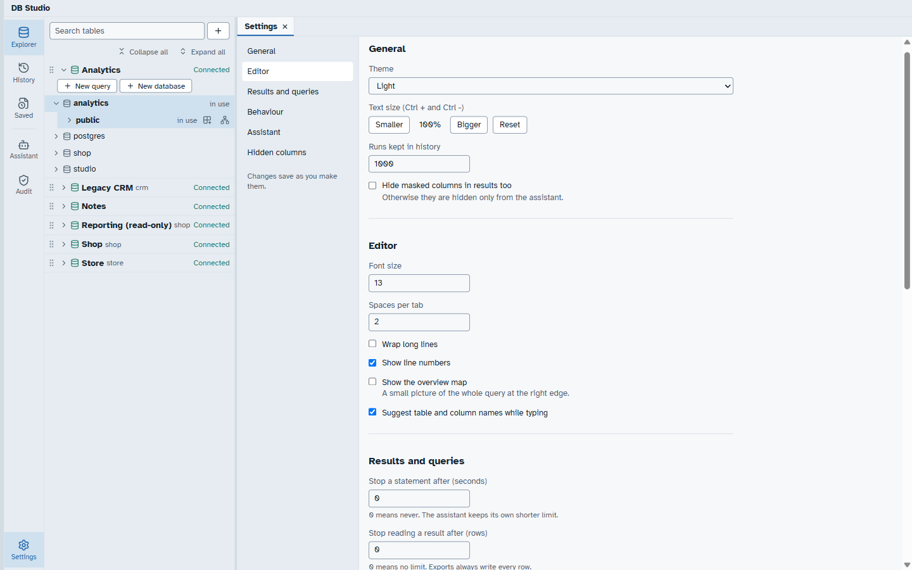
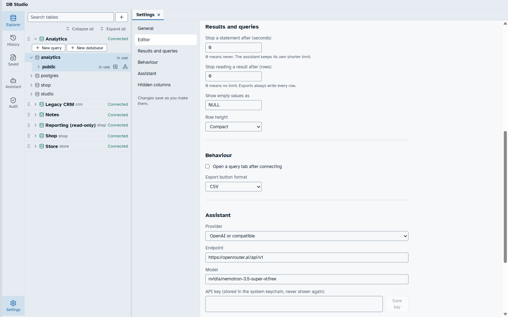
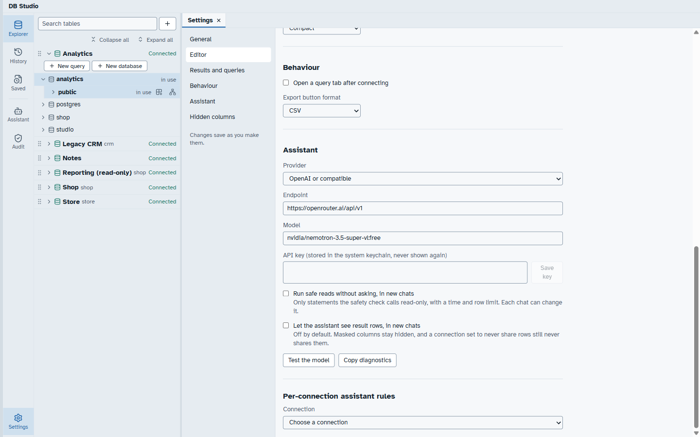
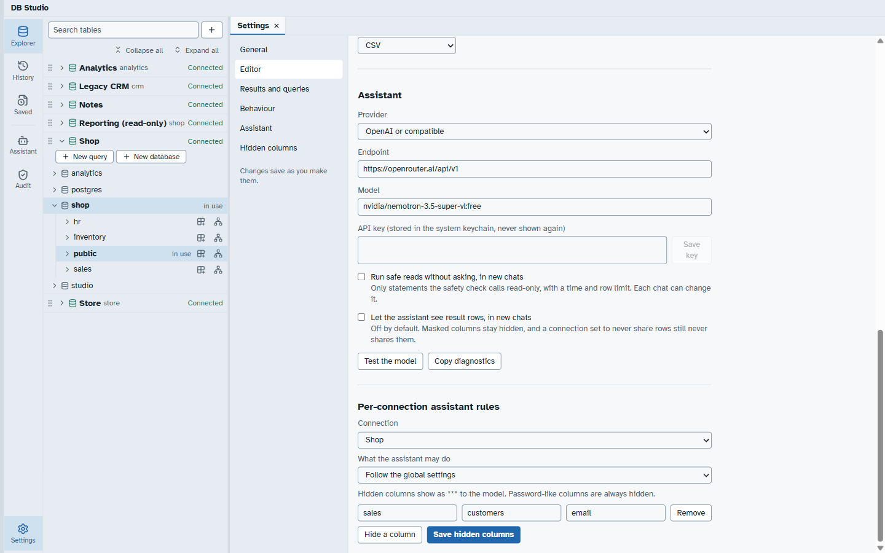
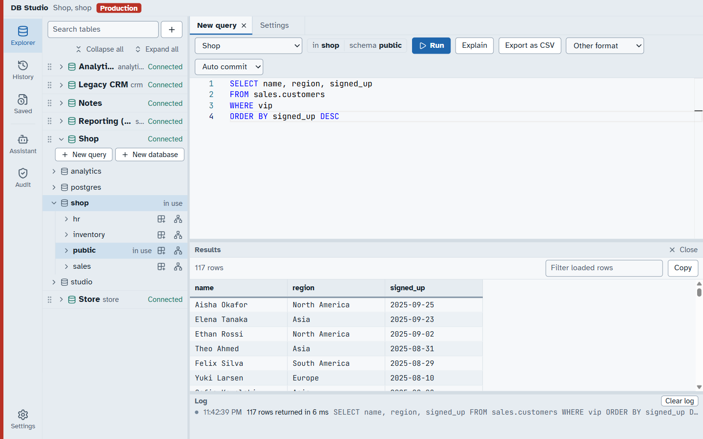

# Settings

Open with the gear in the left bar or ++ctrl+comma++. Changes save as you make them (the API key
has its own **Save key** button). Every field is listed in the [settings reference](../reference/settings.md).

=== "General and editor"

    { .shot }

    Theme (system, light, dark), text size, history size, masking in results, and the editor's
    font size, tab size, wrapping, line numbers, overview map and suggestions.

=== "Results and behaviour"

    { .shot }

    A time limit and a row limit for **your** queries (0 means none), the text shown for NULL,
    row height, opening a query tab on connect, and the Export button's format.

=== "Assistant"

    { .shot }

    Provider, endpoint and model. The API key is stored in the system keychain and never shown
    again. Defaults for *run safe reads* and *share rows* apply to new chats.

=== "Per connection"

    { .shot }

    What the assistant may do on each connection (follow the global settings, local models only,
    never share rows, or off), and **hidden columns** by schema, table and column. Columns whose
    names look like passwords, secrets or tokens are always hidden.

## Text size

Use **Bigger / Smaller / Reset**, ++ctrl+plus++ / ++ctrl+minus++ / ++ctrl+0++, or the command
palette. It scales the whole window.

{ .shot }
