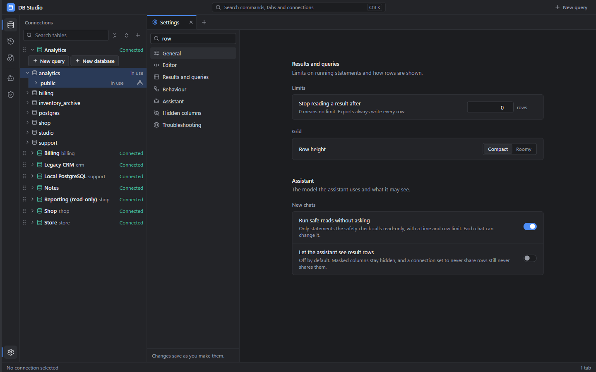
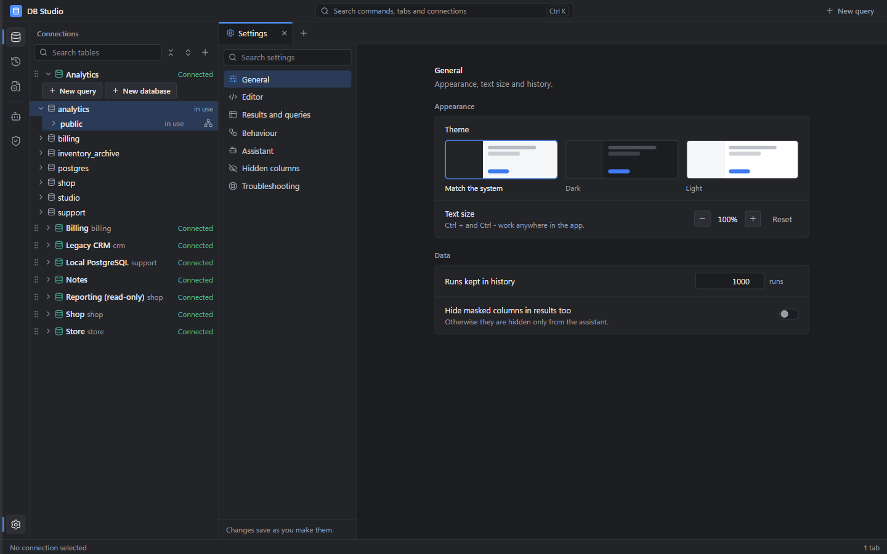
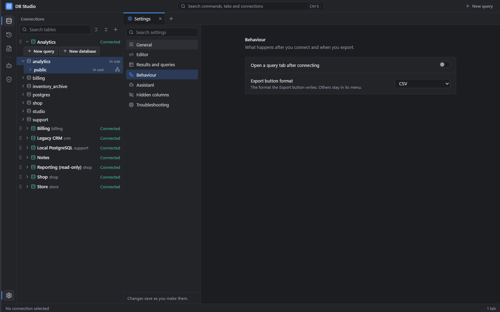
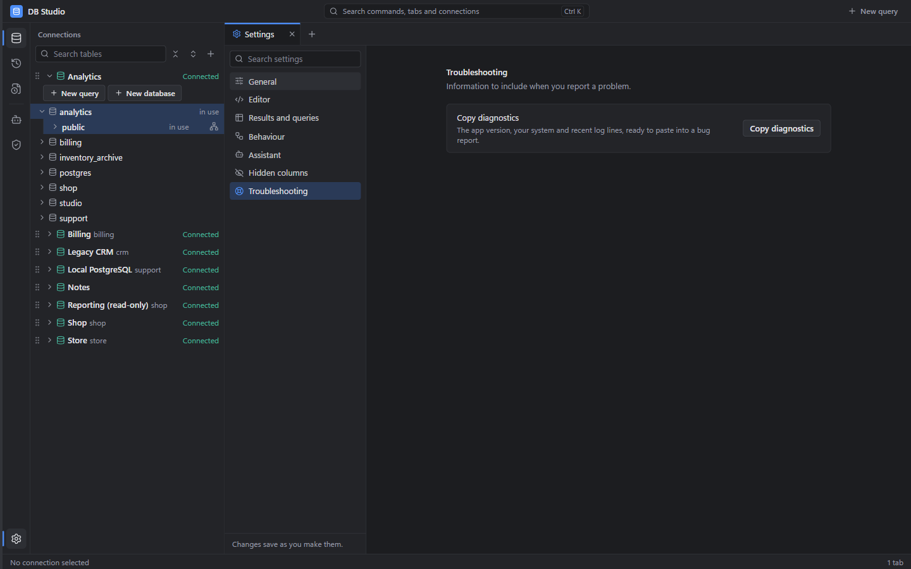
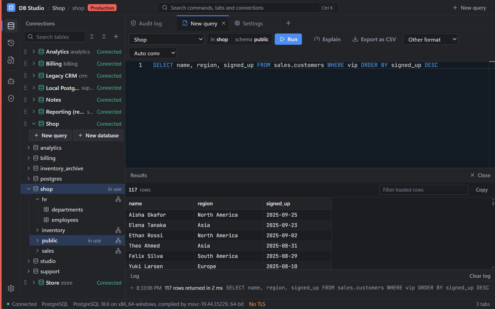

# Settings

Open with the gear in the left bar or ++ctrl+comma++. Changes save as you make them (*Changes save
as you make them* at the bottom of the list, then *Saved*). The API key has its own **Save key**
button. Every field is listed in the [settings reference](../reference/settings.md).

## Find a setting

Type in **Search settings** to show only the matching settings, from every section at once:

{ .shot loading=lazy }

## Sections

=== "General"

    { .shot loading=lazy }

    - **Theme**: *Match the system*, *Dark* or *Light* (see [Light and dark](themes.md)).
    - **Text size**: − / + / Reset (also ++ctrl+plus++ / ++ctrl+minus++ anywhere).
    - **Runs kept in history**: 1000 by default.
    - **Hide masked columns in results too**: otherwise they are hidden only from the assistant.

=== "Editor"

    { .shot loading=lazy }

    Font size, spaces per tab, wrapping long lines, line numbers, the overview map (a small
    picture of the whole query at the right edge), and table and column suggestions while typing.

=== "Results and queries"

    { .shot loading=lazy }

    - **Stop a statement after** *n* seconds (0 means never). The assistant keeps its own
      shorter limit.
    - **Stop reading a result after** *n* rows (0 means no limit). Exports always write every
      row.
    - **Show empty values as**: the text shown for NULL.
    - **Row height**: *Compact* or *Roomy*.

=== "Behaviour"

    { .shot loading=lazy }

    Whether connecting opens a query tab, and which format the **Export** button writes (others
    stay in its menu).

=== "Assistant"

    { .shot loading=lazy }

    Provider, endpoint, model and API key, **Test the model**, and the defaults for new chats.
    See [AI assistant](assistant.md#1-set-up-a-provider).

=== "Hidden columns"

    { .shot loading=lazy }

    Per-connection rules for what the assistant may read:

    - **What the assistant may do** on this connection: *Follow the global settings*, *Local
      models only*, *Never send rows*, or *Off*.
    - **Columns hidden from the assistant**, by schema, table and column. **Hide a column** adds
      a row, and **Save hidden columns** stores them. Hidden columns show as `***` to the model.
      Password-like columns are always hidden.

=== "Troubleshooting"

    { .shot loading=lazy }

    **Copy diagnostics** copies the app version, your system and recent log lines, ready to paste
    into a bug report.

## Masked columns in the grid

With *Hide masked columns in results too* on, masked columns are hidden in grids and results as
well. A padlock marks them, and the values show as `***`:

{ .shot loading=lazy }

## Text size

Use **− / + / Reset** in General, ++ctrl+plus++ / ++ctrl+minus++ / ++ctrl+0++, or the command
palette. It scales the whole window.

{ .shot loading=lazy }
