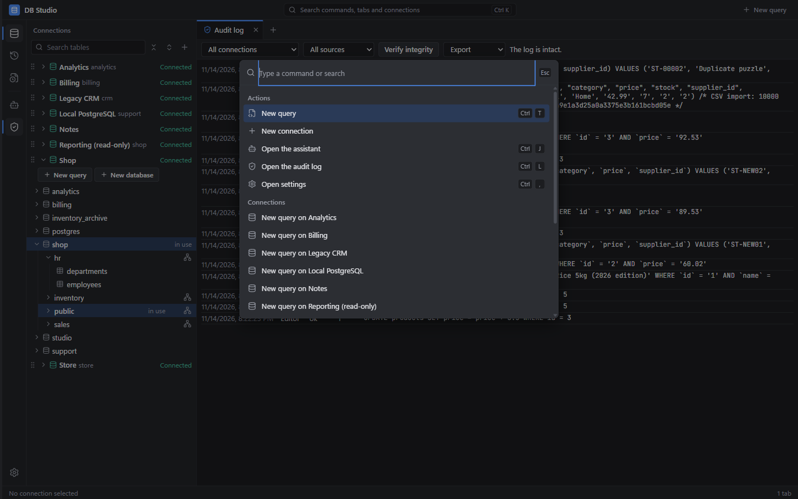
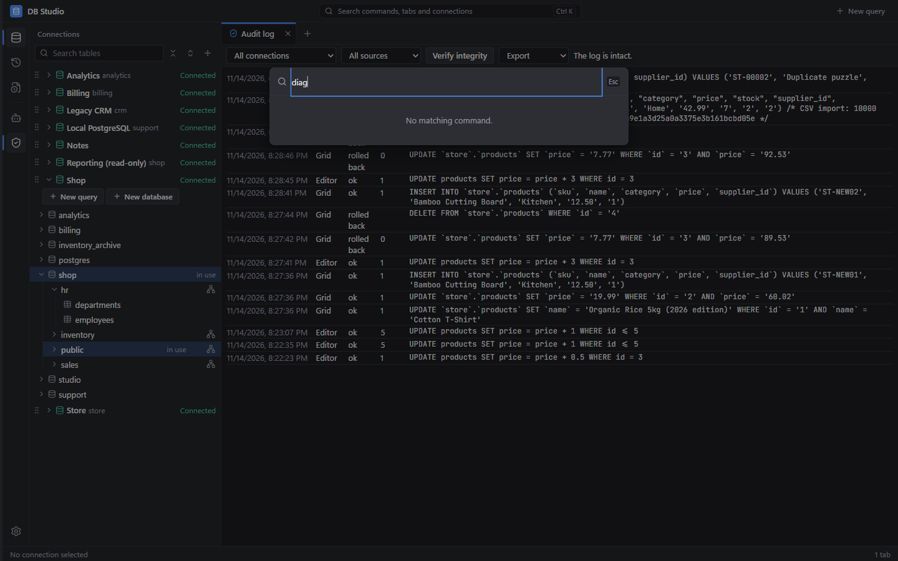

# Keyboard shortcuts

On macOS use ++cmd++ in place of ++ctrl++.

## Command palette

Press ++ctrl+k++, or click the search box in the title bar (*Search commands, tabs and
connections*). It lists **Actions** (new query, new connection, open the assistant, the audit log
or settings, with their shortcuts) and a **New query on …** entry for every connection. Type to
narrow the list. ++esc++ closes it.

| All commands | Typing to search |
|---|---|
| { .shot loading=lazy } | { .shot loading=lazy } |

## Anywhere

| Keys | Action |
|---|---|
| ++ctrl+k++ | Command palette |
| ++ctrl+t++ | New query tab |
| ++ctrl+w++ | Close the active tab |
| ++ctrl+1++ … ++ctrl+4++ | Go to tab 1–4 |
| ++ctrl+b++ | Show or hide the side panel |
| ++ctrl+j++ | Open the assistant |
| ++ctrl+l++ | Open the audit log |
| ++ctrl+comma++ | Open settings |
| ++ctrl+plus++ / ++ctrl+minus++ / ++ctrl+0++ | Bigger, smaller, reset text size |

## SQL editor and results

| Keys | Action |
|---|---|
| ++ctrl+enter++ | Run (the selection, if any) |
| ++ctrl+space++ | Show completions |
| ++ctrl+a++ / ++esc++ | Select all rows / clear the selection (in results) |

## Table grid

| Keys | Action |
|---|---|
| Arrow keys | Move between cells |
| ++enter++ / ++f2++ | Edit the cell |
| ++enter++ / ++tab++ / ++shift+tab++ | Keep the value and move down / right / left |
| ++esc++ | Cancel the edit |
| ++alt+n++ | Set NULL |

## Assistant

| Keys | Action |
|---|---|
| ++enter++ | Send |
| ++shift+enter++ | New line |

## Side panel

| Keys | Action |
|---|---|
| ++shift+f10++ or ++menu++ | Open the menu of a database or schema |
| ++alt+up++ / ++alt+down++ | Move a connection (on its grip) |
