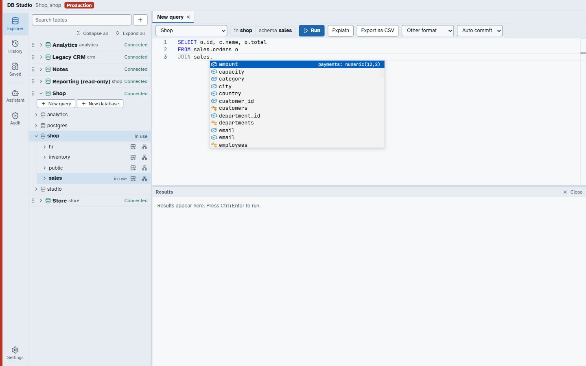
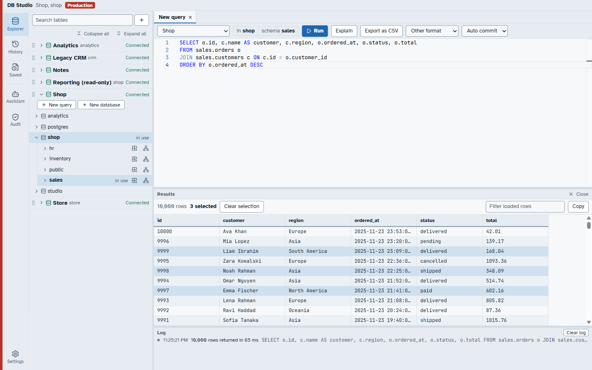
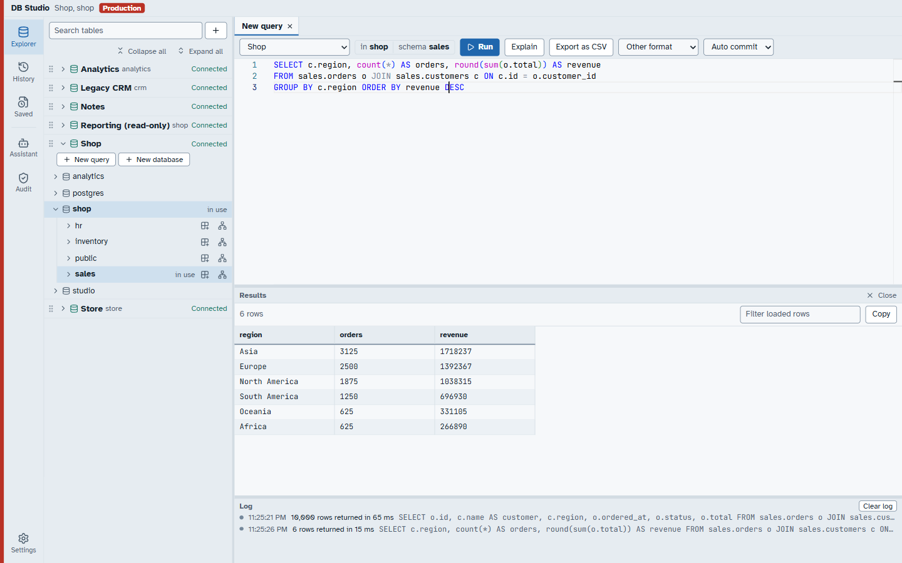
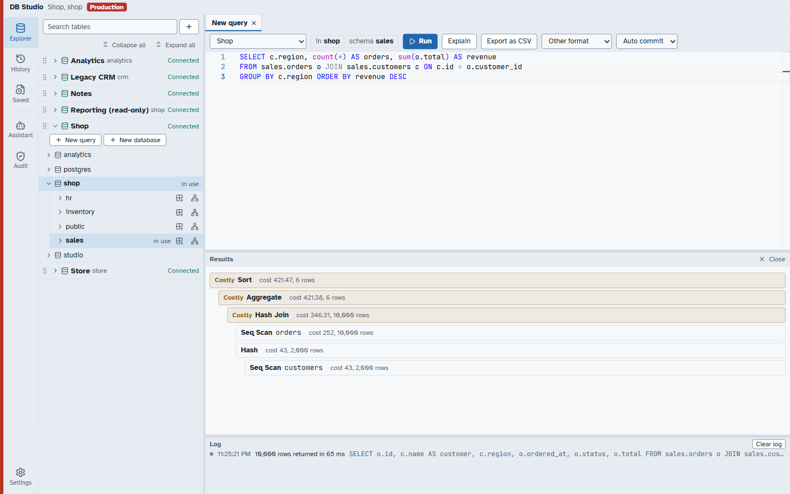
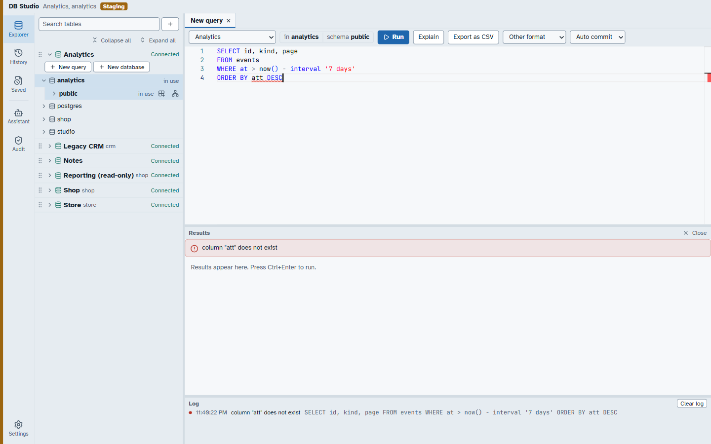
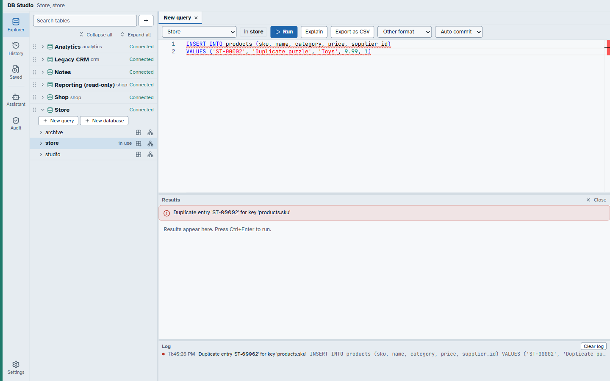
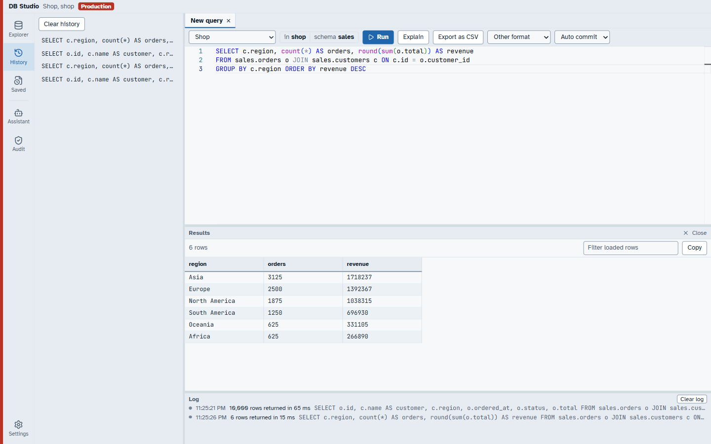
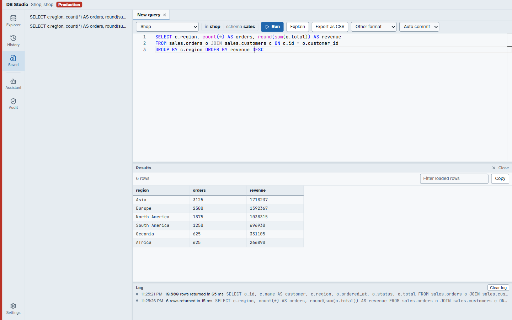

# SQL editor

Each SQL tab has its own editor, connection and results. The toolbar shows where it runs
(*in shop · schema sales*).

{ .shot }

## Writing SQL

- **Completion** suggests the tables and columns of the database in use (turn it off in Settings).
- **Run** with ++ctrl+enter++. With a selection, only the selected text runs.
- **Several statements** run in order and stop at the first error; each gets its own result and
  log line.
- **Drafts** save automatically and appear under *Saved queries*.

## Results

{ .shot }

- Rows stream into a **virtual grid**, so very large results stay responsive (a million rows has
  been measured at about 7 seconds with under 25 ms of UI stall).
- **Filter loaded rows** searches what is already on screen; **Copy** copies it.
- **Select rows** with click, ++ctrl++ + click and ++shift++ + click; ++ctrl+a++ selects all and
  ++esc++ clears. Export then writes only the selected rows.
- **Close** hides the results until the next run.

{ .shot }

## The run log

Under the results, one line per statement: time, rows, duration and the SQL. Errors are red,
changes amber.

{ .shot }

## Explain

**Explain** shows the plan as a tree. Steps that cost more than their share are marked *Costly*.

{ .shot }

## Errors

Database errors are shown exactly as the server reports them, and the position is underlined in
the editor.

{ .shot }

Constraint errors name the key that was violated; the run log keeps the failed statement:

{ .shot }

## History and saved queries

| History | Saved queries |
|---|---|
| { .shot } | { .shot } |
