# SQL editor

Each SQL tab has its own editor, connection, results and run log. The toolbar shows where the tab
runs (*in shop · schema public*). The title bar names the connection and database, and the status
bar shows the engine, server version and TLS state.

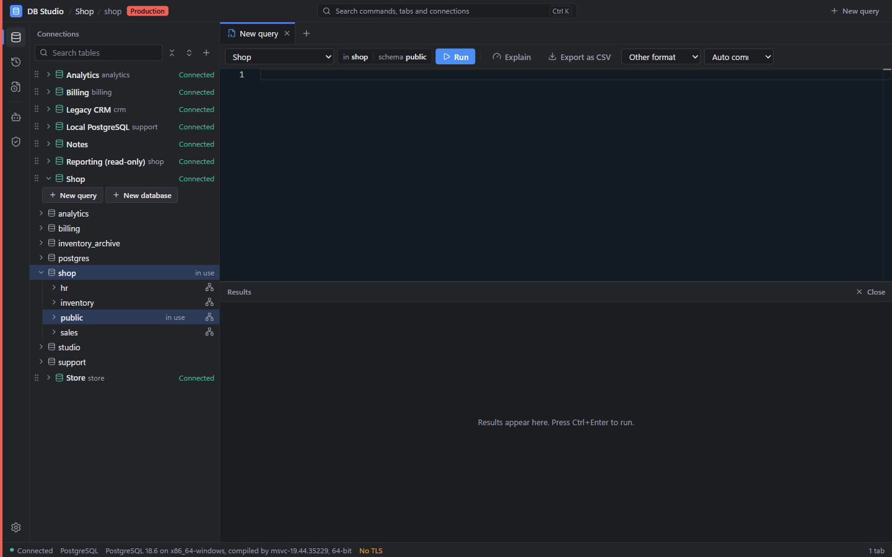{ .shot loading=lazy }

## Workflow at a glance

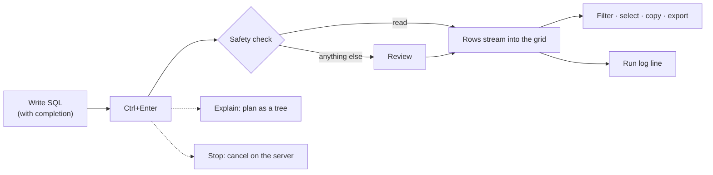

## The toolbar

| Control | What it does |
|---|---|
| **Connection** | Which connection this tab runs on. |
| **in … · schema …** | The database and schema in use. Change them from the side panel. |
| **Run** / **Stop** | Runs the editor's SQL (or the selection). While a statement runs, the button turns into **Stop**. |
| **Explain** | Shows the plan without running the statement. |
| **Export as CSV** | Exports the result in the format chosen in Settings. **Other format** picks another. |
| **Auto commit / Manual** | The [transaction mode](safety.md#transactions). |

## Writing SQL

Completion suggests the tables and columns of the database in use, and you can turn it off in
Settings → Editor.

| Tables | Columns |
|---|---|
| 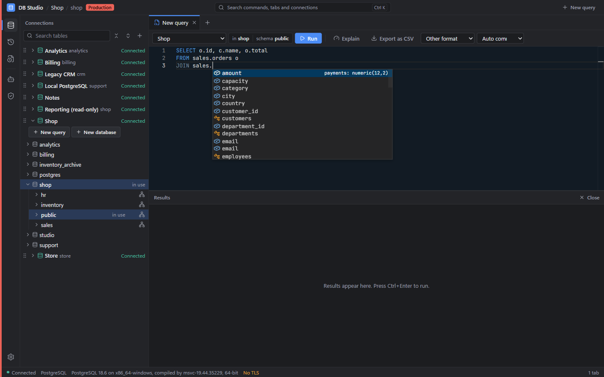{ .shot loading=lazy } | 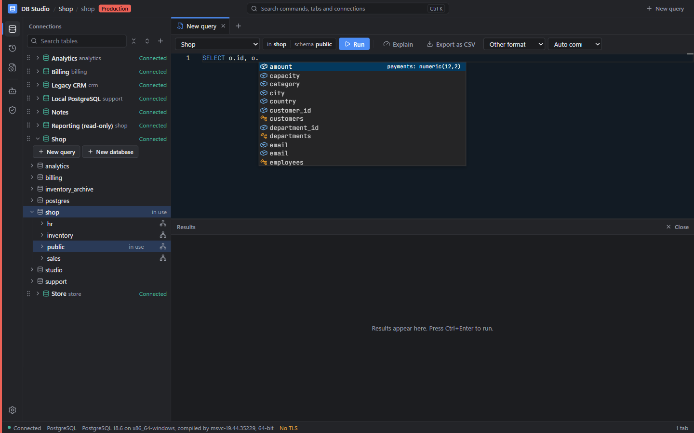{ .shot loading=lazy } |

- **Run** with ++ctrl+enter++. With a selection, only the selected text runs.
- **Drafts** save automatically and appear under [*Saved queries*](#history-and-saved-queries).

## Results

{ .shot loading=lazy }

- Rows stream into a **virtual grid**, so very large results stay responsive. A million rows has
  been measured at about 7 seconds with under 25 ms of UI stall.
- The bar above the grid counts the rows. **Close** hides the results until the next run.

### Select, filter and copy

| Select rows | Filter loaded rows |
|---|---|
| 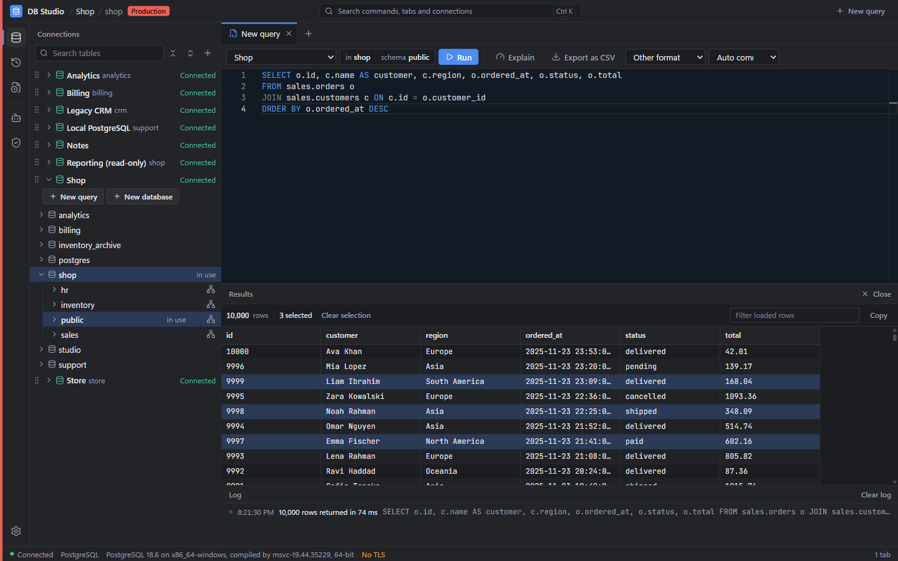{ .shot loading=lazy } | 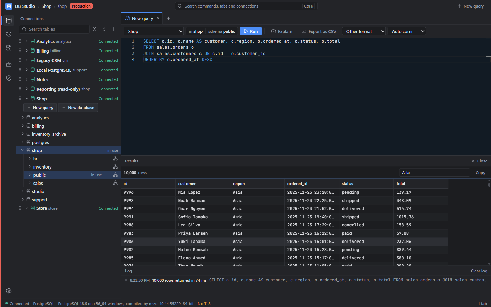{ .shot loading=lazy } |

- **Select rows** with click, ++ctrl++ + click and ++shift++ + click. ++ctrl+a++ selects all
  and ++esc++ clears. Copy and export then use only the selected rows.
- **Filter loaded rows** searches what is already on screen, in every column.
- **Copy** copies what is shown.

### Several statements

Several statements run in order and stop at the first error. Each one gets its own **Result** tab
and its own log line.

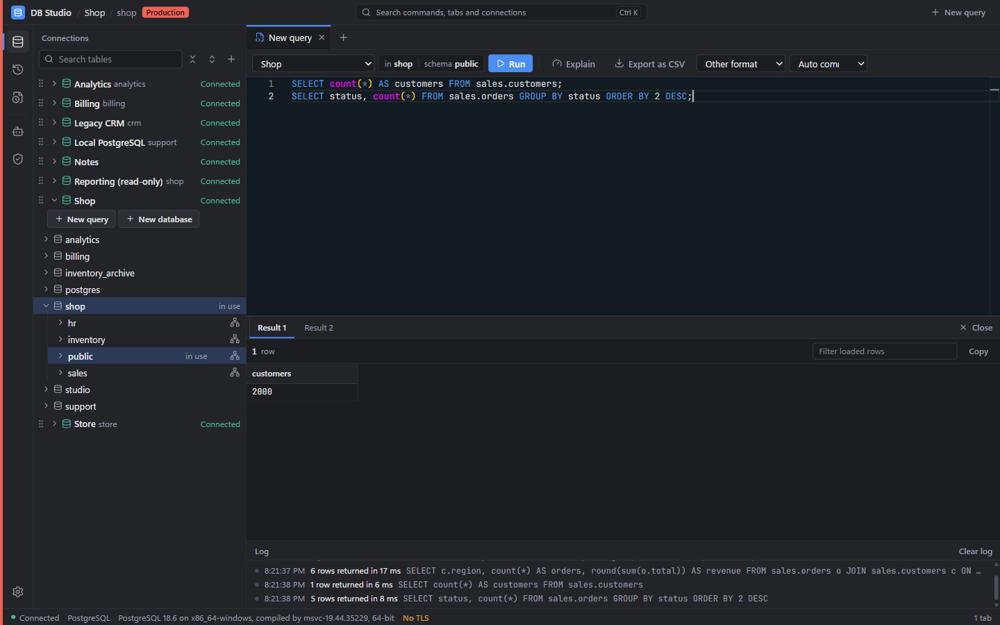{ .shot loading=lazy }

### Export

**Export as CSV** (or the format set in Settings) writes the selected rows, else the filtered rows,
else the whole result. **Other format** offers CSV, JSON lines, Excel and SQL inserts. See
[Import and export](import-export.md).

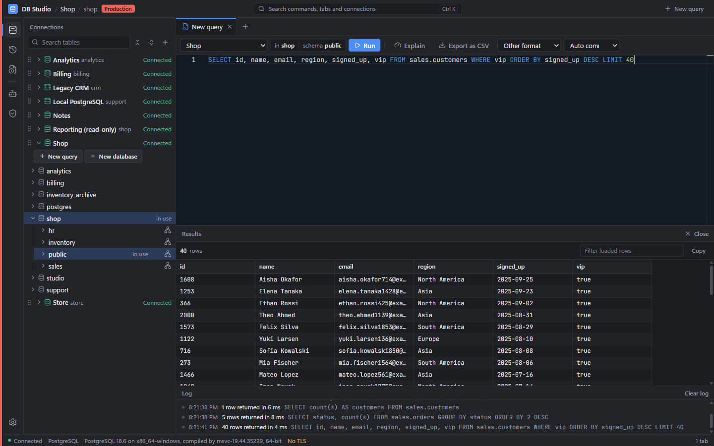{ .shot loading=lazy }

## The run log

Under the results, one line per statement: time, outcome, rows, duration and the SQL. Errors are
red, changes amber. Statements you declined in a review are logged as *Statement not run:
confirmation declined*. **Clear log** empties it.

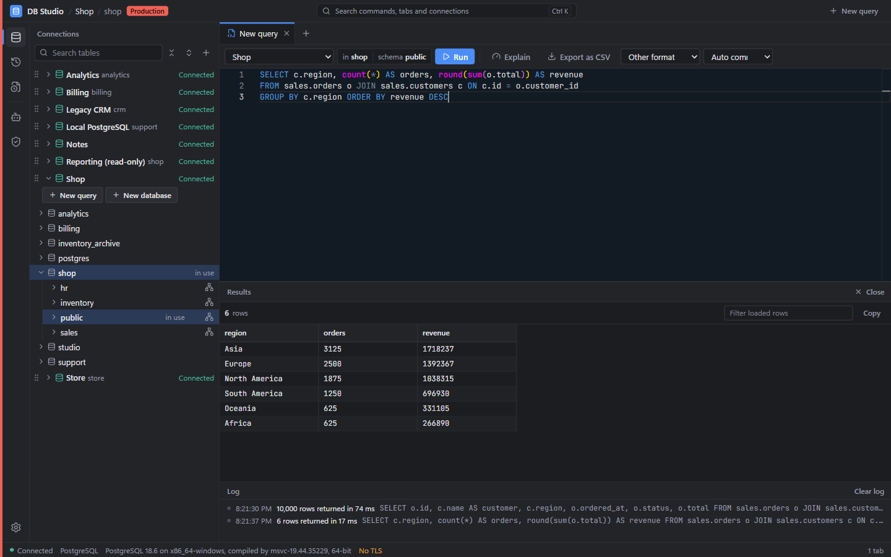{ .shot loading=lazy }

## Explain

**Explain** shows the plan as a tree, with the estimated cost and rows of each step. Steps that
cost more than their share are marked *Costly*.

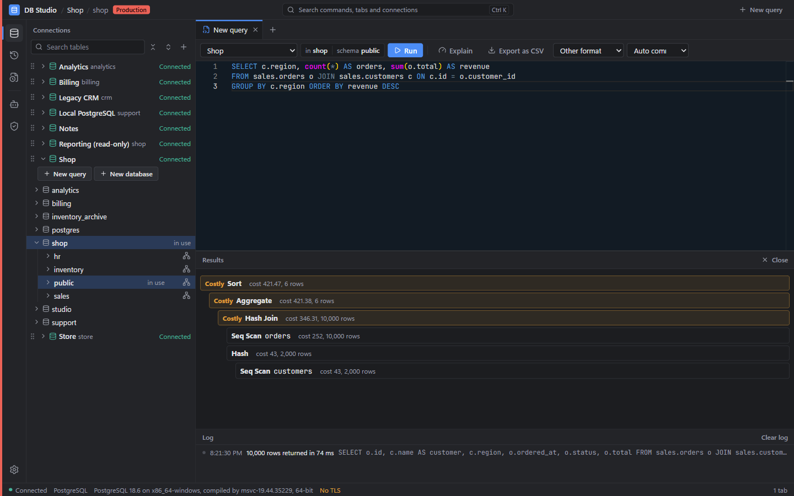{ .shot loading=lazy }

## Stop a running statement

While a statement runs, the results show *Fetching* and both **Stop** buttons are live. Stopping
cancels on the server (a cancel request on PostgreSQL, `KILL QUERY` on MySQL), and the log says
*Stopped*.

| Running | Stopped |
|---|---|
| 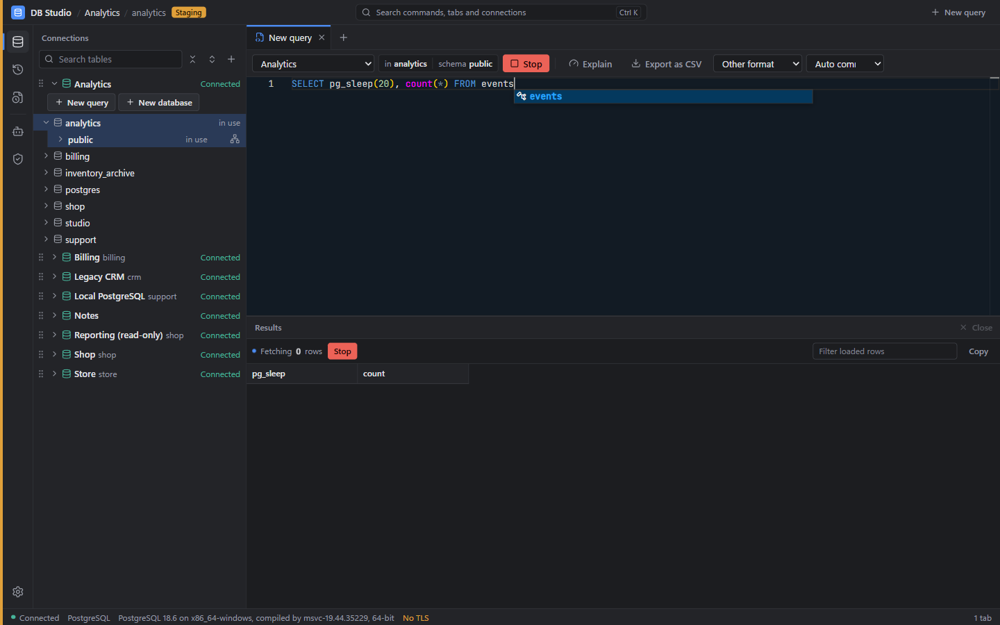{ .shot loading=lazy } | 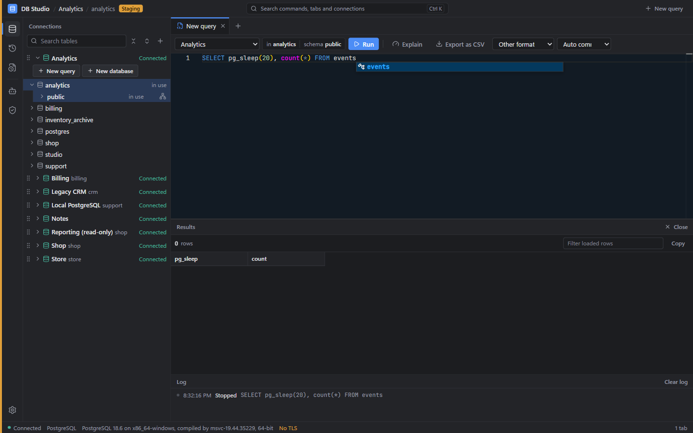{ .shot loading=lazy } |

## Other engines

The editor works the same way on every engine:

| MySQL | SQLite |
|---|---|
| 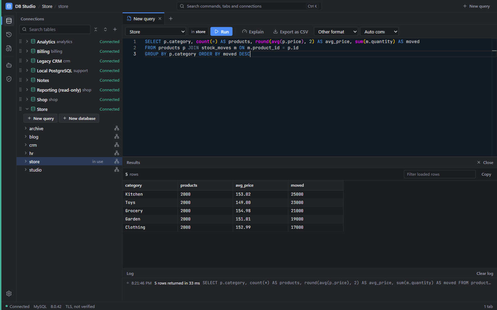{ .shot loading=lazy } | 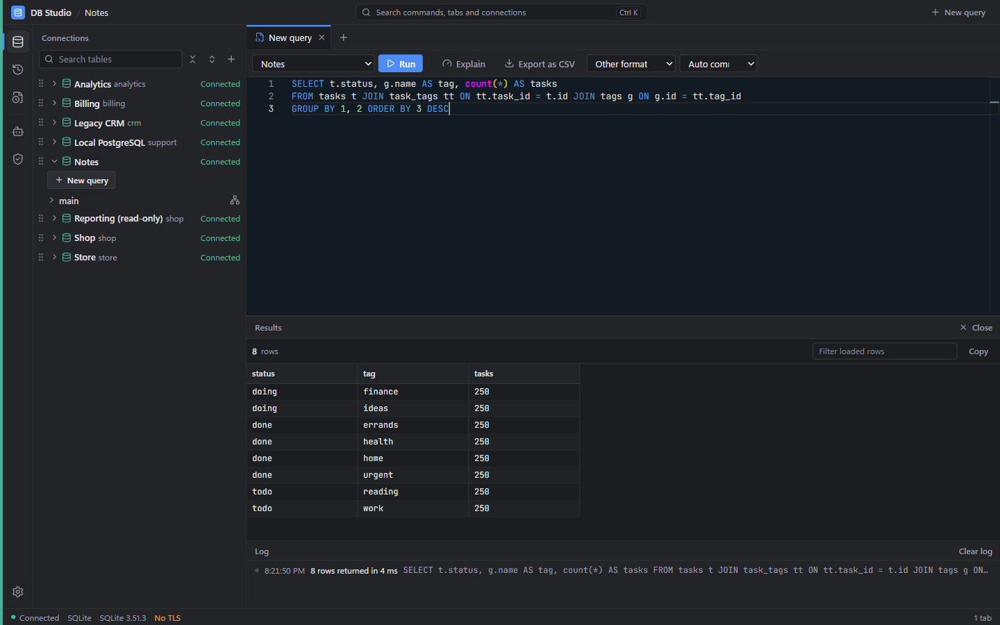{ .shot loading=lazy } |

## Errors

Database errors are shown exactly as the server reports them. When the server gives a position,
it is underlined in the editor. See [Troubleshooting](troubleshooting.md#query-errors) for more
examples.

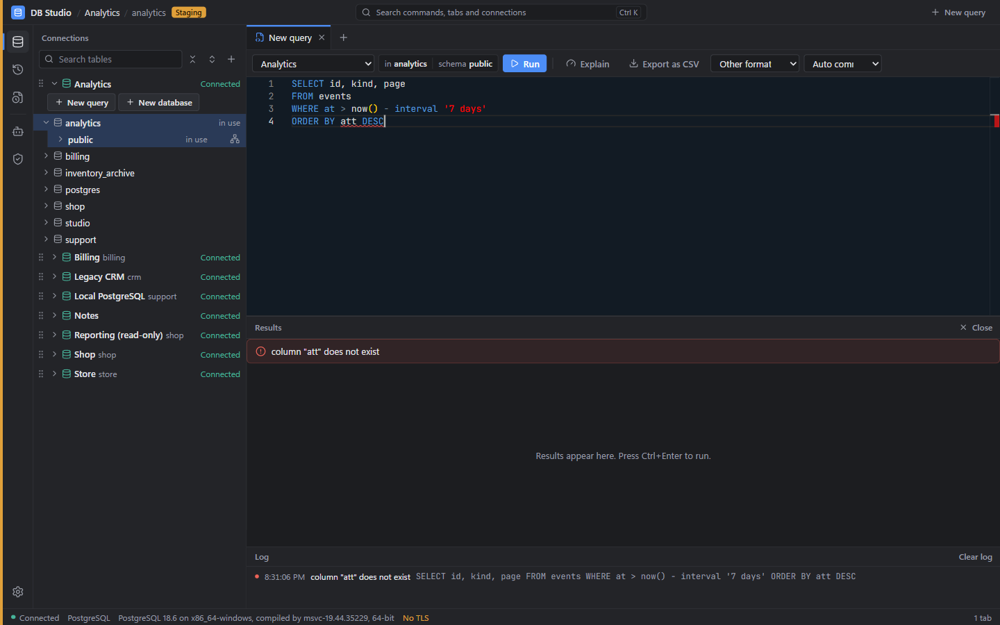{ .shot loading=lazy }

## History and saved queries

The left bar's **History** lists recent runs (the number kept is set in Settings → General).
**Saved queries** lists your drafts.

| History | Saved queries |
|---|---|
| 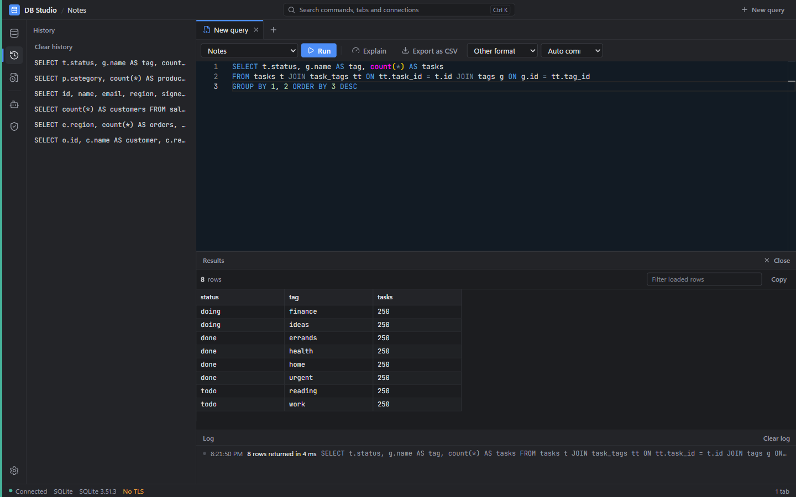{ .shot loading=lazy } | 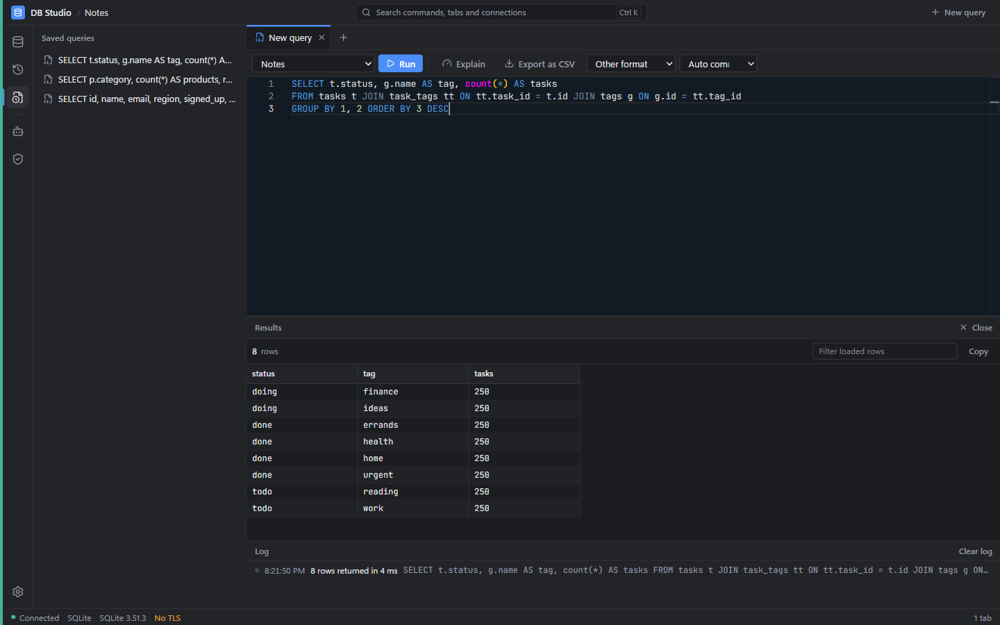{ .shot loading=lazy } |
