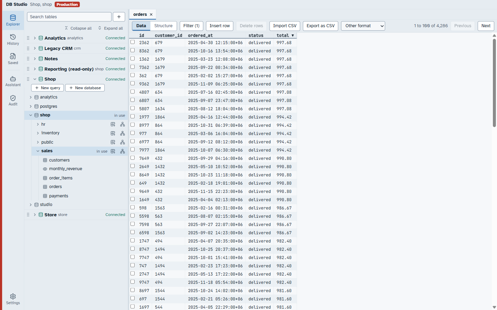
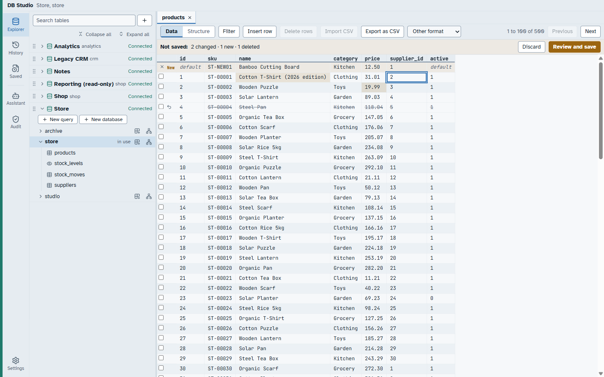
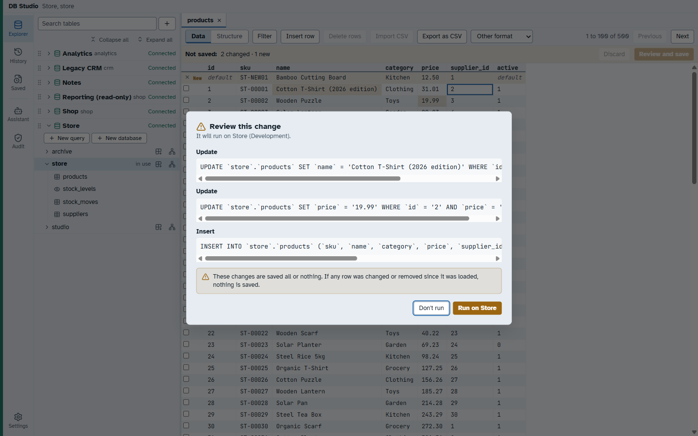
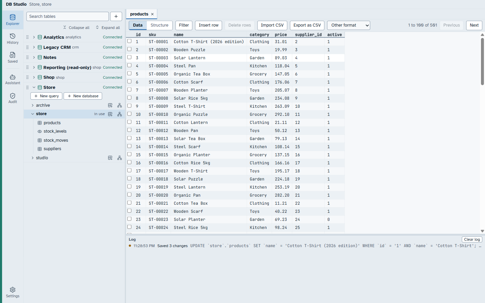
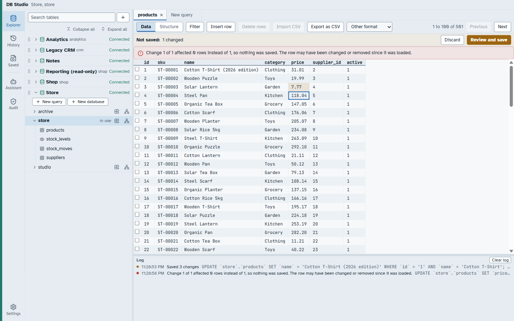
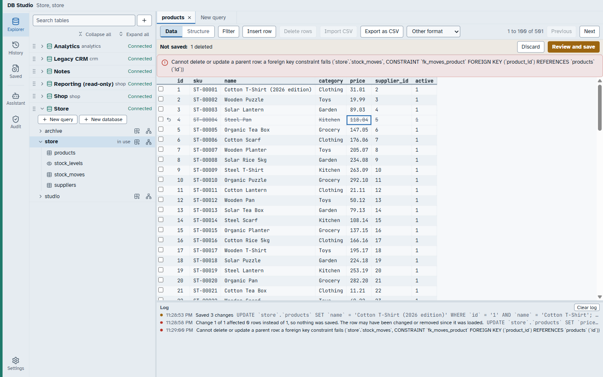
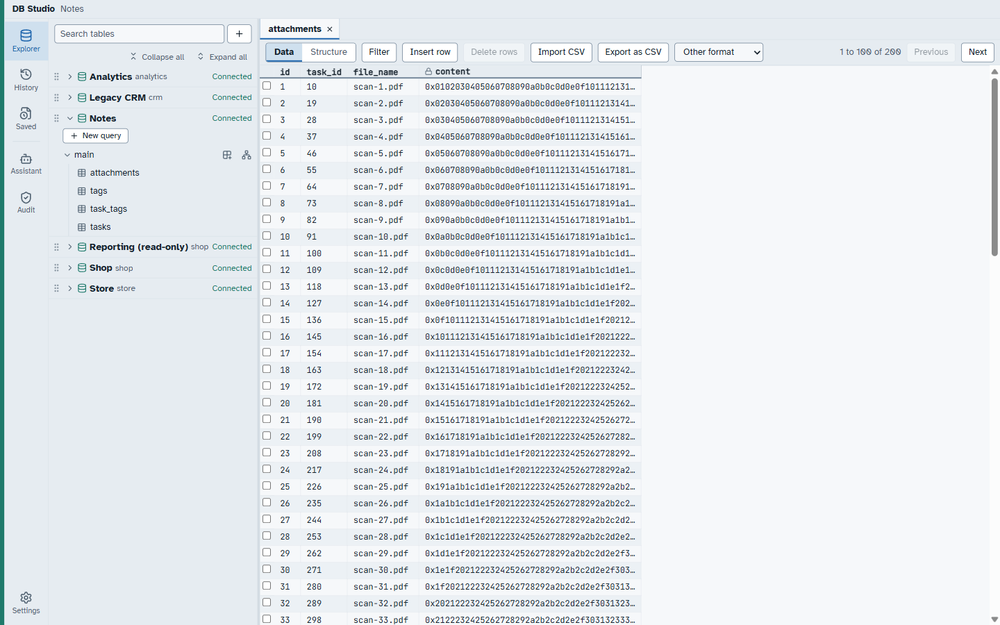
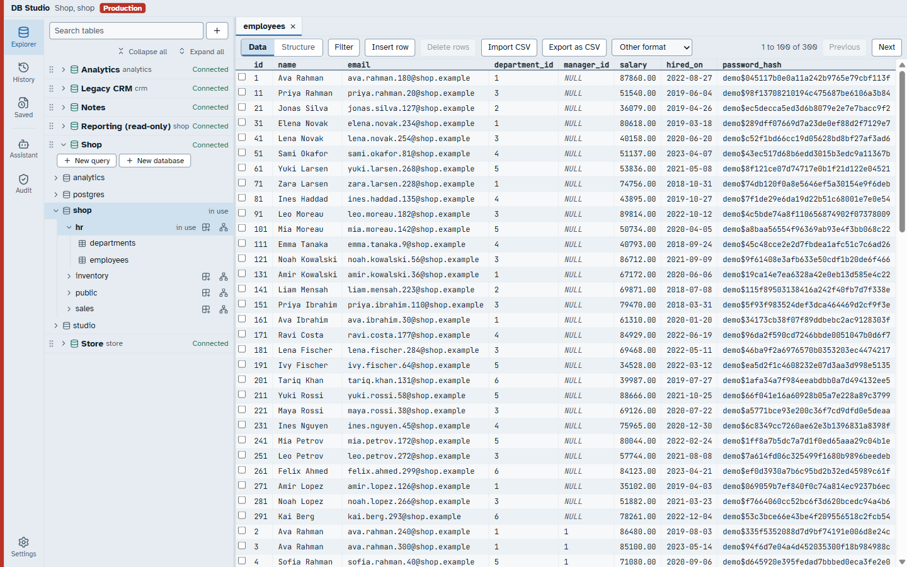
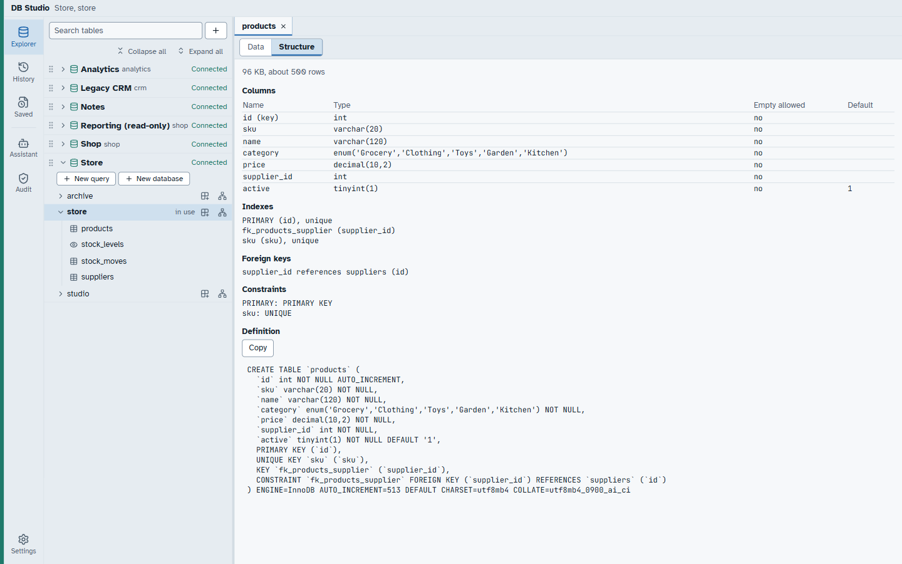

# Tables and inline editing

Click a table in the side panel to open it. The **Data** view pages through rows on the server
(100 at a time); **Structure** shows its definition.

{ .shot }

- **Filter** builds conditions (equals, contains, starts with, greater than, is empty, …).
- Click a **column header** to sort; click again to reverse.
- **Previous / Next** page through; the count shows the total.

## Editing in place

Tables with a primary key can be edited directly in the grid.

| Action | How |
|---|---|
| Edit a cell | Double-click, or press ++enter++ / ++f2++ on it |
| Keep and move on | ++enter++ (down) or ++tab++ (right) |
| Cancel | ++esc++ |
| Set NULL | The **NULL** button, or ++alt+n++ |
| Add a row | **Insert row** (new rows appear at the top) |
| Delete rows | Select them, then **Delete rows** |
| Undo one change | Right-click → **Revert cell** / **Revert row** |

Nothing is saved yet: changed cells are tinted, new rows marked *New*, deleted rows struck through,
and a bar counts what is pending.

{ .shot }

**Review and save** shows every statement in one review. They run **all or nothing**, inside a
transaction (or a savepoint, in manual mode):

{ .shot }

{ .shot }

### When a save is refused

Every statement must change **exactly one row**. Each UPDATE also matches the values you loaded, so
if someone changed the row in the meantime, nothing is saved and your edits stay pending:

{ .shot }

If the database refuses a statement (here a foreign key), the whole save is undone:

{ .shot }

### What cannot be edited

- Tables **without a primary key**: the grid explains why and offers a row form instead.
- **Binary** columns: the grid holds only a 64-byte preview.
- **Masked** columns (see [Settings](settings.md)).
- Anything on a **read-only** connection.

| Binary column | Masked column |
|---|---|
| { .shot } | { .shot } |

Paging, sorting, filtering or closing the tab with pending edits asks before discarding them.

## Structure

{ .shot }

Columns, keys, indexes, foreign keys, constraints and the `CREATE` statement, with a Copy button.
