# Tables and inline editing

Click a table in the side panel to open it. The **Data** view pages through rows on the server,
100 at a time. **Structure** shows the table's definition.

## Workflow at a glance

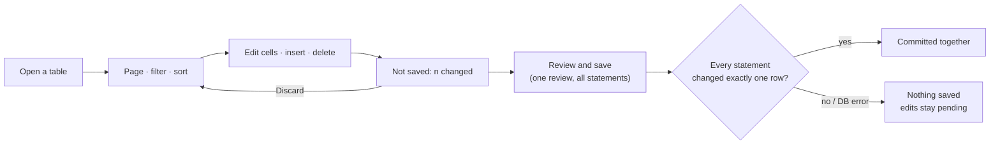

## Browsing data

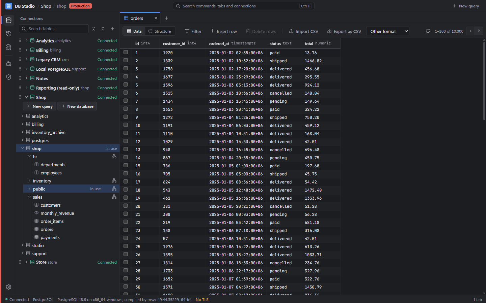{ .shot loading=lazy }

Each column header shows its name and type. The pager on the right shows the range and the total
(*1–100 of 10,000*). Use the arrows to page and the refresh button to reload.

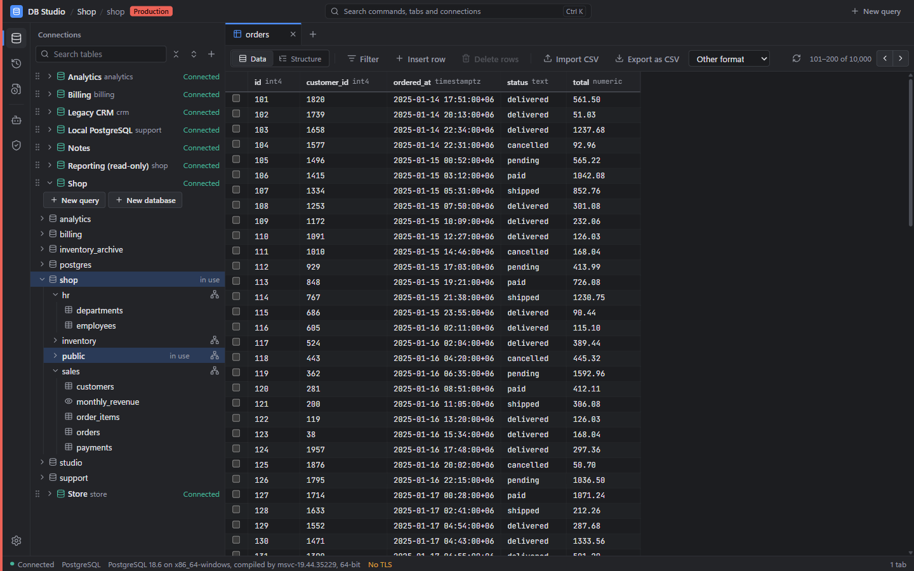{ .shot loading=lazy }

### Filter and sort

**Filter** opens a builder. Pick a column, an operator (*equals*, *contains*, *starts with*, *is
greater than*, *is empty*, …) and a value, and add as many conditions as you need. They are
combined with *and*.

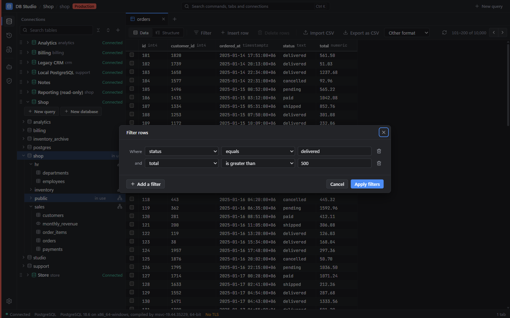{ .shot loading=lazy }

Applied filters appear as chips above the grid, and the count updates (*1–100 of 1,725*). Remove
one with its **×**, or all with **Clear filters**. Click a **column header** to sort, and click
again to reverse. An arrow marks the sorted column.

{ .shot loading=lazy }

The same view works on every engine. Here is a MySQL table:

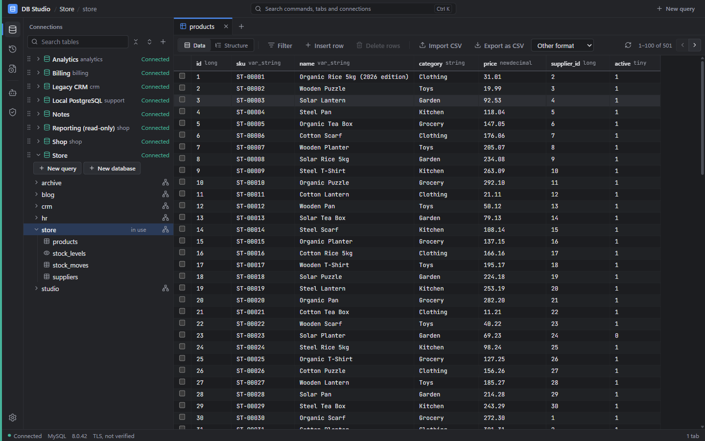{ .shot loading=lazy }

## Editing in place

Tables with a primary key can be edited directly in the grid.

| Action | How |
|---|---|
| Edit a cell | Double-click, or press ++enter++ / ++f2++ on it |
| Keep and move on | ++enter++ (down) or ++tab++ (right) |
| Cancel | ++esc++ |
| Set NULL | The **NULL** button, or ++alt+n++ |
| Add a row | **Insert row** (new rows appear at the top, marked *New*, with *default* for unset columns) |
| Delete rows | Tick them, then **Delete rows** |
| Undo one change | Right-click → **Revert cell** / **Revert row**, or the undo arrow on a deleted row |

Nothing is saved yet. Changed cells are tinted, new rows are marked *New* and deleted rows are
struck through. A bar counts what is pending (*Not saved: 1 new · 1 deleted*) and offers
**Discard** or **Review and save**.

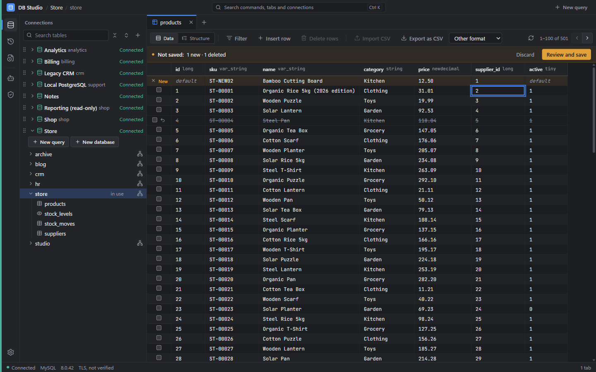{ .shot loading=lazy }

**Review and save** shows every statement in one review. They run **all or nothing**, inside a
transaction (or a savepoint, in manual mode).

| One review for the whole save | Saved |
|---|---|
| { .shot loading=lazy } | { .shot loading=lazy } |

### When a save is refused

Every statement must change **exactly one row**. Each `UPDATE` also matches the values you loaded,
so if someone changed the row in the meantime, nothing is saved and your edits stay pending:

{ .shot loading=lazy }

If the database refuses a statement (here a foreign key), the whole save is undone:

{ .shot loading=lazy }

Paging, sorting, filtering or closing the tab with pending edits asks before discarding them:

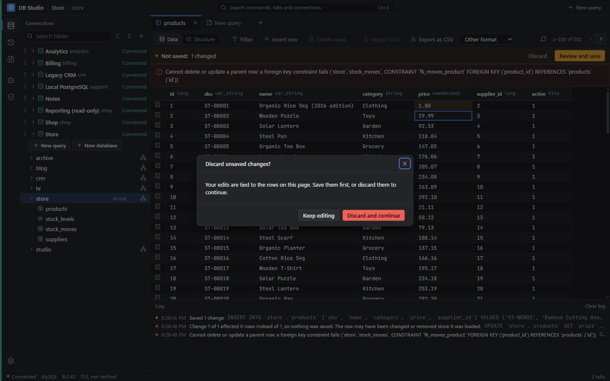{ .shot loading=lazy }

### What cannot be edited

=== "No primary key (views)"

    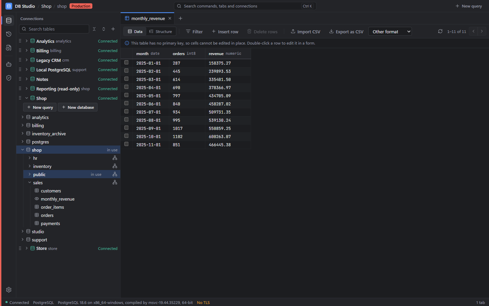{ .shot loading=lazy }

    Tables and views **without a primary key** cannot be edited cell by cell. The grid explains
    why and offers a row form instead (double-click a row).

=== "Read-only connection"

    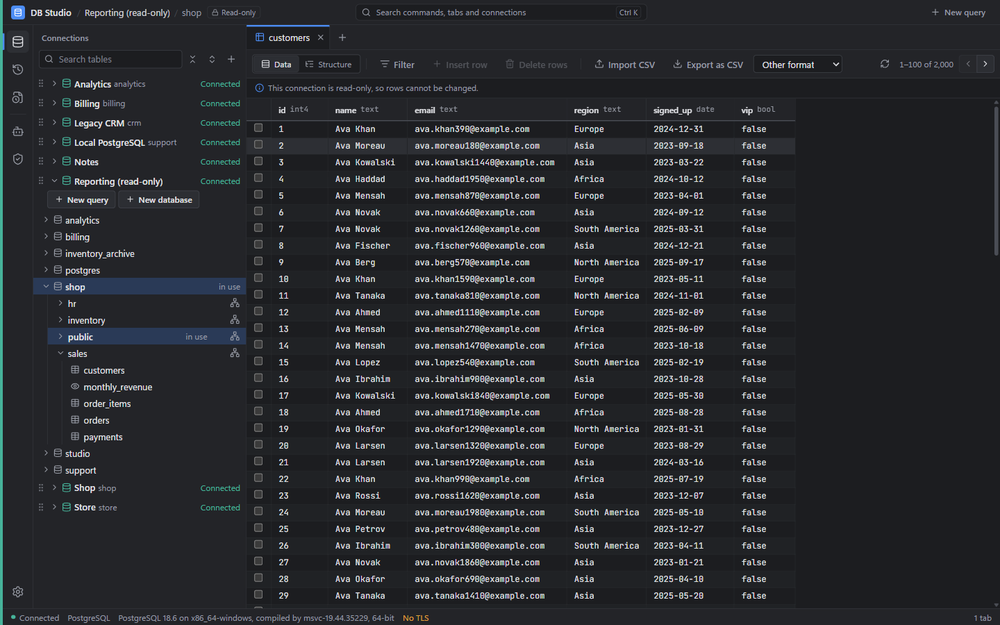{ .shot loading=lazy }

    On a **read-only** connection, *Insert row* and *Delete rows* are disabled.

=== "Binary"

    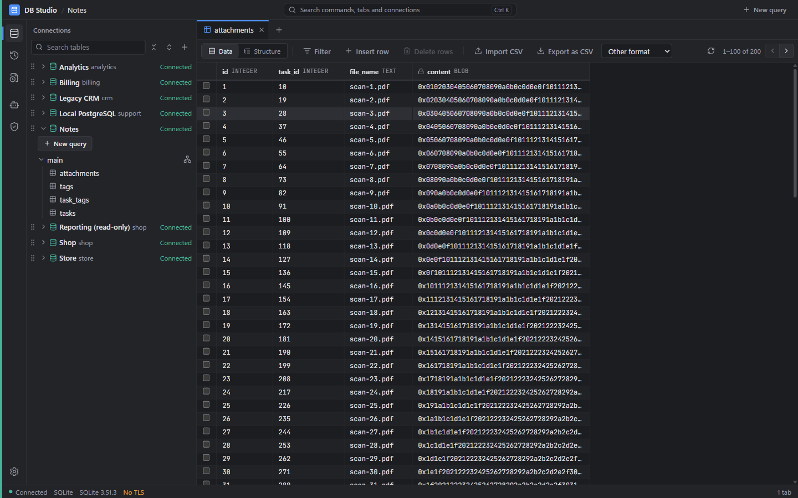{ .shot loading=lazy }

    **Binary** columns are locked (a padlock in the header). The grid holds only a 64-byte
    preview.

=== "Masked"

    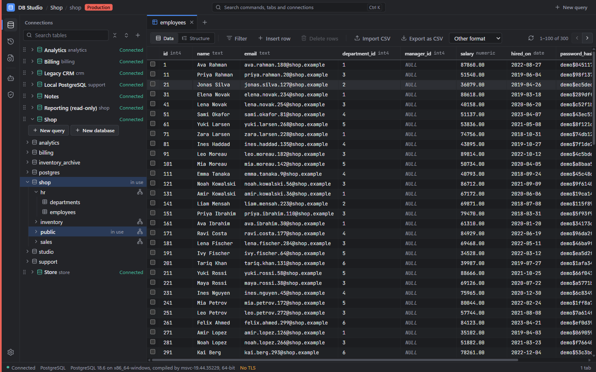{ .shot loading=lazy }

    **Masked** columns are locked too. With *Hide masked columns in results too* switched on in
    [Settings](settings.md), their values show as `***`:

    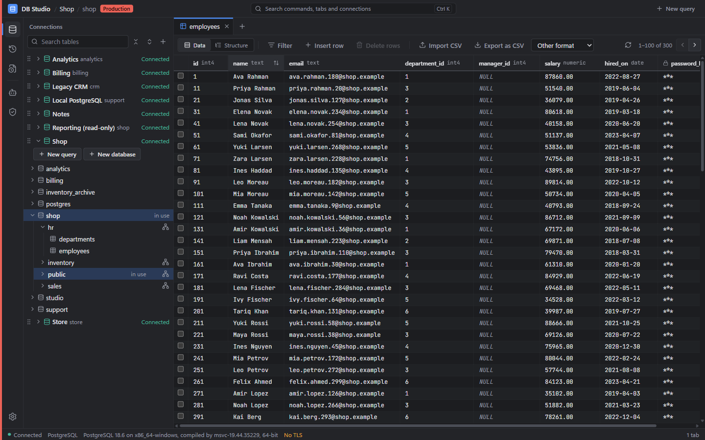{ .shot loading=lazy }

## Structure

The **Structure** view shows the estimated row count, size on disk, owner, and every column,
index, foreign key and constraint, plus the `CREATE` statement with a Copy button.

| PostgreSQL | MySQL |
|---|---|
| { .shot loading=lazy } | 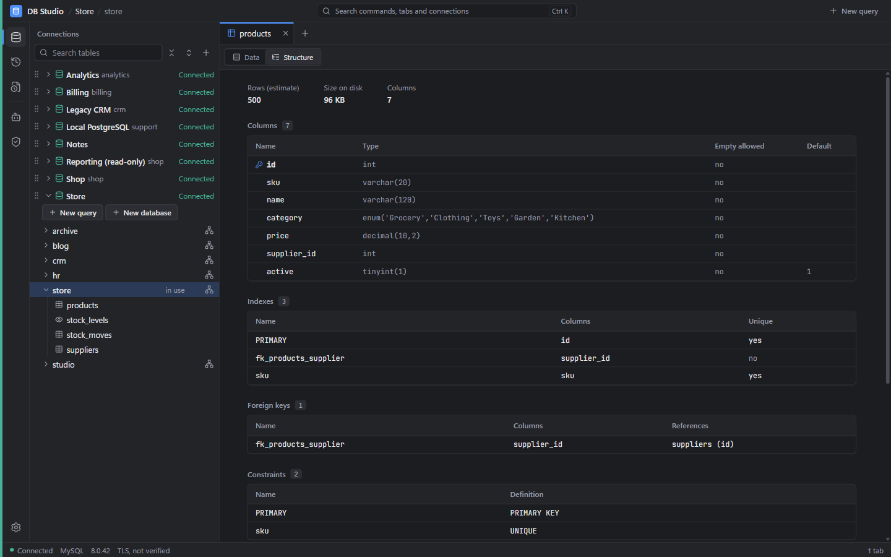{ .shot loading=lazy } |
